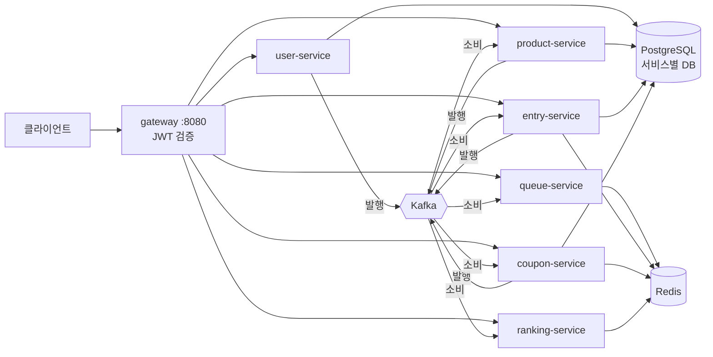

# queue-drop

한정판 선착순 드로우 서비스. **대기열 → 선착순 응모(정원 M) → 마감 시각 자동 추첨(K명)**, 대기열 없는 **선착순 쿠폰 발급**, 응모 이벤트 기반 **랭킹**을 마이크로서비스 7개로 구현했다. 결제는 없다.

트래픽이 한꺼번에 몰려도 **정원·수량을 넘기지 않고(초과 0) 같은 사용자가 두 번 받지 않는 것(중복 0)** 이 목표이며, 부하 테스트(최대 20,000명)의 모든 실행에서 이를 확인했다.

| 문서 | 경로 |
|------|------|
| 종합 결과보고서 (PDF) | [docs/report/queue-drop-결과보고서.pdf](docs/report/queue-drop-결과보고서.pdf) |
| 부하 테스트 리포트 | [docs/report/load-test-report.md](docs/report/load-test-report.md) |
| 설계 문서 인덱스 | [docs/design/README.md](docs/design/README.md) |
| 구현 플랜 (0~8단계) | [docs/plan/implementation-plan.md](docs/plan/implementation-plan.md) |
| 고도화 백로그 | [docs/plan/enhancement-backlog.md](docs/plan/enhancement-backlog.md) |

## 핵심 기능

| 기능 | 흐름 |
|------|------|
| 드로우 등록 | 관리자가 상품·드로우(오픈·마감 시각, 정원 M, 당첨 K) 등록 → `drop.created` 로 대기열·응모·랭킹 서비스에 복제 |
| 대기열 | 오픈 시각에 진입 → Redis Sorted Set 순번 → 1초마다 배치 N명 입장(입장 토큰, TTL 300초). 정원이 차면 이후 진입·폴링은 `SOLD_OUT` |
| 선착순 응모 | 입장 토큰 확인·정원·중복을 **Redis Lua 한 번에 원자 판정** → `entry.created` 발행 확인 후 202 → 컨슈머가 DB 저장 |
| 자동 추첨 | 마감 후 Redis 응모 수 == DB 응모 수가 되면 **시드를 저장한 셔플**로 K명 추첨 (재현 가능) |
| 선착순 쿠폰 | 대기열 없이 수량·중복을 Redis Lua 로 판정 → `coupon.issued` 발행 확인 후 202 → DB 저장 |
| 랭킹 | 인기 드로우(응모 수), 사용자 랭킹(주간·전체·내 순위) — Redis Sorted Set, 이벤트 중복 집계 방지 |

## 아키텍처



- **gateway 만 외부에 노출**한다(8080). 서비스는 내부 네트워크에서만 접근하고, gateway 가 JWT 를 검증해 `X-User-*` 헤더로 전달한다(외부에서 온 같은 헤더는 제거).
- **서비스별 DB**(Flyway, `ddl-auto: validate`). 서비스 사이 데이터는 Kafka 이벤트로 복제한다.
- 각 서비스는 **4계층**(`presentation` / `application` / `domain` / `infrastructure`) + 엄격한 DIP. 도메인은 순수 Java, 도메인 모델은 계층 밖으로 노출하지 않는다. 규칙은 ArchUnit(R1~R7)으로 테스트한다 — [layered-architecture.md](docs/design/02-architecture/layered-architecture.md).

| 모듈 | 역할 |
|------|------|
| `gateway` | 라우팅, JWT 검증, 헤더 위조 차단 (Spring Cloud Gateway) |
| `user-service` | 회원가입·로그인(BCrypt), JWT 발급, 관리자 계정 |
| `product-service` | 상품·드로우 등록·조회, 추첨 결과 반영 |
| `queue-service` | 대기열 진입·순번·입장(배치 스케줄러) |
| `entry-service` | 선착순 응모 판정·저장, 마감 추첨 |
| `coupon-service` | 쿠폰 이벤트, 선착순 발급·저장 |
| `ranking-service` | 인기 드로우·사용자 랭킹 |
| `common` | 이벤트 계약(`common.event`), 에러 응답 계약 |

| Kafka 토픽 | 발행 → 소비 |
|------------|-------------|
| `user.registered` | user → ranking |
| `drop.created` | product → entry, queue, ranking |
| `entry.created` | entry → entry(저장), ranking |
| `draw.completed` | entry → product |
| `coupon.issued` | coupon → coupon(저장) |

## 동시성·정합성 설계

| 결정 | 선택 |
|------|------|
| D1. 선착순 판정 위치 | **Redis Lua 원자 판정 + Kafka 비동기 DB 저장** (DB 락 대신) |
| D2. Kafka 발행 실패 | 동기 발행 확인(멱등 producer, 3초 제한) → 실패 시 요청 ID 기준 Redis 보상, 저장 확정(claim)과 보상을 Redis 에서 원자적으로 경합 |
| D3. 입장 토큰 검증 | entry-service 가 응모 Lua 안에서 공유 Redis 를 직접 조회 |
| D4. 드로우 정보 전파 | `drop.created` 이벤트로 복제 (커밋 후 발행, 재발행 API) |
| D5. 추첨 위치 | entry-service 내부 |
| D6. 추첨 명단 기준 | DB 기준 — 마감 후 Redis 응모 수 == DB 응모 수까지 대기 |
| D7. 추첨 공정성 | 시드 저장 셔플 (재현 가능) |

상세: [concurrency-consistency.md](docs/design/04-non-functional/concurrency-consistency.md)

## 기술 스택

Java 21 · Spring Boot 4.1.2 · Spring Cloud 2025.1.4 (Gateway) · Spring Data JPA · Spring Kafka · PostgreSQL 17 · Redis 7.4 (AOF) · Kafka 4.0 (KRaft) · Flyway · Gradle 9 멀티모듈 · JUnit 5 · Testcontainers · ArchUnit · k6 · Micrometer · Prometheus · Grafana

## 실행

사전 준비: JDK 21, Docker (Docker Desktop 메모리 8GB 이상 권장).

```bash
# 1) 인프라만 (PostgreSQL 5432, Redis 6379, Kafka 9092, Kafka UI 8090) — 서비스는 IDE 에서 실행
docker compose up -d

# 2) 서비스 7개까지 컨테이너로
export JWT_SECRET=$(openssl rand -base64 48)
./gradlew clean bootJar
scripts/loadtest-up.sh --build        # 인프라 + 서비스 기동, healthy·포트 비노출·헤더 위조 차단 점검

# 3) 시연 페이지 → http://localhost:8000  (nginx 가 /api 를 gateway 로 프록시)
docker compose --profile demo up -d demo
#    대기 순번이 줄어드는 모습을 보려면 입장 배치를 작게: QUEUE_ADMISSION_BATCH_SIZE=3 scripts/loadtest-up.sh

# 4) 모니터링 → Grafana http://localhost:3000 (대시보드 "queue-drop 부하 테스트"), Prometheus :9090
docker compose --profile monitoring up -d

# 정리 (서비스 이름을 빼면 인프라까지 멈춘다)
docker compose --profile app --profile demo --profile monitoring stop
```

- 관리자 계정 기본값: `admin@queuedrop.test` / `Admin!2345` (`ADMIN_EMAIL`, `ADMIN_PASSWORD` 로 변경)
- 주요 튜닝값(환경변수): `QUEUE_ADMISSION_BATCH_SIZE`(100), `QUEUE_ADMISSION_INTERVAL_MS`(1000), `QUEUE_ADMISSION_TOKEN_TTL_SECONDS`(300), `ENTRY_DRAW_INTERVAL_MS`(5000), `GATEWAY_POOL_MAX_CONNECTIONS`(200)

### 테스트

```bash
./gradlew build      # 단위·슬라이스·통합(Testcontainers)·ArchUnit — 1,323건
```

### 부하 테스트

```bash
# 테스트 사용자 생성 (1회)
k6 run -e BASE_URL=http://localhost:8080 -e TOTAL_USERS=5200 load-test/prepare-users.js

# 드로우 오픈 3,000명 / 정원 1,000 → 직후 정합성 검증 → 마감 후 추첨 검증
k6 run -e BASE_URL=http://localhost:8080 -e RESULTS_DIR=docs/report/results \
  -e USERS=3000 -e CAPACITY=1000 -e WINNERS=100 load-test/drop-open-spike.js
scripts/verify-drop.sh <dropId> --expect <entry_ok>
scripts/verify-drop.sh <dropId> --after-draw

# 쿠폰 3,000명 / 수량 500 + 중복 버스트(200명 × 5회)
k6 run -e BASE_URL=http://localhost:8080 -e RESULTS_DIR=docs/report/results \
  -e USERS=3000 -e QUANTITY=500 load-test/coupon-spike.js
scripts/verify-coupon.sh <eventId> --expect 500
scripts/verify-coupon.sh <dupEventId> --expect 200

scripts/kafka-lag.sh                  # 컨슈머 lag
```

10,000명 이상은 `-e LOGIN_SPREAD_SEC=90 -e OPEN_DELAY_SEC=120` 로 로그인을 분산한다. 측정 방식은 [phase-8-load-test.md](docs/plan/phases/phase-8-load-test.md) 3.9.

## 부하 테스트 결과 요약

로컬 단일 머신(Apple M5 Pro 15코어, Docker VM 7.7GB, k6 는 호스트 실행) 기준. 상세는 [load-test-report.md](docs/report/load-test-report.md).

| 시나리오 | 결과 |
|----------|------|
| 정합성 (모든 실행) | **정원·수량 초과 0, 중복 0**, Redis = DB = 랭킹, 추첨 결과 일치, 보상(롤백) 0 |
| 드로우 오픈 3,000명 / 정원 1,000 | 응모 p99 **29ms**, 대기열 진입 p99 17ms, 5xx 0, consumer lag 0 |
| 정원 조기 소진 5,000명 / 정원 100 | 정확히 100명, 소진 후 입장 중단 |
| 쿠폰 3,000명 / 500장 + 중복 버스트 | 정확히 500장, 200명 × 5회 동시 요청에도 1인 1장, 발급 p99 **153~204ms** |
| Redis 재시작 | 재시작 후 응모·발급 상태 유지 (재검증 PASS) |
| 확대: 드로우 10,000~20,000명 | 정합성 PASS, 10,000명 응모 p99 30ms |
| 확대: 쿠폰 10,000~14,000 동시 | 정합성 PASS, p99 0.7~1.2s — 단일 인스턴스 처리량 상한 (백로그 E-56) |

측정으로 찾아 고친 병목: gateway 업스트림 연결 폭주로 인한 연결 리셋(P1), gateway·서비스 컨테이너 OOM(P2·P4), 로그인이 BCrypt 동안 DB 커넥션 점유(P3).

## 디렉터리

```
├── gateway/ user-service/ product-service/ queue-service/
├── entry-service/ coupon-service/ ranking-service/ common/
├── e2e-test/                 # 종단 시나리오 테스트
├── load-test/                # k6 스크립트 (사용자 준비, 드로우 오픈, 쿠폰 스파이크)
├── scripts/                  # 기동 점검, 정합성 검증, lag 조회, 시연 영상 압축
├── demo/                     # 시연 페이지 (정적 HTML)
├── infra/                    # Kafka·PostgreSQL 초기화, 모니터링, 시연 nginx 설정
├── docker/                   # 서비스 공용 Dockerfile
└── docs/                     # 설계, 구현 플랜, 리포트
```

## 개발 방식

0~8단계로 나눠 단계마다 브랜치 → PR → `dev` 머지로 진행했다(PR #4~#12). 각 작업 단위는 TDD 로 실패하는 테스트 작성(Red) → 최소 구현(Green) → 정리(Refactor) → 전체 테스트·경계 케이스 보강 → 설계·정합성 관점 검토 순서로 진행했으며, 역할을 나눈 AI 에이전트 협업으로 수행했다(역할 정의: [CLAUDE.md](CLAUDE.md)).
