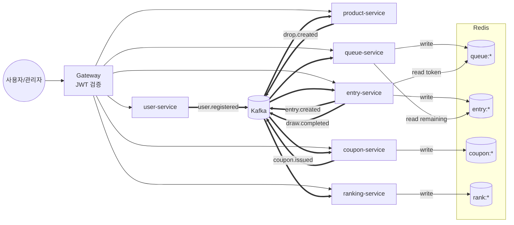

# 아키텍처 개요

## 변경 이력
| 버전 | 날짜 | 변경 내용 | 관련 요구사항 |
|------|------|-----------|----------------|
| v1.0 | 2026-11-16 | 최초 작성 | 전체 |
| v1.1 | 2026-11-16 | 서비스 내부 계층 구조 문서 링크 추가 | layered-architecture.md |

---

## 1. 쉬운 설명 (한눈에)

> 사용자의 모든 요청은 정문(Gateway)에서 신분증(JWT)을 확인받고 각 창구로 안내돼요.
> 창구(서비스)마다 자기 장부(DB)를 따로 갖고, 서로 알려줄 일은 우체통(Kafka)에 편지를 넣어 전달해요.
> 아주 빠른 판정이 필요한 일(줄 세우기, 선착순)은 공용 메모장(Redis)에서 처리해요.

> 서비스 **내부** 구조(4계층, DIP, 모델 비노출)는 [layered-architecture.md](layered-architecture.md) 참고. 이 문서는 서비스 **간** 구조를 다룬다.

## 2. 서비스 책임

| 서비스 | 포트 | 데이터 주인 | 저장소 | 핵심 책임 |
|--------|------|-------------|--------|-----------|
| gateway | 8080 | - | - | 라우팅, JWT 검증, `X-User-Id`/`X-User-Role` 헤더 주입 |
| user-service | 8081 | 회원 | user_db | 회원가입, 로그인(JWT 발급) |
| product-service | 8082 | 상품, 드로우 | product_db | 상품·드로우 등록/조회, `DropCreated` 발행 |
| queue-service | 8083 | 대기열, 입장 토큰 | Redis | 대기열 진입·순번, 주기적 입장 처리 |
| entry-service | 8085 | 응모, 추첨 결과 | entry_db, Redis | 선착순 응모 판정, 응모 저장, 마감 자동 추첨 |
| coupon-service | 8084 | 쿠폰 이벤트, 발급 쿠폰 | coupon_db, Redis | 선착순 쿠폰 발급 |
| ranking-service | 8086 | 랭킹 집계 | Redis | 이벤트 소비 → 인기 드로우 / 유저 활동 랭킹 |

## 3. 전체 구성도

**읽는 법**
- 서비스 간 **동기 호출은 없다.** 모든 서비스 간 데이터 전달은 Kafka 이벤트 또는 (읽기 전용) 공유 Redis 다.
- Redis 공유는 두 군데뿐이다: entry 가 queue 의 **토큰**을 읽고, queue 가 entry 의 **잔여 정원**을 읽는다(마감 시 대기열 입장 중단용).
- 랭킹 장애는 응모에 영향을 주지 않는다 (이벤트 소비 지연만 발생).

## 4. Kafka 토픽 / 이벤트

| 토픽 | 발행 | 소비 | 페이로드 | 파티션 키 |
|------|------|------|----------|-----------|
| `user.registered` | user | ranking | userId, nickname | userId |
| `drop.created` | product | entry, queue, ranking | dropId, productId, title, entryCapacity, winnerCount, openAt, closeAt | dropId |
| `entry.created` | entry | entry(저장), ranking | eventId, dropId, userId, entrySeq, appliedAt | `dropId:userId` |
| `draw.completed` | entry | product | dropId, applicantCount, winnerCount, drawnAt | dropId |
| `coupon.issued` | coupon | coupon(저장) | eventId, couponEventId, userId, issuedAt | `couponEventId:userId` |

- 이벤트 스키마는 `common` 모듈에 둔다.
- 모든 컨슈머는 **at-least-once 전제로 멱등**하게 처리한다 (DB 유니크 제약 / Redis dedupe Set).
- `entry.created` 키를 `dropId` 단독으로 두면 인기 드로우 하나가 한 파티션에 몰리므로 `dropId:userId` 로 분산. 드로우 내 순서는 `entrySeq` 가 보장하므로 파티션 순서에 의존하지 않는다.

## 5. Redis 키 네임스페이스 (쓰기 소유자 고정)

| 키 | 타입 | 쓰기 소유자 | 읽기 | 설명 |
|----|------|-------------|------|------|
| `queue:{dropId}:meta` | Hash | queue | queue | openAt, closeAt |
| `queue:{dropId}:seq` | String | queue | queue | 대기열 진입 순번 발급 카운터 |
| `queue:{dropId}:waiting` | ZSet | queue | queue | member=userId, score=진입 순번 |
| `queue:{dropId}:token:{userId}` | String(TTL) | queue | **entry** | 입장 토큰 (존재 = 유효) |
| `entry:{dropId}:meta` | Hash | entry | entry | state(OPEN/CLOSED), capacity, openAt, closeAt |
| `entry:{dropId}:remaining` | String | entry | entry, **queue** | 잔여 응모 정원 |
| `entry:{dropId}:applicants` | Set | entry | entry | 응모자 userId (중복 방지) |
| `coupon:{eventId}:meta` | Hash | coupon | coupon | issueStartAt |
| `coupon:{eventId}:remaining` | String | coupon | coupon | 잔여 수량 |
| `coupon:{eventId}:issued` | Set | coupon | coupon | 발급 userId (중복 방지) |
| `rank:drop:popular` | ZSet | ranking | ranking | member=dropId, score=응모 수 |
| `rank:user:weekly:{yyyy-Www}` | ZSet(TTL) | ranking | ranking | member=userId, score=주간 응모 수 |
| `rank:user:all` | ZSet | ranking | ranking | member=userId, score=누적 응모 수 |
| `rank:dedupe:{dropId}` | Set | ranking | ranking | 이미 집계한 userId (멱등 처리) |
| `rank:drop:info` / `rank:user:info` | Hash | ranking | ranking | 표시용 드로우 제목 / 닉네임 |

> **규칙**: 다른 서비스 소유 키는 **읽기만** 한다. 키 구조 변경 시 이 표와 읽는 서비스를 함께 수정한다.

## 6. 인증 (REQ-USER-02, 03)

**쉬운 설명**
> 로그인하면 신분증(JWT)을 받고, 정문(Gateway)이 매번 그 신분증을 확인한 뒤 "이 사람은 3번 회원이에요"라는 메모를 붙여 창구로 보내요.

**상세 설명**
- user-service 가 로그인 성공 시 JWT 발급 (HS256, claims: `sub=userId`, `role=USER|ADMIN`, 만료 시간)
- Gateway 의 GlobalFilter 가 `Authorization: Bearer` 검증 → `X-User-Id`, `X-User-Role` 헤더 주입
- **클라이언트가 보낸 `X-User-*` 헤더는 Gateway 에서 항상 제거** (헤더 위조 방지)
- 인증 제외 경로: 회원가입, 로그인, 드로우 목록/상세 조회, 랭킹 조회
- 관리자 API 는 각 서비스가 `X-User-Role == ADMIN` 확인
- 내부 서비스 포트는 docker 네트워크 내부에만 노출하는 것을 전제로 한다 (Gateway 우회 방지)
