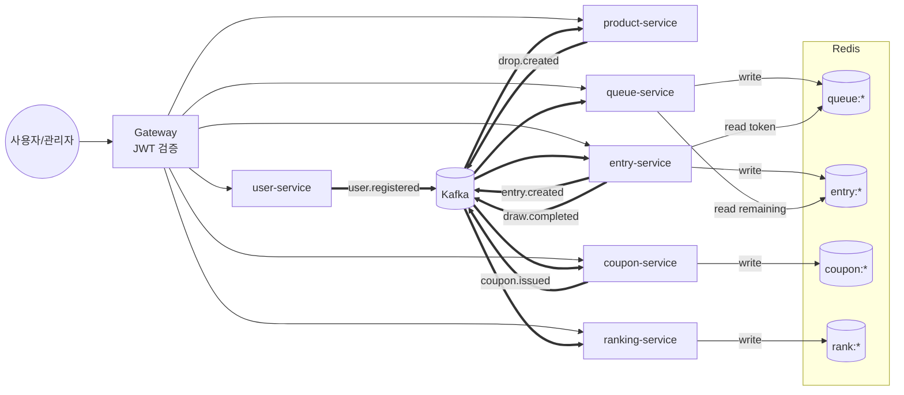

# 아키텍처 개요

## 변경 이력
| 버전 | 날짜 | 변경 내용 | 관련 요구사항 |
|------|------|-----------|----------------|
| v1.0 | 2026-11-16 | 최초 작성 | 전체 |
| v1.1 | 2026-11-16 | 서비스 내부 계층 구조 문서 링크 추가 | layered-architecture.md |
| v1.2 | 2026-11-16 | Redis 키 `entry:{dropId}:seq` 추가 | NFR-03 |
| v1.3 | 2026-11-16 | DLT 토픽·컨슈머 실패 정책, Redis 키(`queue:active-drops`, `queue:admission:gate`, `rank:drop:closeAt`) 추가, 인증 제외 경로 구체화·JWT 세부·관리자 시드 추가 | phase-1·3·4·7·8 구현 상세 6장, REQ-USER-04 |
| v1.4 | 2026-11-16 | queue 키(`meta`·`seq`·`waiting`) 만료 시각 `closeAt + 1일` 명시 | phase-3 구현 상세 v1.2 |
| v1.5 | 2026-11-17 | Redis 키 `entry:{dropId}:requests`(요청 ID), `entry:{dropId}:persisted`(저장 확정) 추가 — 유령 이벤트·Redis 타임아웃 대응 (사용자 결정, E-40·E-41). TTL 은 5단계(E-42) | concurrency-consistency.md D2 v1.3 |
| v1.6 | 2026-11-17 | 응모 키 6개 TTL: 추첨 커밋 후 EXPIRE 1일 (E-42 기본안) | draw.md v1.2 |
| v1.7 | 2026-11-17 | product `draw.completed` 컨슈머를 DB 저장 컨슈머로 분류: 3회 재시도 후 `draw.completed.DLT` (드로우 없음은 로그 후 커밋). 추첨 완료 반영 누락을 DLT 재처리로 복구 | phase-5 구현 상세 v1.12 |
| v1.8 | 2026-11-17 | Redis 키 `coupon:{eventId}:requests`, `coupon:{eventId}:persisted` 추가 — 응모와 같은 유령 이벤트·타임아웃 대응 | phase-6 구현 상세 v1.4 |

---

## 1. 쉬운 설명 (한눈에)

> 사용자의 모든 요청은 정문(Gateway)에서 신분증(JWT)을 확인받고 각 창구로 안내돼요.
> 창구(서비스)마다 자기 장부(DB)를 따로 갖고, 서로 알려줄 일은 우체통(Kafka)에 편지를 넣어 전달해요.
> 아주 빠른 판정이 필요한 일(줄 세우기, 선착순)은 공용 메모장(Redis)에서 처리해요.

> 서비스 **내부** 구조(4계층, DIP, 모델 비노출)는 [layered-architecture.md](layered-architecture.md) 참고. 이 문서는 서비스 **간** 구조를 다룬다.

## 2. 서비스 책임

| 서비스 | 포트 | 데이터 주인 | 저장소 | 핵심 책임 |
|--------|------|-------------|--------|-----------|
| gateway | 8080 | - | - | 라우팅, JWT 검증, `X-User-Id`/`X-User-Role` 헤더 주입 |
| user-service | 8081 | 회원 | user_db | 회원가입, 로그인(JWT 발급) |
| product-service | 8082 | 상품, 드로우 | product_db | 상품·드로우 등록/조회, `DropCreated` 발행 |
| queue-service | 8083 | 대기열, 입장 토큰 | Redis | 대기열 진입·순번, 주기적 입장 처리 |
| entry-service | 8085 | 응모, 추첨 결과 | entry_db, Redis | 선착순 응모 판정, 응모 저장, 마감 자동 추첨 |
| coupon-service | 8084 | 쿠폰 이벤트, 발급 쿠폰 | coupon_db, Redis | 선착순 쿠폰 발급 |
| ranking-service | 8086 | 랭킹 집계 | Redis | 이벤트 소비 → 인기 드로우 / 유저 활동 랭킹 |

## 3. 전체 구성도

**읽는 법**
- 서비스 간 **동기 호출은 없다.** 모든 서비스 간 데이터 전달은 Kafka 이벤트 또는 (읽기 전용) 공유 Redis 다.
- Redis 공유는 두 군데뿐이다: entry 가 queue 의 **토큰**을 읽고, queue 가 entry 의 **잔여 정원**을 읽는다(마감 시 대기열 입장 중단용).
- 랭킹 장애는 응모에 영향을 주지 않는다 (이벤트 소비 지연만 발생).

## 4. Kafka 토픽 / 이벤트

| 토픽 | 발행 | 소비 | 페이로드 | 파티션 키 |
|------|------|------|----------|-----------|
| `user.registered` | user | ranking | userId, nickname | userId |
| `drop.created` | product | entry, queue, ranking | dropId, productId, title, entryCapacity, winnerCount, openAt, closeAt | dropId |
| `entry.created` | entry | entry(저장), ranking | eventId, dropId, userId, entrySeq, appliedAt | `dropId:userId` |
| `draw.completed` | entry | product | dropId, applicantCount, winnerCount, drawnAt | dropId |
| `coupon.issued` | coupon | coupon(저장) | eventId, couponEventId, userId, issuedAt | `couponEventId:userId` |
| `drop.created.DLT` / `entry.created.DLT` / `draw.completed.DLT` / `coupon.issued.DLT` | (DLT) | 운영자 재처리 | 원본과 동일 | 원본과 동일 |

- 이벤트 스키마는 `common` 모듈에 둔다.
- **컨슈머 실패 정책**: DB 에 저장하는 컨슈머(entry 의 `drop.created`·`entry.created`, product 의 `draw.completed`, coupon 의 `coupon.issued`)는 1초 간격 3회 재시도 후 `{topic}.DLT` 로 보낸다 (product 의 `draw.completed` 중 드로우 없음은 재시도·DLT 없이 로그 후 커밋, E-30). Redis 만 쓰는 컨슈머(queue, ranking)는 3회 재시도 후 로그를 남기고 건너뛴다. 토픽 자동 생성이 꺼져 있으므로 DLT 도 미리 생성한다 ([infrastructure.md](../03-infrastructure/infrastructure.md) 5장).
- 모든 컨슈머는 **at-least-once 전제로 멱등**하게 처리한다 (DB 유니크 제약 / Redis dedupe Set).
- `entry.created` 키를 `dropId` 단독으로 두면 인기 드로우 하나가 한 파티션에 몰리므로 `dropId:userId` 로 분산. 드로우 내 순서는 `entrySeq` 가 보장하므로 파티션 순서에 의존하지 않는다.

## 5. Redis 키 네임스페이스 (쓰기 소유자 고정)

| 키 | 타입 | 쓰기 소유자 | 읽기 | 설명 |
|----|------|-------------|------|------|
| `queue:{dropId}:meta` | Hash | queue | queue | openAt, closeAt (`closeAt + 1일` 만료) |
| `queue:{dropId}:seq` | String | queue | queue | 대기열 진입 순번 발급 카운터 (`closeAt + 1일` 만료) |
| `queue:{dropId}:waiting` | ZSet | queue | queue | member=userId, score=진입 순번 (`closeAt + 1일` 만료) |
| `queue:{dropId}:token:{userId}` | String(TTL) | queue | **entry** | 입장 토큰 (존재 = 유효) |
| `queue:active-drops` | ZSet | queue | queue | member=dropId, score=closeAt — 입장 스케줄러 대상 조회용 인덱스 (`KEYS`/`SCAN` 금지) |
| `queue:admission:gate` | String(PX) | queue | queue | 입장 스케줄러 주기당 1회 실행 게이트 (`SET NX PX`, 해제하지 않음) |
| `entry:{dropId}:meta` | Hash | entry | entry | state(OPEN/CLOSED), capacity, openAt, closeAt |
| `entry:{dropId}:remaining` | String | entry | entry, **queue** | 잔여 응모 정원 |
| `entry:{dropId}:applicants` | Set | entry | entry | 응모자 userId (중복 방지) |
| `entry:{dropId}:seq` | String | entry | entry | 응모 번호 발급 카운터 (증가만, 보상 시에도 되돌리지 않음) |
| `entry:{dropId}:requests` | Hash | entry | entry | field=userId, value=이 자리를 잡은 요청의 eventId. 응모 Lua 가 `HSET`, 보상 Lua 가 `HDEL`. 보상·저장 확정이 다른 요청의 응모를 건드리지 않게 한다 |
| `entry:{dropId}:persisted` | Set | entry | entry | 저장 컨슈머가 DB 저장 전에 확정한 userId (claim Lua 가 `SADD`). 여기 있으면 보상 Lua 가 되돌리지 않는다 |
| `coupon:{eventId}:meta` | Hash | coupon | coupon | issueStartAt |
| `coupon:{eventId}:remaining` | String | coupon | coupon | 잔여 수량 |
| `coupon:{eventId}:issued` | Set | coupon | coupon | 발급 userId (중복 방지) |
| `coupon:{eventId}:requests` | Hash | coupon | coupon | userId → 발급 자리를 잡은 요청 ID (E-40) |
| `coupon:{eventId}:persisted` | Set | coupon | coupon | 저장 확정된 userId (claim Lua, E-40) |
| `rank:drop:popular` | ZSet | ranking | ranking | member=dropId, score=응모 수 |
| `rank:user:weekly:{yyyy-Www}` | ZSet(TTL) | ranking | ranking | member=userId, score=주간 응모 수 |
| `rank:user:all` | ZSet | ranking | ranking | member=userId, score=누적 응모 수 |
| `rank:dedupe:{dropId}` | Set | ranking | ranking | 이미 집계한 userId (멱등 처리) |
| `rank:drop:info` / `rank:user:info` | Hash | ranking | ranking | 표시용 드로우 제목 / 닉네임 |
| `rank:drop:closeAt` | Hash | ranking | ranking | dropId → closeAt(epoch ms) — 진행 중 드로우 필터, dedupe TTL 계산 |

- `entry:{dropId}:*` 6개 키는 추첨 커밋 후 EXPIRE 1일 (추첨 전에는 만료 없음 — 건수 비교 근거, draw.md v1.2)

> **규칙**: 다른 서비스 소유 키는 **읽기만** 한다. 키 구조 변경 시 이 표와 읽는 서비스를 함께 수정한다.

## 6. 인증 (REQ-USER-02, 03)

**쉬운 설명**
> 로그인하면 신분증(JWT)을 받고, 정문(Gateway)이 매번 그 신분증을 확인한 뒤 "이 사람은 3번 회원이에요"라는 메모를 붙여 창구로 보내요.

**상세 설명**
- user-service 가 로그인 성공 시 JWT 발급 (HS256, claims: `iss=queue-drop`, `sub=userId`, `role=USER|ADMIN`, `iat`, `exp`)
  - 만료 1시간, Refresh token 없음
  - 비밀키 `JWT_SECRET`(32바이트 이상)을 user-service(서명)와 gateway(검증)가 공유. 기동 시 길이 검증
- Gateway 의 GlobalFilter 가 `Authorization: Bearer` 검증 → `X-User-Id`, `X-User-Role` 헤더 주입
- **클라이언트가 보낸 `X-User-*` 헤더는 Gateway 에서 항상 제거** (헤더 위조 방지)
- **필터 순서**: ① 클라이언트 `X-User-*` 헤더 제거 → ② JWT 검증·헤더 주입 (제거가 항상 먼저)
- 인증 제외 경로 (경로를 한정한다 — 예: `/api/rankings/**` 전체를 공개하면 `/api/rankings/users/me` 에 `X-User-Id` 가 주입되지 않는다)

  | Method | Path |
  |--------|------|
  | POST | `/api/users/signup`, `/api/users/login` |
  | GET | `/api/products/drops`, `/api/products/drops/{dropId}` |
  | GET | `/api/rankings/drops`, `/api/rankings/users/weekly`, `/api/rankings/users/all` |
  | GET | `/api/coupons/events/{eventId}` |
  | GET | `/api/entries/drops/{dropId}/result` (추첨 요약 — 공개 범위는 5단계에서 확정, 기본안 공개) |
  | GET | `/actuator/health` |
- 인증 제외 경로의 토큰 처리: 토큰 없음 → 익명 통과 / 유효 → 헤더 주입 / **잘못되거나 만료된 토큰 → 익명 통과** (공개 API 는 토큰 상태와 무관하게 응답)
- 관리자 API 는 각 서비스가 `X-User-Role == ADMIN` 확인 (presentation 은 헤더를 전달만 하고, 판단은 application)
- **관리자 계정 (REQ-USER-04)**: user-service 기동 시 환경변수 `ADMIN_EMAIL` / `ADMIN_PASSWORD` 가 있으면, 해당 이메일 계정이 없을 때만 ADMIN 으로 생성한다 (회원가입 API 는 USER 만 생성)
- 내부 서비스 포트는 docker 네트워크 내부에만 노출하는 것을 전제로 한다 (Gateway 우회 방지)
