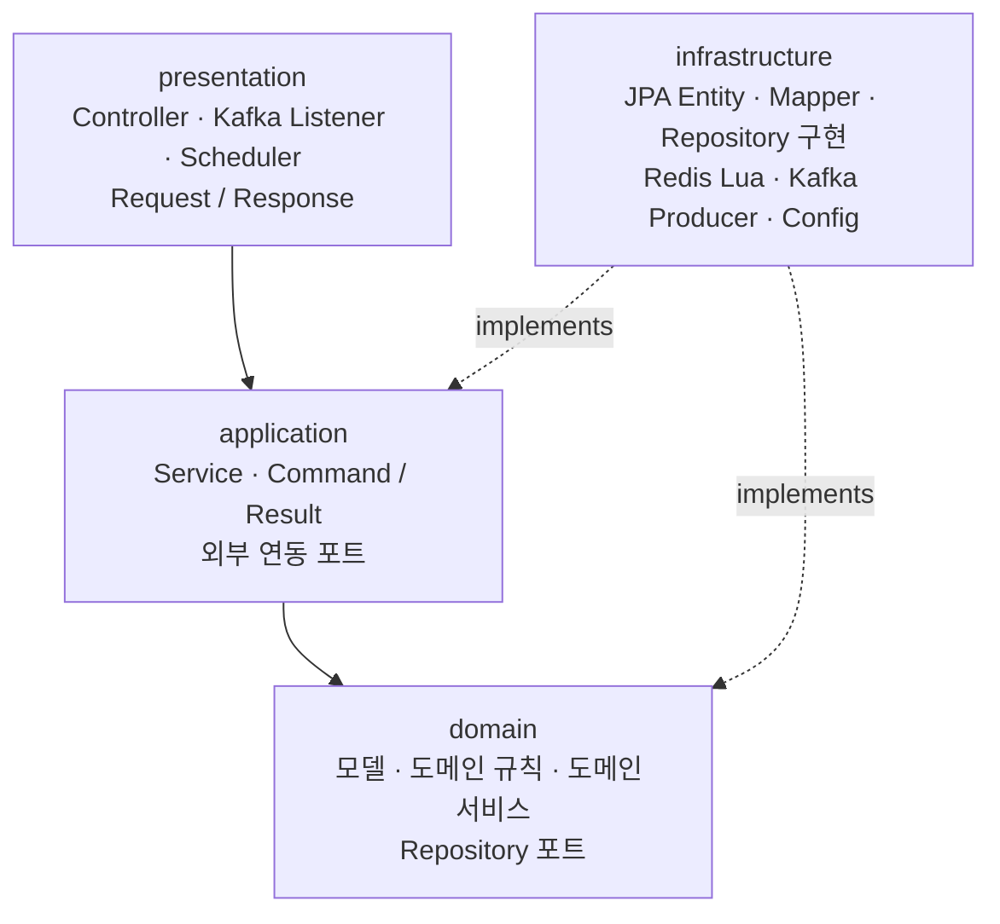
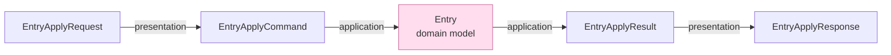

# 4계층 아키텍처 · DIP 규칙

## 변경 이력
| 버전 | 날짜 | 변경 내용 | 관련 요구사항 |
|------|------|-----------|----------------|
| v1.0 | 2026-11-16 | 최초 작성 (4계층, 엄격한 DIP, 모델 비노출 원칙 합의) | 전체 |
| v1.1 | 2026-11-16 | application 의 `common.error` 의존 허용, 커밋 후 발행 규칙(발행 어댑터 내 afterCommit), 에러 계약 위치·추가 에러 코드, domain `exception` 패키지, R3 금지 목록 확장 | phase-0·2·4 구현 상세 6장 |
| v1.2 | 2026-11-16 | R1 허용 목록에 `lombok..` 추가 (Lombok 생성 코드의 `@lombok.Generated` 가 바이트코드에 남는 것을 확인) | phase-0 커밋 #4 |

## 1. 쉬운 설명 (한눈에)
> 가게로 비유하면 **창구(presentation)** 는 손님 말을 주문서로 옮겨 적고, **매니저(application)** 는 주문서를 보고 일을 지시하고,
> **장인(domain)** 은 실제 규칙대로 물건을 만들고, **창고·택배(infrastructure)** 는 보관과 배송을 맡아요.
>
> 핵심 규칙 두 가지:
> 1. 장인(domain)은 창고가 어떻게 생겼는지 몰라요. "보관해 주세요"라는 **약속(인터페이스)** 만 알고, 창고가 그 약속을 지켜요. → **DIP**
> 2. 손님은 장인이 만든 원본(도메인 모델)을 절대 직접 받지 않아요. 매니저가 **포장(Result DTO)** 해서 내보내요. → **모델 비노출**

## 2. 계층과 의존 방향



**읽는 법**
- 실선은 "사용한다", 점선은 "구현한다". **모든 화살표가 domain 쪽을 향한다** — domain 은 아무것도 의존하지 않는다.
- infrastructure 는 위에서 호출당하지 않는다. application/domain 이 정의한 인터페이스를 **구현**하고, Spring DI 가 런타임에 연결한다.
- presentation 은 **domain 을 모른다**. 컨트롤러 코드에 도메인 클래스 import 가 있으면 규칙 위반이다.

## 3. 계층별 책임과 허용 의존

| 계층 | 책임 | 의존 허용 | 의존 금지 | 주요 클래스 |
|------|------|-----------|-----------|-------------|
| **presentation** | 입력 수신·검증, 형식 변환 (Request→Command, Result→Response, 이벤트 메시지→Command) | application, Spring Web, `common` 이벤트 메시지 | domain, infrastructure | `XxxController`, `XxxRequest`, `XxxResponse`, `XxxEventListener`, `XxxScheduler` |
| **application** | 유스케이스 흐름 조율, 트랜잭션 경계, 도메인 모델 → Result 변환 | domain, `common.error`(에러 계약, 순수 Java), `spring-context`·`spring-tx` (어노테이션만) | presentation, infrastructure, JPA, Redis, Kafka, Spring Web, `common.event` | `XxxService`, `XxxCommand`, `XxxResult`, 외부 연동 포트 |
| **domain** | 비즈니스 규칙, 상태 전이, 불변식 | **순수 Java 만** | Spring, JPA(jakarta.persistence), 다른 모든 계층 | 모델, 값 객체, enum, 도메인 서비스, `XxxRepository`(인터페이스) |
| **infrastructure** | 기술 구현 (DB, Redis, Kafka), 포트 구현, 설정 | domain, application(포트), 모든 기술 라이브러리, `common` | presentation | `XxxJpaEntity`, `XxxJpaRepository`, `XxxRepositoryImpl`, `XxxMapper`, `RedisXxx`, `KafkaXxxPublisher` |

> application 에 `@Service`, `@Transactional` 사용을 허용한 이유: 트랜잭션 경계는 유스케이스의 책임이고, 이 두 어노테이션은 기술 구현(JPA/Redis/Kafka)이 아니라 **선언**이기 때문. domain 에는 이것조차 허용하지 않는다.

## 4. 결정 사항

### 4.1 도메인 모델 ↔ JPA 엔티티 분리
| | 내용 |
|---|---|
| **쉬운 설명** | 장인이 만드는 물건(도메인 모델)과 창고 보관용 상자(JPA 엔티티)는 다른 것. 창고 직원(Mapper)이 넣고 뺄 때 옮겨 담는다. |
| **상세** | `domain/model/Entry` 는 어노테이션 없는 순수 Java. `infrastructure/persistence/EntryJpaEntity` 가 `@Entity`. `EntryMapper` 가 양방향 변환. `EntryRepositoryImpl` 이 domain 의 `EntryRepository` 를 구현하며 내부에서 Spring Data `EntryJpaRepository` 사용. |
| **결과** | ✅ domain 이 JPA 를 모름, 순수 단위 테스트 가능 / ❌ 매핑 코드 증가, **변경 감지(dirty checking)에 의존할 수 없음 → 변경 후 반드시 `repository.save()` 명시 호출** |

### 4.2 모델 비노출 경계: application 밖으로 금지
| | 내용 |
|---|---|
| **쉬운 설명** | 매니저가 손님에게 내보낼 때는 항상 포장(Result)해서 내보낸다. 창구 직원도 원본을 본 적이 없다. |
| **상세** | application 서비스의 public 메서드는 **입력 = `XxxCommand`(또는 원시값), 출력 = `XxxResult`(또는 원시값/void)**. 도메인 모델을 파라미터·반환 타입으로 쓰지 않는다. `XxxResult.from(domainModel)` 변환은 application 안에서만. |
| **데이터 흐름** | `Request → Command → (domain) → Result → Response` — 계층마다 자기 DTO |


**읽는 법**: 분홍색(도메인 모델)이 application 박스 밖으로 나가는 화살표가 없다.

### 4.3 포트 위치
| 포트 종류 | 위치 | 예시 | 이유 |
|-----------|------|------|------|
| 영속성 (도메인 개념) | **domain** `domain/repository` | `EntryRepository`, `DropSnapshotRepository`, `DrawResultRepository` | "응모를 저장하고 찾는다"는 도메인 언어 |
| 외부 연동 (기술 개념) | **application** `application/port` | `EntryGate`(Redis 선착순 판정·보상), `EntryEventPublisher`(Kafka), `ApplicantCounter`(Redis 응모 수) | "Lua 로 판정", "이벤트 발행·보상"은 도메인 규칙이 아니라 유스케이스 실행 방식 |

> **Redis 선착순 판정의 위치에 대한 주의**: "정원 초과 금지, 1인 1응모"는 도메인 규칙이지만, 이 프로젝트에서는 **원자성 확보를 위해 판정 자체를 Redis Lua 에 위임**한다 ([D1](../04-non-functional/concurrency-consistency.md)).
> 따라서 domain 에는 규칙의 **결과 타입**(`ApplyOutcome`: OK / CLOSED / NO_TOKEN / DUPLICATE / SOLD_OUT)만 두고, 판정 실행은 application 포트 `EntryGate` → infrastructure `RedisEntryGate` 가 담당한다.
> 규칙이 Lua 스크립트(infrastructure)에 있다는 점은 이 설계가 감수하는 트레이드오프이며, **Lua 스크립트를 통합 테스트(Testcontainers)로 검증**하여 보완한다.

### 4.4 Kafka 이벤트 메시지
- `common` 모듈의 이벤트(`EntryCreated` 등)는 **서비스 간 계약(메시지 DTO)** 이지 도메인 모델이 아니다.
- **발행**: application 은 포트 `EntryEventPublisher.publishCreated(EntryCreatedPayload)` 만 호출 → infrastructure 의 `KafkaEntryEventPublisher` 가 `common` 메시지로 변환해 전송.
  - application 이 `common` 메시지에 직접 의존하지 않도록, 포트 파라미터는 application 자체 DTO 로 둔다.
- **커밋 후 발행** (user `user.registered`, product `drop.created`): application 은 포트만 호출하고 **발행 시점을 모른다**. infrastructure 발행 어댑터가 `TransactionSynchronizationManager.registerSynchronization(afterCommit)` 으로 커밋 후 발행을 등록하고, 활성 트랜잭션이 없으면 즉시 발행한다. application 이 Spring 이벤트 API(`ApplicationEventPublisher`, `@TransactionalEventListener`)에 의존하지 않는다.
- **동기 발행** (entry `entry.created`, coupon `coupon.issued`): 어댑터가 `send().get()` 으로 수신 확인까지 기다리고, 실패는 application 포트 예외로 바꿔 던진다. 재시도는 producer 내부 재시도만 쓴다 ([D2](../04-non-functional/concurrency-consistency.md)).
- **수신**: presentation 의 `XxxEventListener`(`@KafkaListener`)가 메시지를 받아 **Command 로 변환 후 application 호출**. 컨트롤러와 같은 "입력 어댑터" 위치.
- 스케줄러(`@Scheduled`)도 같은 이유로 presentation 에 둔다 — 시간이 보내는 요청을 받는 입력 어댑터.

### 4.5 예외·에러 코드
- presentation 은 domain 을 볼 수 없으므로, domain 의 판정 결과(`ApplyOutcome.SOLD_OUT` 등)를 그대로 HTTP 로 매핑할 수 없다.
- **에러 계약은 `common.error`** 에 순수 Java 로 둔다: `ErrorCode`(interface: code, HTTP 상태), `ApplicationException`, `ErrorResponse`(응답 바디 형식). 서비스별 에러 코드 enum 은 **application** 의 `application/exception` 에 두고 `ErrorCode` 를 구현한다.
- **application 이 에러 코드를 정의**하고, 도메인 결과를 application 예외로 변환해 던진다.
  - 예: `ApplyOutcome.SOLD_OUT` → `throw new EntryApplyException(EntryErrorCode.SOLD_OUT)`
- presentation 의 `@RestControllerAdvice` 가 application 예외 → HTTP 상태·응답 바디로 매핑한다.
- domain 의 불변식 위반(예: `Drop` 생성 시 M < K)은 domain 예외(`DomainException`, 순수 Java, `domain/exception`)로 던지고, application 이 받아 에러 코드로 변환한다.
  - 리스너 경로도 같다: 수신 메시지가 불변식을 어기면 application 이 예외를 변환해 던지고(예: `InvalidDropSnapshotException`), 리스너 재시도 후 DLT 로 간다.
- `X-User-Id` 누락(Gateway 우회 등)은 presentation 이 `MISSING_USER_HEADER`(400) 로 처리한다.
- `@RestControllerAdvice` 는 Spring Web 의존이 있어 `common` 에 두지 않고 서비스마다 같은 형태로 둔다.

## 5. 패키지 구조 (서비스 공통)

```
com.queuedrop.{service}
├── presentation
│   ├── api            # XxxController, request/, response/
│   ├── listener       # Kafka @KafkaListener
│   └── scheduler      # @Scheduled
├── application
│   ├── service        # XxxService (유스케이스)
│   ├── dto            # XxxCommand, XxxResult
│   ├── port           # 외부 연동 포트 (interface)
│   └── exception      # 서비스별 에러 코드 enum (common.error.ErrorCode 구현), application 예외
├── domain
│   ├── model          # 도메인 모델, 값 객체, enum
│   ├── service        # 도메인 서비스 (예: Drawer)
│   ├── repository     # 영속성 포트 (interface)
│   └── exception      # 도메인 예외 (DomainException, 순수 Java)
└── infrastructure
    ├── persistence    # XxxJpaEntity, XxxJpaRepository, XxxRepositoryImpl, XxxMapper
    ├── redis          # RedisXxx (포트 구현), Lua 스크립트 로더
    ├── messaging      # KafkaXxxPublisher
    └── config         # Redis/Kafka/JPA 설정
```
- Lua 스크립트 파일: `src/main/resources/scripts/*.lua`
- queue-service, ranking-service 는 DB 가 없으므로 `persistence` 패키지와 domain `repository` 가 없을 수 있다 (Redis 기반 저장소 포트는 domain `repository` 에 두고 `infrastructure/redis` 가 구현).

## 6. 규칙 강제: ArchUnit

각 서비스 모듈에 `ArchitectureTest` 를 두고, 위반 시 **빌드(test) 실패**.

| # | 규칙 | 의미 |
|---|------|------|
| R1 | `domain..` 은 `domain..`, `java..`, `lombok..` 외에 의존하지 않는다 | domain 순수성 (Spring·JPA 의존 금지, 컴파일 타임 Lombok 허용*) |
| R2 | `application..` 은 `presentation..`, `infrastructure..` 에 의존하지 않는다 | 상위·기술 계층 모름 |
| R3 | `application..` 은 `jakarta.persistence..`, `org.springframework.data..`, `org.springframework.kafka..`, `org.springframework.web..`, `com.queuedrop.common.event..` 에 의존하지 않는다 | 기술 의존 금지, 메시지 계약 직접 의존 금지(4.4) |
| R4 | `presentation..` 은 `domain..`, `infrastructure..` 에 의존하지 않는다 | **모델 비노출** |
| R5 | `infrastructure..` 는 `presentation..` 에 의존하지 않는다 | 역방향 금지 |
| R6 | `application.service..` 의 public 메서드는 `domain.model..` 타입을 파라미터·반환으로 쓰지 않는다 | **모델 비노출 (메서드 시그니처 수준)** |
| R7 | `@Entity` 클래스는 `infrastructure.persistence..` 에만 존재한다 | 엔티티 분리 |

\* Lombok 은 컴파일 타임 전용(`compileOnly`)이라 `@Getter`, `@RequiredArgsConstructor` 등은 domain 에서 허용한다. 단, Lombok 이 생성한 메서드에는 CLASS 보존 어노테이션 `@lombok.Generated` 가 남아 ArchUnit 이 바이트코드 의존으로 잡으므로, R1 허용 목록에 `lombok..` 을 명시한다 (런타임 클래스패스에는 Lombok 이 없다).

- 규칙 정의는 중복을 피하기 위해 `common` 모듈의 **test fixtures**(`java-test-fixtures` 플러그인)에 두고 각 서비스 테스트에서 재사용한다.

## 7. 잠재 리스크
- **매핑 보일러플레이트**: 엔티티 하나당 도메인 모델 + JPA 엔티티 + Mapper + Result + Response. 서비스 7개 × 여러 엔티티 → 코드량 증가. 선택지: MapStruct 도입 / 수동 매핑 유지. 1차는 수동 매핑(규모가 작고 명시적).
- **변경 감지 미사용**: 도메인 모델을 바꾸고 `save()` 를 빠뜨리면 반영되지 않는다. 추첨처럼 대량 상태 변경은 도메인 모델 루프 대신 **repository 의 벌크 메서드**(`markWinners(dropId, winnerIds)`)로 표현한다.
- **Lua 에 위치한 도메인 규칙**: 4.3 참고. 규칙 변경 시 domain 이 아니라 Lua 를 고쳐야 한다는 점을 문서·테스트로 드러내야 한다.
- **Result DTO 와 Response DTO 중복**: 필드가 거의 같아 보일 수 있다. 그래도 합치지 않는다 — API 스펙(Response)과 유스케이스 출력(Result)의 변경 이유가 다르기 때문.
