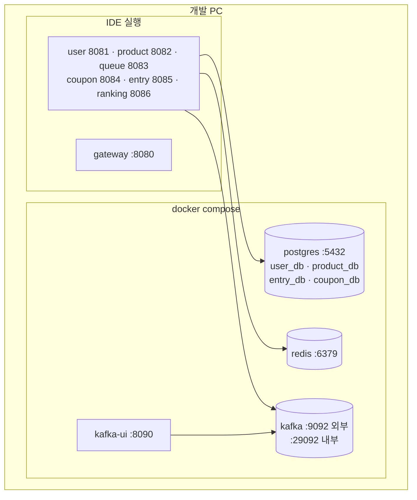

# 인프라 구성

## 변경 이력
| 버전 | 날짜 | 변경 내용 | 관련 요구사항 |
|------|------|-----------|----------------|
| v1.0 | 2026-11-16 | 최초 작성 (현재 docker-compose 정리 + 설계 결정에 따른 변경 예정 사항) | NFR-01 ~ 03 |

## 1. 쉬운 설명 (한눈에)
> 개발 PC 에서 `docker compose up -d` 한 번으로 DB(PostgreSQL), 메모장(Redis), 우체통(Kafka)이 뜨고,
> 각 서비스는 IDE 에서 실행해 이 인프라에 붙어요. 나중에는 서비스도 컨테이너로 같이 띄울 수 있게 설정을 환경변수로 빼뒀어요.

## 2. 기술 스택
| 구분 | 기술 | 버전 |
|------|------|------|
| 언어 | Java | 21 |
| 프레임워크 | Spring Boot / Spring Cloud | 4.1.2 / 2025.1.4 |
| 빌드 | Gradle (멀티모듈) | 9.8.2 (wrapper) |
| DB | PostgreSQL | 17 |
| 캐시·선착순 판정 | Redis | 7.4 |
| 메시지 브로커 | Apache Kafka (KRaft, Zookeeper 없음) | 4.0 |
| 컨테이너 | Docker Compose | - |

## 3. 컨테이너 구성 (`docker-compose.yml`)

| 컨테이너 | 이미지 | 호스트 포트 | 용도 |
|----------|--------|-------------|------|
| queuedrop-postgres | postgres:17 | 5432 | 서비스별 DB (init.sql 로 4개 DB 생성) |
| queuedrop-redis | redis:7.4 | 6379 | 대기열, 선착순 판정, 랭킹 |
| queuedrop-kafka | apache/kafka:4.0.0 | 9092 | 서비스 간 이벤트 |
| queuedrop-kafka-ui | provectuslabs/kafka-ui:v0.7.2 | 8090 | 토픽·메시지 확인 |

**읽는 법**
- Kafka 리스너가 둘인 이유: 호스트(IDE)의 서비스는 `localhost:9092`, 컨테이너끼리는 `kafka:29092` 로 접속한다. 서비스를 컨테이너로 올리면 `KAFKA_BOOTSTRAP_SERVERS=kafka:29092` 로 바꾸면 된다.
- PostgreSQL 은 인스턴스 하나에 DB 를 4개 둔다. "서비스별 DB 분리" 원칙은 지키되, 로컬 리소스를 아끼기 위한 타협이다.

## 4. 서비스 설정 (환경변수)
| 변수 | 기본값 | 사용 서비스 |
|------|--------|-------------|
| `DB_HOST` / `DB_PORT` | localhost / 5432 | user, product, entry, coupon |
| `DB_USERNAME` / `DB_PASSWORD` | queuedrop / queuedrop | 〃 |
| `REDIS_HOST` / `REDIS_PORT` | localhost / 6379 | queue, entry, coupon, ranking |
| `KAFKA_BOOTSTRAP_SERVERS` | localhost:9092 | product, queue, entry, coupon, ranking |
| `{SERVICE}_SERVICE_URL` | http://localhost:{port} | gateway (라우팅 대상) |

## 5. 설계 결정에 따른 변경 예정 사항

| 항목 | 변경 내용 | 근거 |
|------|-----------|------|
| Redis 영속성 | `appendonly yes`, `appendfsync everysec` + 볼륨 마운트 | 재시작 시 정원·응모자 판정 유실 → 오버 응모 방지 ([D1](../04-non-functional/concurrency-consistency.md)) |
| Kafka 토픽 사전 생성 | 토픽별 파티션 수 지정, `auto.create.topics.enable=false` | 자동 생성 토픽은 파티션 1개 → 컨슈머 병렬성 확보 불가 |
| `entry.created` 보존 기간 | 30일 | 랭킹 유실 시 오프셋 리셋으로 재집계 ([ranking.md](../05-features/ranking.md)) |
| Producer 설정 | `acks=all`, `enable.idempotence=true` | "성공 응답 = 이벤트 기록" 불변식 ([D2](../04-non-functional/concurrency-consistency.md)) |
| 내부 포트 비노출 | 서비스 컨테이너화 시 gateway 만 외부 포트 노출 | 헤더 신뢰 기반 인증의 우회 방지 ([architecture.md](../02-architecture/architecture.md) 6장) |
| DB 스키마 관리 | `ddl-auto: update` → Flyway 전환 검토 | 스키마 변경 이력 관리 |

## 6. 잠재 리스크
- **단일 브로커 / 단일 Redis**: 로컬 개발용 구성이라 장애 시 전체가 멈춘다. 운영 수준 가용성(Kafka 3 브로커, Redis Sentinel/Cluster)은 이번 범위 밖으로 둔다.
- **Redis 공유**: 서비스들이 Redis 인스턴스 하나를 같이 쓰므로, 랭킹 조회가 몰리면 선착순 판정 지연에 영향을 줄 수 있다. 부하 테스트에서 확인 후 필요하면 인스턴스를 분리한다.
