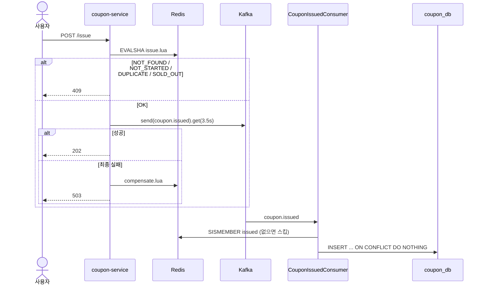

# 선착순 쿠폰 발급 설계 문서

## 변경 이력
| 버전 | 날짜 | 변경 내용 | 관련 요구사항 |
|------|------|-----------|----------------|
| v1.0 | 2026-11-16 | 최초 작성 | REQ-COUPON-01 ~ 05 |
| v1.1 | 2026-11-16 | 저장 전 Redis 확인(필수) 추가, 발행 재시도를 producer 내부 멱등 재시도로 변경, Lua 결과 `NOT_FOUND`·재초기화 API·DLT 추가 | NFR-01·03, phase-6 구현 상세 6장 |

## 1. 요구사항 요약 (근거)
- REQ-COUPON-01: 쿠폰 이벤트 등록 (총 수량, 발급 시작 시각)
- REQ-COUPON-02: 발급 시작 이후 총 수량까지 선착순
- REQ-COUPON-03: 1인 1매
- REQ-COUPON-04: 보유 쿠폰 조회
- REQ-COUPON-05: 대기열 없음
- 비기능 결정 D1, D2 (응모와 동일 패턴)

## 2. 쉬운 설명 (한눈에)
> 응모와 똑같은 방식이에요. 메모장(Redis)이 "이미 받았나? 남았나?"를 한 번에 확인하고 하나 떼어 주고, 장부 기록은 편지(Kafka)로 넘겨요.
> 다른 점은 줄(대기열)이 없다는 것 — 그래서 요청이 그대로 몰려와도 Redis 가 버텨야 해요.

## 3. 상세 설명

### 발급 Lua
| 순서 | 검사 | 실패 시 |
|------|------|---------|
| 0 | meta 존재 (이벤트가 Redis 에 초기화됨) | `NOT_FOUND` |
| 1 | `now ≥ issueStartAt` | `NOT_STARTED` |
| 2 | `SISMEMBER issued userId` == 0 | `DUPLICATE` |
| 3 | `GET remaining` > 0 | `SOLD_OUT` |
| 4 | `DECR remaining`, `SADD issued userId` | `OK` |

### 이벤트 등록 (관리자)
- `INSERT coupon_events` → 커밋 후 Redis 초기화 (`SET remaining NX`, meta)
- 같은 서비스 내부이므로 이벤트 없이 직접 초기화. Redis 초기화 실패 시 관리자 재초기화 API 로 복구

### 발행·보상·저장
- `coupon.issued` 동기 발행 확인: 응모와 같은 규칙 — `get(3.5s)`, producer 내부 멱등 재시도(`acks=all`, `enable.idempotence=true`, `delivery.timeout.ms=3000`), **애플리케이션 재시도 없음** ([D2](../04-non-functional/concurrency-consistency.md))
- 실패 시 보상 Lua (`SREM issued` 결과가 1이면 `INCR remaining`) → 503
- 저장 컨슈머
  1. **저장 전 Redis 확인 (필수)**: `SISMEMBER issued userId` 가 0 이면 보상된 발급(유령 이벤트)으로 보고 저장하지 않는다
     - 쿠폰에는 추첨의 건수 비교(D6) 같은 사후 안전장치가 없다. 이 확인이 없으면 유령 이벤트가 그대로 저장되어 **수량보다 많이 발급**된다
  2. `INSERT issued_coupons ... ON CONFLICT (coupon_event_id, user_id) DO NOTHING` (멱등)
  3. 처리 실패 → 3회 재시도 후 `coupon.issued.DLT`

### API
| Method | Path | 권한 | 설명 |
|--------|------|------|------|
| POST | `/api/coupons/events` | ADMIN | 쿠폰 이벤트 등록 |
| GET | `/api/coupons/events/{eventId}` | 공개 | 이벤트 정보 + 잔여 수량 |
| POST | `/api/coupons/events/{eventId}/initialize` | ADMIN | Redis 재초기화 (`SET NX`, 등록 시 초기화 실패 복구용) |
| POST | `/api/coupons/events/{eventId}/issue` | USER | 발급 요청 → 202 |
| GET | `/api/coupons/me` | USER | 내 쿠폰 목록 |

## 4. 설계 결정
| 결정점 | 선택 | 이유 / 포기한 것 |
|--------|------|------------------|
| 판정 | Redis Lua (응모와 동일) | 패턴 재사용, 비교 실험 용이 / Redis 의존 |
| 대기열 | 사용하지 않음 (요구사항) | 쿠폰은 판정 비용이 매우 작아 Redis 만으로 흡수 가능하다고 판단 |
| 저장 | 자기 서비스 Kafka 경유 비동기 | 피크 DB 쓰기 평탄화 / 조회 시 잠깐 미반영 가능 |

> 💡 응모(entry)와 쿠폰(coupon)의 **선착순 판정 패턴이 동일**하므로, Lua 실행·보상 로직을 `common` 의 공통 컴포넌트로 추출할지 구현 시 결정한다. 단, 검사 항목이 다르므로 스크립트 자체는 서비스별로 둔다.

## 5. 다이어그램

### 5.1 시퀀스 다이어그램

**읽는 법**
- 응모 시퀀스([entry-apply.md](entry-apply.md) 5.2)와 구조가 같다 — 차이는 토큰 검사가 없고 시작 시각 검사만 있다는 점.
- 대기열이 없으므로 **피크 요청이 전부 Redis 에 도달**한다. 판정 실패(SOLD_OUT)가 대부분인 구간에서도 Lua 가 실행된다.
- 저장 컨슈머의 Redis 확인이 쿠폰의 **유일한 유령 이벤트 방어선**이다 (응모는 추첨 전 건수 비교가 한 번 더 있다).

### 5.2 ERD
[erd.md](../06-erd/erd.md) 의 coupon_db (`coupon_events`, `issued_coupons`) 참고.

## 6. 잠재 리스크
- **매진 후 폭주**: 수량 소진 후에도 요청이 Lua 까지 온다. 선택지: (a) 애플리케이션 로컬 캐시에 "매진" 플래그를 두고 Redis 호출 전 차단, (b) 그대로 둠(Lua 가 O(1) 이라 감당 가능). 부하 테스트 결과로 결정.
- **Redis 유실 시 오버 발급**: 응모와 동일 — AOF 필수.
- 나머지는 [entry-apply.md](entry-apply.md) 6장과 동일.
