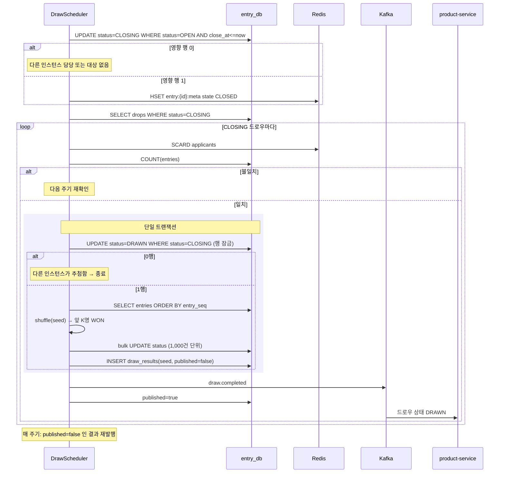

# 추첨 설계 문서

## 변경 이력
| 버전 | 날짜 | 변경 내용 | 관련 요구사항 |
|------|------|-----------|----------------|
| v1.0 | 2026-11-16 | 최초 작성 | REQ-ENTRY-05, 06 |
| v1.1 | 2026-11-16 | 추첨 트랜잭션 첫 문장을 `CLOSING → DRAWN` 조건부 UPDATE 로 변경(동시 추첨 방지), `draw_results.published` 와 발행 실패 재발행 추가, 시드 생성 포트, 벌크 UPDATE 분할 | phase-5 구현 상세 6장 |
| v1.2 | 2026-11-17 | 건수 불일치 장기화: (a) 경고 후 관리자 수동 추첨 API 확정(`POST /api/entries/admin/drops/{dropId}/draw`, DB 응모 기준). 추첨 커밋 후 응모 Redis 키 6개 EXPIRE 1일 | 사용자 결정, phase-5 v1.2 D5-1·D5-4 |

## 1. 요구사항 요약 (근거)
- REQ-ENTRY-05: 응모 마감 시각에 자동 추첨, 응모자 중 K명 무작위 (정원이 일찍 차도 마감 시각까지 대기)
- REQ-ENTRY-06: 당첨/낙첨 결과 조회
- 비기능 결정 D5 (entry 내부), D6 (DB 기준 + 건수 일치 대기), D7 (시드 저장 셔플)

## 2. 쉬운 설명 (한눈에)
> 마감 종이 울리면 응모 창구를 닫고, 장부 정리가 다 끝났는지 확인해요(줄 선 사람 수 = 장부 기록 수).
> 다 맞으면 응모 번호를 순서대로 놓고, 기록해 둔 "섞는 방법(시드)"으로 섞어서 앞의 K명을 당첨으로 정해요.
> 섞는 방법을 저장해 두었기 때문에 나중에 똑같이 다시 섞어보면 같은 결과가 나와요.

## 3. 상세 설명

### drop_snapshots.status 전이
```
OPEN ──(closeAt 도달, 조건부 UPDATE)──▶ CLOSING ──(건수 일치, 추첨 트랜잭션)──▶ DRAWN
```

### 추첨 스케줄러 (주기 예: 5초)
1. **마감 잠금**: `UPDATE drop_snapshots SET status='CLOSING' WHERE drop_id=? AND status='OPEN' AND close_at <= now`
   - 영향 행 1 → 이 인스턴스가 추첨 담당 (다중 인스턴스 중복 추첨 방지)
   - 동시에 Redis `HSET entry:{id}:meta state CLOSED` → 이후 응모 Lua 는 `CLOSED` 반환
2. **건수 일치 확인**: `SCARD entry:{id}:applicants` == `SELECT COUNT(*) FROM entries WHERE drop_id=?`
   - 불일치 → 이번 주기는 종료, 다음 주기 재확인. `CLOSING` 상태가 일정 시간(예: 5분) 넘으면 경고 로그
3. **추첨 (하나의 DB 트랜잭션)**
   - **첫 문장**: `UPDATE drop_snapshots SET status='DRAWN' WHERE drop_id=? AND status='CLOSING'`
     - 영향 행 0 → 다른 인스턴스가 이미 추첨함 → 롤백하고 종료
     - 이 UPDATE 가 행 잠금을 잡으므로, 두 인스턴스가 같은 드로우를 동시에 추첨하지 못한다 (나중에 온 쪽은 잠금을 기다린 뒤 0행)
   - `SELECT user_id FROM entries WHERE drop_id=? ORDER BY entry_seq`
   - 시드: application 포트 `SeedGenerator` 로 생성 (구현은 `SecureRandom`, 테스트는 고정값) → `Collections.shuffle(list, new Random(seed))`
   - 앞 `min(K, 응모자 수)` 명 → `WON`, 나머지 → `LOST` (벌크 UPDATE, 1,000건 단위로 나눠 실행)
   - `INSERT draw_results (drop_id, seed, applicant_count, winner_count, drawn_at, published=false)`
4. **결과 이벤트**: 커밋 후 `draw.completed` 발행 → 성공 시 `draw_results.published=true` → product-service 가 드로우 상태 DRAWN 반영
   - 발행 실패 → `published=false` 로 남고, 스케줄러가 다음 주기에 미발행 결과를 다시 발행한다 (product 쪽 처리는 멱등)

### 경계 케이스
| 케이스 | 처리 |
|--------|------|
| 응모자 < K | 응모자 전원 당첨 |
| 응모자 0명 | 당첨 0, draw_results 는 기록 |
| CLOSING 중 서버 재시작 | 다음 주기에 CLOSING 상태 드로우도 대상으로 2단계부터 재시도 |
| 추첨 트랜잭션 실패 | 롤백 → CLOSING 유지 → 다음 주기 재시도 (새 시드로) |
| 두 인스턴스가 동시에 추첨 시도 | 첫 문장(`CLOSING → DRAWN`)의 행 잠금으로 한쪽만 진행, 다른 쪽은 0행 → 종료 |
| `draw.completed` 발행 실패 | `published=false` → 다음 주기 재발행 |

### API
| Method | Path | 설명 |
|--------|------|------|
| GET | `/api/entries/drops/{dropId}/me` | 내 결과 (APPLIED / WON / LOST) — 응모 단건 조회와 같은 API ([entry-apply.md](entry-apply.md)) |
| GET | `/api/entries/drops/{dropId}/result` | 추첨 요약 (응모자 수, 당첨 수, 추첨 시각, 시드) |

## 4. 설계 결정
| 결정점 | 선택 | 이유 / 포기한 것 |
|--------|------|------------------|
| 추첨 위치 | entry-service | 응모 데이터 로컬 조회 / entry 책임 증가 |
| 추첨 시점 | 마감 시각 자동 | 시점 명확·재현 가능 / 정원 조기 마감 시에도 대기 |
| 명단 기준 | DB + 건수 일치 대기 | 결과가 영속 데이터와 일치 / 추첨 지연 가능 |
| 중복 추첨 방지 | 마감 잠금(OPEN→CLOSING) + 추첨 트랜잭션 첫 문장(CLOSING→DRAWN) 조건부 UPDATE | 분산 락 불필요 / 추첨 중 해당 행 잠금 유지 |
| 공정성 | entry_seq 정렬 + 시드 셔플 | 재현·감사 가능 / 시드 공개 시 결과 검증 가능하지만 사전 예측 불가 |

## 5. 다이어그램

### 5.1 시퀀스 다이어그램
**왜**: 마감·대기·추첨이 각각 어떤 저장소 상태를 바꾸는지, 그리고 중간 실패 시 어디서 재시작하는지 확인.



**읽는 법**
- `CLOSING` 은 "닫혔지만 아직 안 뽑음" 을 나타내는 **재시작 지점**이다. 어떤 단계에서 죽어도 CLOSING 이 남아 있으므로 다음 주기에 이어서 진행된다.
- 마감 잠금(DB 조건부 UPDATE)이 Redis CLOSED 보다 먼저다. 두 작업 사이에 죽으면 Redis 는 아직 OPEN 이지만 Lua 가 `closeAt` 시각도 함께 검사하므로 마감 후 응모는 들어오지 않는다.
- 트랜잭션의 **첫 문장이 상태 전이**다. 이 UPDATE 가 행 잠금을 잡아서, 동시에 들어온 다른 인스턴스는 잠금이 풀린 뒤 0행을 보고 빠진다.
- 박스(트랜잭션) 밖의 `draw.completed` 발행이 실패하면 product 의 표시 상태만 늦어진다 → `published=false` 로 남아 다음 주기에 재발행된다. 결과 조회는 entry 가 진실의 원천이므로 영향 없음.

### 5.2 ERD
[erd.md](../06-erd/erd.md) 의 entry_db (`drop_snapshots`, `entries`, `draw_results`) 참고.

## 6. 잠재 리스크
- **건수가 영원히 일치하지 않는 경우**: 발행 타임아웃 후 보상([entry-apply.md](entry-apply.md) 6장) 등으로 Redis ≠ DB. 선택지: (a) 경고 후 관리자 수동 확정 API, (b) 일정 시간 후 DB 기준으로 강제 추첨. **(a) 확정 (2026-11-17, 사용자 결정)** — 공정성 문제를 자동으로 덮지 않기 위해. `CLOSING` 이 `closeAt + 5분`을 넘기면 WARN, 운영자가 DLT 재처리로 해소되는지 확인한 뒤 관리자 API 로 DB 응모 기준 추첨. Redis 에만 남은 응모(보상 실패, 미처리 DLT)는 제외되며 별도 Redis∖DB 대조는 두지 않는다.
- **응모 Redis 키 수명**: 추첨 커밋 후 `entry:{dropId}:*` 6개 키(meta, remaining, applicants, seq, requests, persisted)에 EXPIRE 1일. 추첨 전에는 만료시키지 않는다(건수 비교 근거). 만료 실패는 WARN 만 남기고 재시도하지 않는다.
- **대량 응모자 메모리**: M 이 수십만 이상이면 전체 userId 를 메모리에 올려 셔플하는 비용 증가. 현재 범위(M 수천~수만)는 문제 없음. 커지면 "K개 인덱스만 뽑는 부분 셔플"로 변경.
- **추첨 재시도 시 새 시드**: 트랜잭션 롤백 후 재시도는 새 시드를 쓴다. 커밋 전이라 외부에 결과가 노출되지 않았으므로 공정성 문제 없음.
