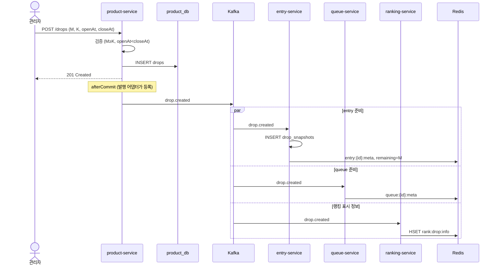

# 드로우 등록·전파 설계 문서

## 변경 이력
| 버전 | 날짜 | 변경 내용 | 관련 요구사항 |
|------|------|-----------|----------------|
| v1.0 | 2026-11-16 | 최초 작성 | REQ-DROP-01 ~ 03 |
| v1.1 | 2026-11-16 | openAt 최소 1분 여유를 확정 규칙으로, 발행 방식을 발행 어댑터 내 afterCommit 등록으로 확정 | phase-2 구현 상세 6장, D4 |
| v1.2 | 2026-11-16 | 등록 검증에 상한(오픈 365일 이내, 응모 기간 30일 이내, 기본안)과 길이·시각 정밀도(마이크로초 내림) 규칙 추가 — 범위 밖 시각이 DB 에서 500 이 되던 문제 수정 | phase-2 단계 검증 |

## 1. 요구사항 요약 (근거)
- REQ-DROP-01: 관리자 상품 등록
- REQ-DROP-02: 드로우 등록 (응모 정원 M, 당첨 수량 K, 오픈 시각, 응모 마감 시각, M ≥ K)
- REQ-DROP-03: 드로우 목록·상세 조회
- 비기능 결정 D4 (Kafka 이벤트 복제) — [concurrency-consistency.md](../04-non-functional/concurrency-consistency.md)

## 2. 쉬운 설명 (한눈에)
> 관리자가 "이 상품을 몇 시부터 몇 시까지, 1,000명 응모 받아 50명 뽑는다"고 공지를 올리면,
> 그 공지가 대기열·응모·랭킹 창구에 편지로 전달되어 각자 준비를 해요.

## 3. 상세 설명

### 드로우 상태
| 상태 | 의미 | 결정 방식 |
|------|------|-----------|
| SCHEDULED | 오픈 전 | `now < openAt` |
| OPEN | 응모 가능 시간 | `openAt ≤ now < closeAt` |
| CLOSED | 마감, 추첨 대기 | `closeAt ≤ now` 이고 추첨 전 |
| DRAWN | 추첨 완료 | `draw.completed` 수신 시 저장 |

- SCHEDULED / OPEN / CLOSED 는 **시각으로 계산**(저장 X), DRAWN 여부만 `drops.drawn` 컬럼으로 저장한다.
  → 스케줄러 없이도 조회 시점에 정확한 상태를 보여줄 수 있다.
- 정원이 조기 마감되어도 드로우 상태는 OPEN 이다. "응모 마감(정원 소진)" 여부는 entry 의 잔여 정원으로 별도 표시.

### 등록 검증
- `entryCapacity ≥ winnerCount ≥ 1`
- `now < openAt < closeAt`
- **`openAt ≥ 등록 시각 + 1분`** (확정) — `drop.created` 가 entry/queue 에 전파되기 전에 오픈되는 것을 막는다
- **`openAt ≤ 등록 시각 + 365일`, `closeAt − openAt ≤ 30일`** (확정(기본안), v1.2) — 범위를 벗어난 시각(예: PostgreSQL timestamptz 상한 초과)이 DB 에서 500 이 되는 것을 막고, 수신 측 Redis 키 TTL 이 비정상적으로 길어지지 않게 한다
- 제목·상품명 100자, 이미지 URL 500자 이하 (DB 컬럼 길이와 같음)
- openAt·closeAt 은 마이크로초로 내림해 저장한다 (PostgreSQL 정밀도). 응답·`drop.created` payload·DB 값이 같아진다
- 등록 후 수정 불가 (1차 범위)

### 이벤트 발행 (D4 확정)
- application `DropService` 는 포트 `DropEventPublisher.publishCreated(...)` 만 호출한다. 발행 시점은 모른다.
- infrastructure `KafkaDropEventPublisher` 가 `TransactionSynchronizationManager` 로 **`afterCommit` 에 발행을 등록**한다. 활성 트랜잭션이 없으면(재발행 API) 즉시 발행한다.
- 롤백되면 발행되지 않는다. 커밋 후 발행이 최종 실패하면 ERROR 로그 → 관리자 재발행 API 로 복구.

### API
| Method | Path | 권한 | 설명 |
|--------|------|------|------|
| POST | `/api/products` | ADMIN | 상품 등록 |
| POST | `/api/products/{productId}/drops` | ADMIN | 드로우 등록 |
| GET | `/api/products/drops` | 공개 | 드로우 목록 (상태 필터) |
| GET | `/api/products/drops/{dropId}` | 공개 | 드로우 상세 |
| POST | `/api/products/drops/{dropId}/republish` | ADMIN | `DropCreated` 재발행 (발행 실패 복구용) |

## 4. 설계 결정
| 결정점 | 선택 | 이유 / 포기한 것 |
|--------|------|------------------|
| 정보 전파 | `DropCreated` Kafka 이벤트 | 응모 피크 시 product 의존 제거 / 데이터 중복 저장 |
| 이벤트 발행 시점 | 발행 어댑터 내 `afterCommit` 등록 + producer 재시도 + 재발행 API | Outbox 대비 단순, application 이 Spring 이벤트 API 에 비의존 / 발행 유실 가능성 → 재발행으로 보완 |
| 상태 저장 | 시각 계산 + DRAWN 만 저장 | 상태 전이 스케줄러 불필요 |

## 5. 다이어그램

### 5.1 시퀀스 다이어그램
**왜**: 드로우 하나가 등록될 때 어느 서비스가 무엇을 준비하는지, 준비가 끝나기 전에 오픈되는 경우는 없는지 확인.

**읽는 법**
- 관리자 응답(201)과 이벤트 전파는 분리되어 있다. 전파가 끝나기 전 오픈되면 응모가 실패하므로 **`openAt` 은 등록 시각 + 1분 이후**여야 한다 (등록 검증 규칙).
- entry 의 Redis 초기화는 `SET NX` 로 수행해 이벤트 재수신 시 잔여 정원을 덮어쓰지 않는다 (멱등).

### 5.2 ERD
[erd.md](../06-erd/erd.md) 의 product_db 참고 (`products`, `drops`).

## 6. 잠재 리스크
- **이벤트 유실**: 커밋 후 발행 실패 → 응모 불가 드로우. 대응: 재시도, 관리자 재발행 API. 더 확실하게 하려면 Outbox 로 전환.
- **이벤트 재발행 시 덮어쓰기**: 이미 응모가 진행 중인데 재발행되면 remaining 이 M 으로 리셋될 위험 → `SET NX` 로 방지.
- **서버 간 시계 차이**: 상태를 시각으로 계산하므로 서비스 간 시계가 어긋나면 경계 시점에 판단이 다를 수 있다. 응모 판정은 entry 의 Redis Lua 에서만 하므로 최종 판정은 한 곳에서 일어난다.
