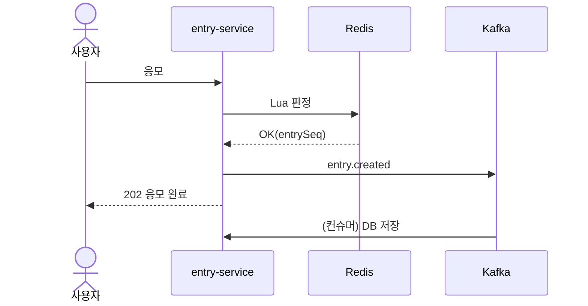
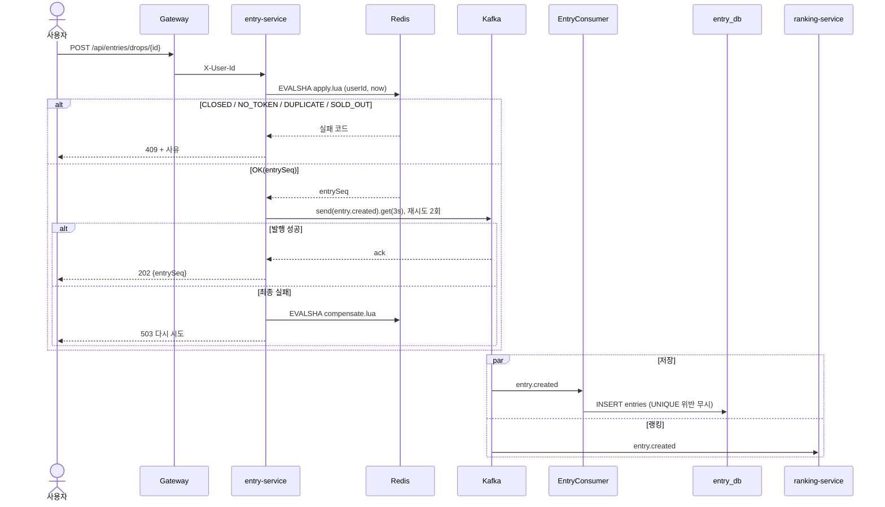

# 응모 설계 문서

## 변경 이력
| 버전 | 날짜 | 변경 내용 | 관련 요구사항 |
|------|------|-----------|----------------|
| v1.0 | 2026-11-16 | 최초 작성 | REQ-ENTRY-01 ~ 04, 06 |
| v1.1 | 2026-11-16 | 클래스 다이어그램을 4계층 구조로 이관 (class-diagram.md 참고) | layered-architecture.md |

## 1. 요구사항 요약 (근거)
- REQ-ENTRY-01: 입장 토큰으로 응모
- REQ-ENTRY-02: 선착순 M명, 정원 차면 마감
- REQ-ENTRY-03: 1인 1드로우 1응모
- REQ-ENTRY-04: 취소 불가
- REQ-ENTRY-06: 내 응모 내역·결과 조회
- 비기능 결정 D1, D2, D3

## 2. 쉬운 설명 (한눈에)
> 입장 팔찌를 찬 사람이 응모 버튼을 누르면, 메모장(Redis)이 한 번에 "팔찌 있나? 이미 응모했나? 자리 남았나?"를 확인하고 자리를 하나 줘요.
> 그 다음 장부 기록용 편지를 우체통(Kafka)에 넣고, 넣었다는 확인을 받아야 "응모 완료"라고 답해요.
> 편지를 못 넣으면 줬던 자리를 다시 회수하고 "다시 시도해 주세요"라고 답해요.

## 3. 상세 설명

### 응모 Lua 스크립트 (원자 판정)
입력: `KEYS = [entry meta, remaining, applicants, queue token]`, `ARGV = [userId, nowEpochMs]`

| 순서 | 검사 | 실패 시 결과 |
|------|------|--------------|
| 1 | meta.state == OPEN 그리고 openAt ≤ now < closeAt | `CLOSED` |
| 2 | `EXISTS token` | `NO_TOKEN` |
| 3 | `SISMEMBER applicants userId` == 0 | `DUPLICATE` |
| 4 | `GET remaining` > 0 | `SOLD_OUT` |
| 5 | `DECR remaining`, `SADD applicants userId` | — |
| 6 | `entrySeq = capacity - remaining` 반환 | `OK(entrySeq)` |

- 시간 비교에 `nowEpochMs` 를 인자로 받는 이유: Lua 안에서 `TIME` 을 쓰면 복제 시 비결정적 — 애플리케이션 시각을 넘기고 판정은 한 곳(Redis)에서만.
- `entrySeq` 는 1 ~ M 의 고유 번호 → 추첨 시 결정적 정렬 기준.

### 이벤트 발행 + 보상 (D2)
- `kafkaTemplate.send(entry.created).get(3s)`, producer `acks=all`, 재시도 2회
- 최종 실패 → 보상 Lua: `if SREM applicants userId == 1 then INCR remaining end`
- 응답: `503 ENTRY_TEMPORARILY_FAILED` (재시도 가능)

### 저장 컨슈머 (entry-service 자기 토픽 소비)
- `entry.created` 소비 → `INSERT entries (drop_id, user_id, entry_seq, status=APPLIED, applied_at)`
- `UNIQUE(drop_id, user_id)` 위반 → 이미 저장된 것으로 보고 무시 (멱등)
- 배치 리스너 + bulk insert 로 DB 쓰기 평탄화 가능 (구현 시 선택)

### API
| Method | Path | 설명 |
|--------|------|------|
| POST | `/api/entries/drops/{dropId}` | 응모 → `202 Accepted {entrySeq}` |
| GET | `/api/entries/me` | 내 응모 목록 (상태: APPLIED/WON/LOST) |
| GET | `/api/entries/drops/{dropId}/me` | 특정 드로우 내 응모·결과 |

- 응답이 `202` 인 이유: 판정은 확정이지만 DB 저장은 비동기. 직후 `/me` 조회 시 아직 없을 수 있으므로, 조회 API 는 DB 에 없으면 Redis `SISMEMBER` 로 보완해 `APPLIED` 로 응답한다.

## 4. 설계 결정
| 결정점 | 선택 | 이유 / 포기한 것 |
|--------|------|------------------|
| 판정 위치 | Redis Lua 하나로 4가지 검사 + 차감 | 원자성, DB 락 없음 / Redis 에 판정 상태 의존 |
| 토큰 검증 | 같은 Lua 안에서 EXISTS | 검증과 차감 사이 토큰 만료 경합 없음 / queue 키 읽기 의존 |
| 성공 기준 | Kafka 수신 확인까지 | "성공 = 기록 보장" 불변식 / 응답 지연에 Kafka 왕복 포함 |
| 토큰 소모 | 응모 후 삭제하지 않음 | 보상 시 토큰 복구 불필요 / 토큰이 TTL 까지 남음 (재응모는 중복 검사가 막음) |

## 5. 다이어그램

### 5.1 시퀀스 다이어그램 (단순)

### 5.2 시퀀스 다이어그램 (상세)
**왜**: 응답 경로에서 무엇이 동기이고 무엇이 비동기인지, 실패 시 어디까지 되돌리는지(트랜잭션 경계) 확인.

**읽는 법**
- 동기 경계는 **Redis Lua + Kafka 발행**까지다. DB 저장과 랭킹 집계는 응답 이후 일이다.
- 실패 분기는 두 종류다: **비즈니스 실패(409)** 는 Redis 에서 아무것도 바뀌지 않았고, **기술 실패(503)** 는 보상으로 되돌린 상태다.
- 저장 컨슈머와 랭킹 컨슈머는 서로 독립이다. 랭킹이 늦어도 응모 저장에는 영향이 없다.

### 5.3 클래스 다이어그램
4계층 구조의 상세 다이어그램은 [class-diagram.md](../07-class-diagram/class-diagram.md) 1.1 (응모) 참고.

**이 기능에서 봐야 할 포인트**
- 응답 경로 `EntryController → EntryApplyService → EntryGate(Redis) / EntryEventPublisher(Kafka)` 에 **DB(EntryRepository) 가 없다**.
- DB 쓰기는 `EntryCreatedListener → EntrySaveService → EntryRepository` 한 경로뿐이다 (쓰기 경로 단일화).
- 판정 결과 `ApplyOutcome` 은 domain enum 이지만, presentation 은 이를 직접 보지 않고 application 예외의 에러 코드로 409 사유를 받는다.

### 5.4 ERD
[erd.md](../06-erd/erd.md) 의 entry_db (`entries`) 참고.

## 6. 잠재 리스크
- **Kafka 발행 타임아웃 후 실제로는 성공**: 보상으로 Redis 에서 빠졌는데 DB 에는 저장됨 → Redis 응모 수 < DB 응모 수. 추첨 건수 비교(D6)에서 불일치로 드러난다. 선택지: 컨슈머가 저장 전 `SISMEMBER` 로 확인해 없으면 스킵.
- **응답 지연**: 피크 시 Kafka 왕복이 응답 시간을 좌우 → 부하 테스트로 측정 필요 (`linger.ms`, `batch.size` 튜닝 지점).
- **Redis 재시작**: AOF 없으면 remaining/applicants 유실 → 오버 응모 가능. **AOF everysec 필수**, 그래도 최대 1초 유실 가능성은 남음.
- **긴 Lua 스크립트**: 현재 O(1) 명령만 사용해 문제 없음. 스크립트에 반복문이 들어가면 Redis 전체가 멈추므로 금지.
