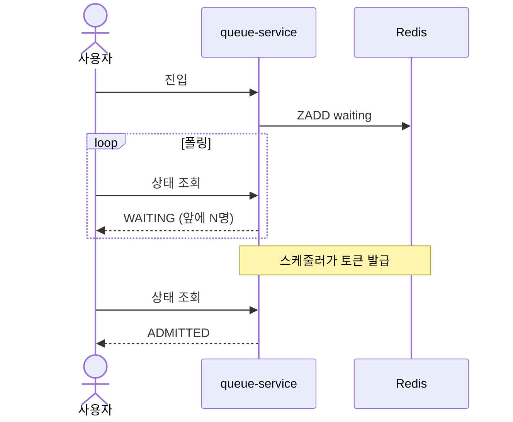
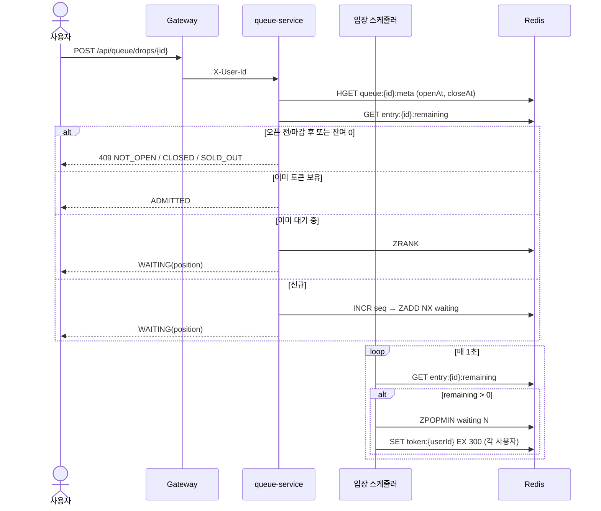

# 대기열 진입·입장 설계 문서

## 변경 이력
| 버전 | 날짜 | 변경 내용 | 관련 요구사항 |
|------|------|-----------|----------------|
| v1.0 | 2026-11-16 | 최초 작성 | REQ-QUEUE-01 ~ 06 |

## 1. 요구사항 요약 (근거)
- REQ-QUEUE-01: 드로우별 대기열
- REQ-QUEUE-02: 오픈 이후 진입, 진입 순서대로 순번
- REQ-QUEUE-03: 내 대기 순번 조회
- REQ-QUEUE-04: 주기적으로 앞에서부터 N명 입장 토큰 발급
- REQ-QUEUE-05: 토큰 TTL 만료
- REQ-QUEUE-06: 응모는 유효 토큰 필요
- 비기능 결정 D3 (공유 Redis 토큰 검증)

## 2. 쉬운 설명 (한눈에)
> 놀이공원 줄과 같아요. 줄을 서면 번호표를 받고, 직원이 1초마다 앞에서 N명씩 "입장 팔찌"를 채워 들여보내요.
> 팔찌는 5분 동안만 유효하고, 그 안에 응모하지 않으면 다시 줄을 서야 해요.
> 응모 정원이 다 차면 직원이 "마감됐어요"라고 알려주고 더 들여보내지 않아요.

## 3. 상세 설명

### 사용자 상태
| 상태 | 조건 | 클라이언트 동작 |
|------|------|-----------------|
| WAITING | `waiting` ZSet 에 존재 | 순번 표시, 폴링 계속 |
| ADMITTED | `token:{userId}` 존재 | 응모 화면 진입 |
| SOLD_OUT | `entry:{dropId}:remaining ≤ 0` | 마감 안내, 폴링 중단 |
| NOT_IN_QUEUE | 둘 다 없음 (토큰 만료 포함) | 재진입 가능 |

### 진입 (REQ-QUEUE-02)
- 검증: `openAt ≤ now < closeAt` (queue meta), 잔여 정원 > 0
- 이미 WAITING/ADMITTED 이면 현재 상태 그대로 반환 (멱등, 새로고침해도 순번 유지)
- 순번: `INCR queue:{dropId}:seq` → `ZADD NX waiting seq userId`
  - 타임스탬프 대신 카운터를 쓰는 이유: 같은 ms 진입 시 동점 방지, 서버 간 시계 차이 무관

### 입장 처리 스케줄러 (REQ-QUEUE-04, 05)
- 주기 1초, 배치 크기 N (설정값, 예: 100)
- `ZPOPMIN waiting N` → 각 userId 에 `SET token:{userId} EX 300`
- `ZPOPMIN` 은 원자적이므로 같은 사용자가 두 번 입장되지 않는다
- 잔여 정원 ≤ 0 이면 입장 중단 (토큰을 줘도 응모 불가)
- 오픈 중인 드로우 목록은 queue meta 에서 조회

### API
| Method | Path | 설명 |
|--------|------|------|
| POST | `/api/queue/drops/{dropId}` | 대기열 진입 → 상태 + 순번 |
| GET | `/api/queue/drops/{dropId}` | 내 상태 조회 (WAITING 이면 `ZRANK` 로 "앞에 N명") |

## 4. 설계 결정
| 결정점 | 선택 | 이유 / 포기한 것 |
|--------|------|------------------|
| 입장 방식 | 주기적 N명 + 토큰 TTL | 처리량(초당 N명) 제어가 명확 / 실제 동시 접속자 수는 제어하지 않음 |
| 순번 발급 | INCR 카운터 | 동점·시계 문제 없음 / 키 하나 추가 |
| 상태 전달 | 클라이언트 폴링 | 구현 단순 / SSE·WebSocket 대비 요청 수 증가 |
| 토큰 형태 | userId 별 키 존재 여부 | 토큰 값 전달 불필요(JWT 의 userId 로 조회) / 별도 토큰 문자열 없음 |

## 5. 다이어그램

### 5.1 시퀀스 다이어그램 (단순)

### 5.2 시퀀스 다이어그램 (상세)
**왜**: 진입·입장·마감이 동시에 일어날 때 한 사용자가 두 번 입장하거나, 마감 후에도 입장되는 경우가 없는지 확인.

**읽는 법**
- "이미 대기 중 / 이미 토큰 보유" 분기 덕분에 새로고침이나 중복 클릭이 순번을 뒤로 밀지 않는다.
- 신규 진입의 `INCR → ZADD NX` 는 두 명령이라 원자적이지 않다. 같은 사용자가 동시에 두 번 요청하면 seq 하나가 낭비되지만, `NX` 때문에 순번이 두 개 생기지는 않는다 (허용 가능한 빈 번호).
- `ZPOPMIN` 과 `SET token` 사이에 장애가 나면 해당 사용자는 대기열에서 빠졌는데 토큰이 없다 → NOT_IN_QUEUE 로 보이고 재진입 시 맨 뒤로 간다. 피하려면 두 동작을 Lua 하나로 묶는다 (**구현 시 Lua 로 묶는 것을 권장**).

### 5.3 클래스 / 저장 구조
- DB 없음. Redis 키는 [architecture.md](../02-architecture/architecture.md) 5장 참고.
- 클래스는 [class-diagram.md](../07-class-diagram/class-diagram.md) 의 queue-service 참고.

## 6. 잠재 리스크
- **다중 인스턴스 스케줄러**: queue-service 가 2대면 초당 2N명이 입장된다. 선택지: (a) Redis 분산 락(`SET NX EX`)으로 한 인스턴스만 실행, (b) 처리량이 인스턴스 수에 비례함을 받아들이고 N 을 나눠 설정. 1차는 (a) 권장.
- **토큰을 받고 응모하지 않는 사용자**: 정원은 남는데 입장 기회만 소모 → TTL 로 회수. 정원 소진 전까지는 스케줄러가 계속 입장시키므로 결국 정원은 채워진다.
- **폴링 부하**: 대기자 수 × 폴링 주기만큼 조회 요청. 대기 순번에 따라 폴링 간격을 늘리도록(서버가 `nextPollAfterMs` 응답) 클라이언트를 설계하면 완화.
- **잔여 정원 키 공유**: queue 가 entry 소유 키를 읽음 → 키 이름 변경 시 두 서비스 동시 수정 필요.
