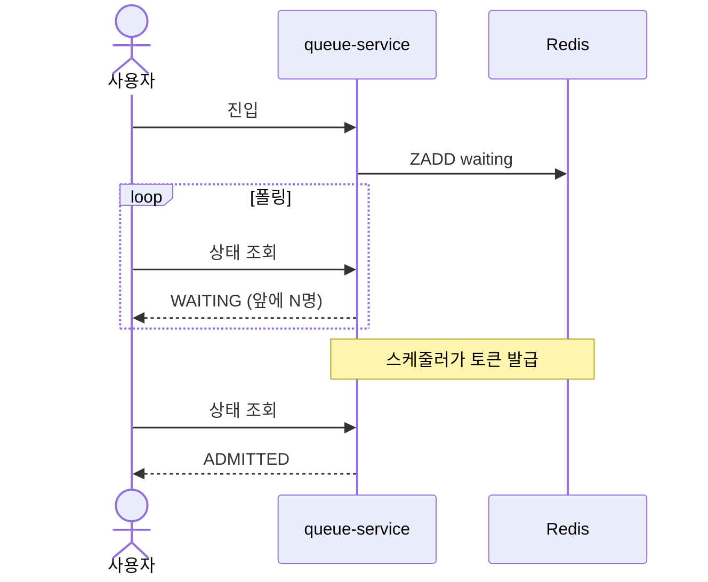
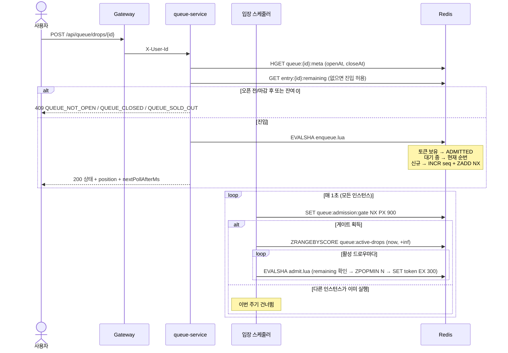

# 대기열 진입·입장 설계 문서

## 변경 이력
| 버전 | 날짜 | 변경 내용 | 관련 요구사항 |
|------|------|-----------|----------------|
| v1.0 | 2026-11-16 | 최초 작성 | REQ-QUEUE-01 ~ 06 |
| v1.1 | 2026-11-16 | 진입을 `enqueue.lua` 원자 처리로, 입장 Lua 에 잔여 정원 확인 포함, 스케줄러 미해제 게이트, 활성 드로우 인덱스, `nextPollAfterMs`, 잔여 정원 키 없음 정책, 상태 우선순위 추가 | phase-3 구현 상세 6장 |
| v1.2 | 2026-11-16 | 에러 코드를 0단계 규칙(`QUEUE_*`)으로 표기, 마감 드로우 queue 키 정리(`closeAt + 1일` 만료, 기본안), 마감 후 별도 CLOSED 상태 없음(기본안) | phase-3 구현 상세 v1.2 |
| v1.3 | 2026-11-16 | 게이트 유지 시간을 주기의 90% 로(지터로 단일 인스턴스도 주기를 건너뛰던 문제), 입장 루프 드로우별 실패 격리, `drop.created` 처리 실패는 1초 간격 3회 재시도 후 로그·스킵 | phase-3 구현 상세 v1.3 |

## 1. 요구사항 요약 (근거)
- REQ-QUEUE-01: 드로우별 대기열
- REQ-QUEUE-02: 오픈 이후 진입, 진입 순서대로 순번
- REQ-QUEUE-03: 내 대기 순번 조회
- REQ-QUEUE-04: 주기적으로 앞에서부터 N명 입장 토큰 발급
- REQ-QUEUE-05: 토큰 TTL 만료
- REQ-QUEUE-06: 응모는 유효 토큰 필요
- 비기능 결정 D3 (공유 Redis 토큰 검증)

## 2. 쉬운 설명 (한눈에)
> 놀이공원 줄과 같아요. 줄을 서면 번호표를 받고, 직원이 1초마다 앞에서 N명씩 "입장 팔찌"를 채워 들여보내요.
> 팔찌는 5분 동안만 유효하고, 그 안에 응모하지 않으면 다시 줄을 서야 해요.
> 응모 정원이 다 차면 직원이 "마감됐어요"라고 알려주고 더 들여보내지 않아요.

## 3. 상세 설명

### 사용자 상태
| 상태 | 조건 | 클라이언트 동작 |
|------|------|-----------------|
| WAITING | `waiting` ZSet 에 존재 | 순번 표시, 폴링 계속 |
| ADMITTED | `token:{userId}` 존재 | 응모 화면 진입 |
| SOLD_OUT | `entry:{dropId}:remaining ≤ 0` | 마감 안내, 폴링 중단 |
| NOT_IN_QUEUE | 둘 다 없음 (토큰 만료 포함) | 재진입 가능 |

- 상태 판정 우선순위: **SOLD_OUT > ADMITTED > WAITING > NOT_IN_QUEUE**
- 상태 응답에는 다음 폴링 시점 `nextPollAfterMs` 를 포함한다 (순번이 가까울수록 짧게: 1초 / 3초 / 5초). 클라이언트는 이 값을 따른다.

### 진입 (REQ-QUEUE-02)
- 검증: `openAt ≤ now < closeAt` (queue meta), 잔여 정원 > 0
  - **잔여 정원 키(`entry:{dropId}:remaining`)가 아직 없으면** (entry 가 `drop.created` 를 처리하기 전) 진입은 허용하고 입장만 보류한다
- **`enqueue.lua` 하나로 원자 처리**: 토큰 보유 확인 → 대기 여부 확인 → `INCR queue:{dropId}:seq` → `ZADD NX waiting seq userId`
  - 이미 WAITING/ADMITTED 이면 현재 상태 그대로 반환 (멱등, 새로고침해도 순번 유지). 신규·재진입 모두 200
  - 타임스탬프 대신 카운터를 쓰는 이유: 같은 ms 진입 시 동점 방지, 서버 간 시계 차이 무관

### 입장 처리 스케줄러 (REQ-QUEUE-04, 05)
- 주기 1초, 배치 크기 N (설정값, 예: 100, 최대 1,000). 드로우마다 N 을 적용
- **`admit.lua` 하나로 원자 처리**: 잔여 정원 확인(없거나 ≤ 0 이면 중단) → `ZPOPMIN waiting N` → 각 userId 에 `SET token:{userId} EX 300`
  - 대기열에서 빠졌는데 토큰이 없는 상태가 생기지 않는다
- 오픈 중인 드로우 목록은 인덱스 `queue:active-drops` (ZSet, score=closeAt) 에서 조회한다. `queue:*:meta` 를 `KEYS`/`SCAN` 하지 않는다. 마감이 지난 드로우는 인덱스에서 제거
- **다중 인스턴스 게이트**: 실행 전 `SET queue:admission:gate {instanceId} NX PX {0.9 × interval}` 를 잡고, **작업 후 해제하지 않는다**. 해제하면 같은 1초 안에 다른 인스턴스가 다시 실행해 초당 2N명이 입장할 수 있다 → 전역 "주기당 1회" 게이트
  - 유지 시간을 주기보다 10% 짧게 두는 이유: Redis 는 만료 시각이 **지나야** 키를 지우므로, 주기와 같으면 다음 실행이 조금만 일찍 도착해도 자기 게이트에 막혀 주기를 건너뛴다(단일 인스턴스에서도 약 40%). 대가로 다중 인스턴스 상한은 초당 약 1.11N명
- 한 드로우의 입장 처리가 실패해도 다른 드로우는 계속 처리한다 (드로우별 실패 격리)

### API
| Method | Path | 설명 |
|--------|------|------|
| POST | `/api/queue/drops/{dropId}` | 대기열 진입 → 상태 + 순번 |
| GET | `/api/queue/drops/{dropId}` | 내 상태 조회 (WAITING 이면 `ZRANK` 로 "앞에 N명") |

- 실패 응답: 404 `QUEUE_DROP_NOT_FOUND`(queue meta 없음), 409 `QUEUE_NOT_OPEN` / `QUEUE_CLOSED` / `QUEUE_SOLD_OUT`(진입만), 400 `COMMON_MISSING_USER_HEADER`
- 상태 조회는 마감 후에도 별도 `CLOSED` 상태를 두지 않는다. 마감 여부는 드로우 상세(product)로 판단한다

### 키 정리
- `queue:{dropId}:meta`·`waiting`·`seq` 는 `closeAt + 1일` 에 만료된다 (`PEXPIREAT`). meta 는 `drop.created` 처리 시, waiting·seq 는 `enqueue.lua` 의 신규 등록 시 건다
- 토큰 키는 자체 TTL(5분), `queue:active-drops` 의 마감 드로우는 스케줄러가 매 주기 제거한다

## 4. 설계 결정
| 결정점 | 선택 | 이유 / 포기한 것 |
|--------|------|------------------|
| 입장 방식 | 주기적 N명 + 토큰 TTL | 처리량(초당 N명) 제어가 명확 / 실제 동시 접속자 수는 제어하지 않음 |
| 순번 발급 | INCR 카운터 | 동점·시계 문제 없음 / 키 하나 추가 |
| 상태 전달 | 클라이언트 폴링 | 구현 단순 / SSE·WebSocket 대비 요청 수 증가 |
| 토큰 형태 | userId 별 키 존재 여부 | 토큰 값 전달 불필요(JWT 의 userId 로 조회) / 별도 토큰 문자열 없음 |

## 5. 다이어그램

### 5.1 시퀀스 다이어그램 (단순)

### 5.2 시퀀스 다이어그램 (상세)
**왜**: 진입·입장·마감이 동시에 일어날 때 한 사용자가 두 번 입장하거나, 마감 후에도 입장되는 경우가 없는지 확인.

**읽는 법**
- "이미 대기 중 / 이미 토큰 보유" 판정이 `enqueue.lua` 안에 있어 새로고침·중복 클릭·동시 요청이 순번을 뒤로 밀거나 순번을 두 개 만들지 않는다.
- `admit.lua` 가 잔여 정원 확인·`ZPOPMIN`·토큰 발급을 한 번에 하므로, 대기열에서 빠졌는데 토큰이 없는 사용자가 생기지 않는다.
- 게이트를 해제하지 않는 것이 핵심이다. TTL(1초)이 곧 "주기당 1회"의 경계다.

### 5.3 클래스 / 저장 구조
- DB 없음. Redis 키는 [architecture.md](../02-architecture/architecture.md) 5장 참고.
- 클래스는 [class-diagram.md](../07-class-diagram/class-diagram.md) 의 queue-service 참고.

## 6. 잠재 리스크
- **다중 인스턴스 스케줄러**: 미해제 게이트로 주기당 1회만 실행한다. 게이트 유지 시간(주기의 90%)과 각 인스턴스의 실행 위상이 어긋나면 실제 입장 간격이 0.9~2초 사이로 흔들릴 수 있다 → 처리량 상한은 초당 약 1.11N명이고, 실측값을 8단계에서 기록한다.
- **Redis Cluster 비호환**: Lua 가 여러 키(entry 소유 키 포함)를 다루므로 단일 Redis 전제. Cluster 전환 시 해시 태그(`{drop:1}`)로 키 재설계 필요.
- **토큰을 받고 응모하지 않는 사용자**: 정원은 남는데 입장 기회만 소모 → TTL 로 회수. 정원 소진 전까지는 스케줄러가 계속 입장시키므로 결국 정원은 채워진다.
- **폴링 부하**: 대기자 수 × 폴링 주기만큼 조회 요청. 서버가 `nextPollAfterMs` 로 간격을 늘려 완화하지만, 클라이언트가 따르지 않으면 효과 없다.
- **잔여 정원 키 공유**: queue 가 entry 소유 키를 읽음 → 키 이름 변경 시 두 서비스 동시 수정 필요. 키가 없으면 "입장 보류"로 동작하므로, entry 가 키 형식을 바꾸면 조용히 입장이 멈춘다 → 통합 테스트로 고정.
