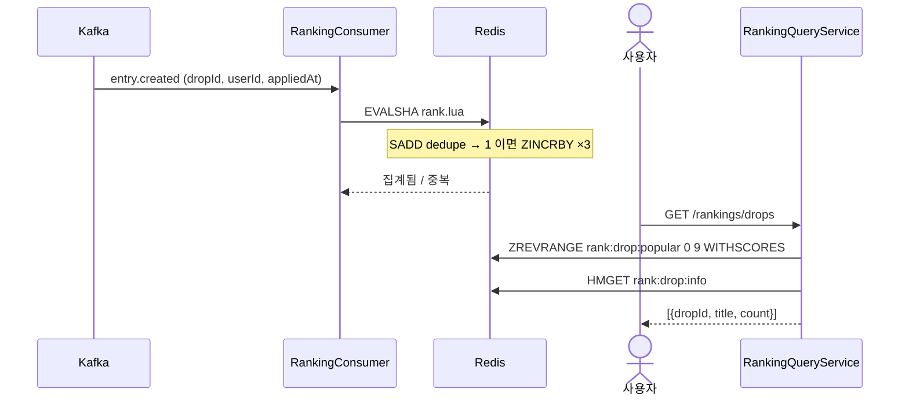

# 랭킹 설계 문서

## 변경 이력
| 버전 | 날짜 | 변경 내용 | 관련 요구사항 |
|------|------|-----------|----------------|
| v1.0 | 2026-11-16 | 최초 작성 | REQ-RANK-01 ~ 03 |
| v1.1 | 2026-11-16 | `rank:drop:closeAt` 키, dedupe Set TTL 정책, Lua KEYS·주간 키 TTL 설정 위치, 리스너 실패 정책 명시 | phase-7 구현 상세 6장 |

## 1. 요구사항 요약 (근거)
- REQ-RANK-01: 인기 드로우 랭킹 (응모 수 기준 실시간)
- REQ-RANK-02: 유저 활동 랭킹 (응모 1회 = 1점, 주간 리셋 + 전체 누적)
- REQ-RANK-03: 응모 이벤트 비동기 소비

## 2. 쉬운 설명 (한눈에)
> 응모가 하나 들어올 때마다 랭킹 담당자가 편지를 받아 점수판 3개(인기 드로우, 이번 주 유저, 전체 유저)에 1점씩 더해요.
> 같은 편지가 두 번 와도 "이미 셌음" 목록을 보고 한 번만 세요.

## 3. 상세 설명

### 집계 (entry.created 소비)
```
if SADD rank:dedupe:{dropId} userId == 1:     # 처음 보는 응모만
    ZINCRBY rank:drop:popular 1 dropId
    ZINCRBY rank:user:weekly:{week} 1 userId   # week = appliedAt 기준 ISO 주차 (Asia/Seoul)
    ZINCRBY rank:user:all 1 userId
```
- 위 명령은 **`rank.lua` 하나로 원자 실행** (dedupe 와 증가 사이 장애 시 누락 방지)
  - KEYS: `rank:dedupe:{dropId}`, `rank:drop:popular`, `rank:user:weekly:{week}`, `rank:user:all`, `rank:drop:closeAt`
  - 같은 스크립트 안에서 주간 키 TTL(35일)과 dedupe Set TTL 을 설정한다
- **dedupe Set TTL**: `closeAt + 7일` (최소 1일 보장). closeAt 을 아직 모르면(`drop.created` 미수신) 30일
- 주차 기준은 처리 시각이 아니라 **이벤트의 `appliedAt`** → 컨슈머 지연이 있어도 올바른 주에 집계
- 주간 키 TTL: 35일 (지난 주 랭킹 조회 가능하게 일부 보관)
- dedupe 기준 `(dropId, userId)` 는 요구사항(1인 1드로우 1응모)과 정확히 일치하므로 별도 eventId 가 필요 없다

### 표시 정보
- `drop.created` 소비 → `HSET rank:drop:info dropId title`, `HSET rank:drop:closeAt dropId closeAtEpochMs`
  - closeAt 은 "진행 중 드로우만" 필터(기본안 — 7단계에서 확정)와 dedupe TTL 계산에 쓴다
- `user.registered` 소비 → `HSET rank:user:info userId nickname`
- 조회 시 ZSet 상위 N + Hash 로 이름 조인 (닉네임이 없으면 `user-{id}` 로 표시)

### 리스너 실패 처리
- 3회 재시도 후 로그를 남기고 건너뛴다 (DLT 없음). 랭킹은 응모의 진실의 원천이 아니며, 누락은 Kafka 오프셋 리셋 재집계로 복구한다.

### API (`/users/me` 를 제외하고 공개 — 인증 제외 경로는 [architecture.md](../02-architecture/architecture.md) 6장)
| Method | Path | 설명 |
|--------|------|------|
| GET | `/api/rankings/drops?size=10` | 인기 드로우 Top N |
| GET | `/api/rankings/users/weekly?week=2026-W47&size=10` | 주간 유저 랭킹 (week 생략 시 이번 주) |
| GET | `/api/rankings/users/all?size=10` | 누적 유저 랭킹 |
| GET | `/api/rankings/users/me` | 내 순위·점수 (USER) |

## 4. 설계 결정
| 결정점 | 선택 | 이유 / 포기한 것 |
|--------|------|------------------|
| 저장소 | Redis ZSet 만 사용 (DB 없음) | 순위 계산 O(log N) / Redis 유실 시 재집계 필요 |
| 주간 리셋 | 주차별 키 분리 + TTL | 리셋 배치 불필요, 지난 주 조회 가능 / 키 여러 개 |
| 멱등성 | (dropId, userId) dedupe Set | 요구사항 제약과 일치 / dedupe Set 메모리 사용 |
| 인기 드로우 범위 | 전체 드로우 누적 | 단순 / 종료된 드로우도 상위 노출 → 아래 리스크 |

## 5. 다이어그램

### 5.1 시퀀스 다이어그램


**읽는 법**
- ranking 은 **쓰기 경로(컨슈머)와 읽기 경로(조회)가 완전히 분리**되어 있고 다른 서비스를 호출하지 않는다.
- 랭킹이 응모보다 늦게 반영되는 건 정상이다 (컨슈머 지연 = 랭킹 지연).

## 6. 잠재 리스크
- **Redis 유실 시 랭킹 소실**: 진실의 원천이 Redis 뿐. 선택지: (a) Kafka 보존 기간 내 오프셋 리셋으로 재집계, (b) entry_db 기반 재집계 배치. 1차는 (a) — `entry.created` 보존 기간을 충분히(예: 30일) 설정.
- **종료 드로우가 인기 랭킹 상위 고착**: 선택지: (a) 조회 시 OPEN 드로우만 필터 (`drop.created` 의 closeAt 활용), (b) 최근 24시간 슬라이딩 윈도우 키. 요구사항이 "실시간"이므로 **(a) 를 1차로 권장**, 정책은 확인 필요.
- **dedupe Set 메모리**: 드로우당 응모자 수만큼 저장. 추첨 완료 후 TTL 부여로 정리 가능.
- **동점 처리**: ZSet 은 동점 시 member 사전순. "먼저 달성한 사람 우선" 같은 정책이 필요하면 score 에 시간 보정값을 섞어야 함 — 정책 확인 필요.
