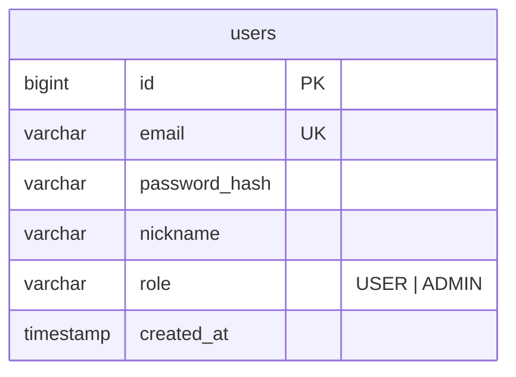
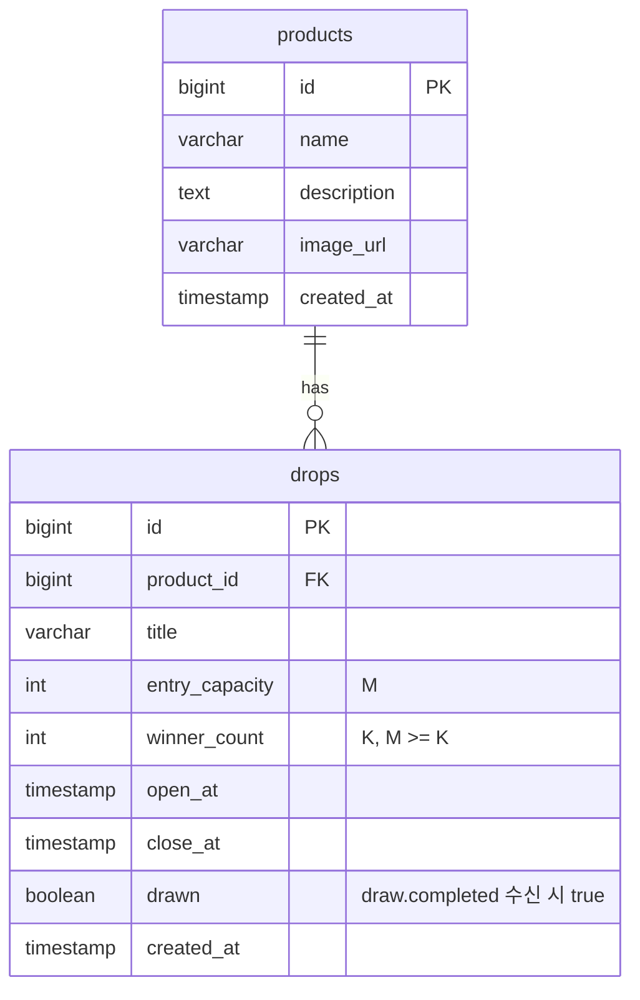
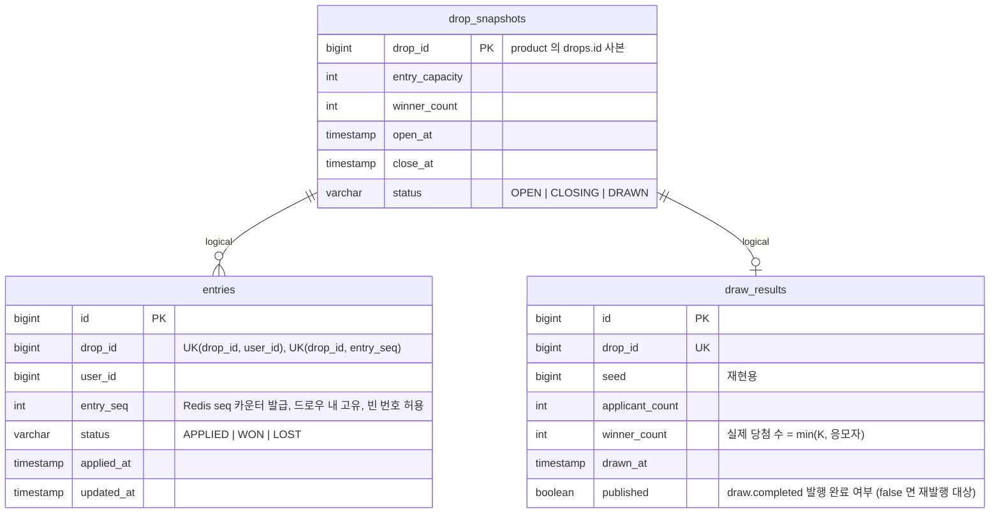
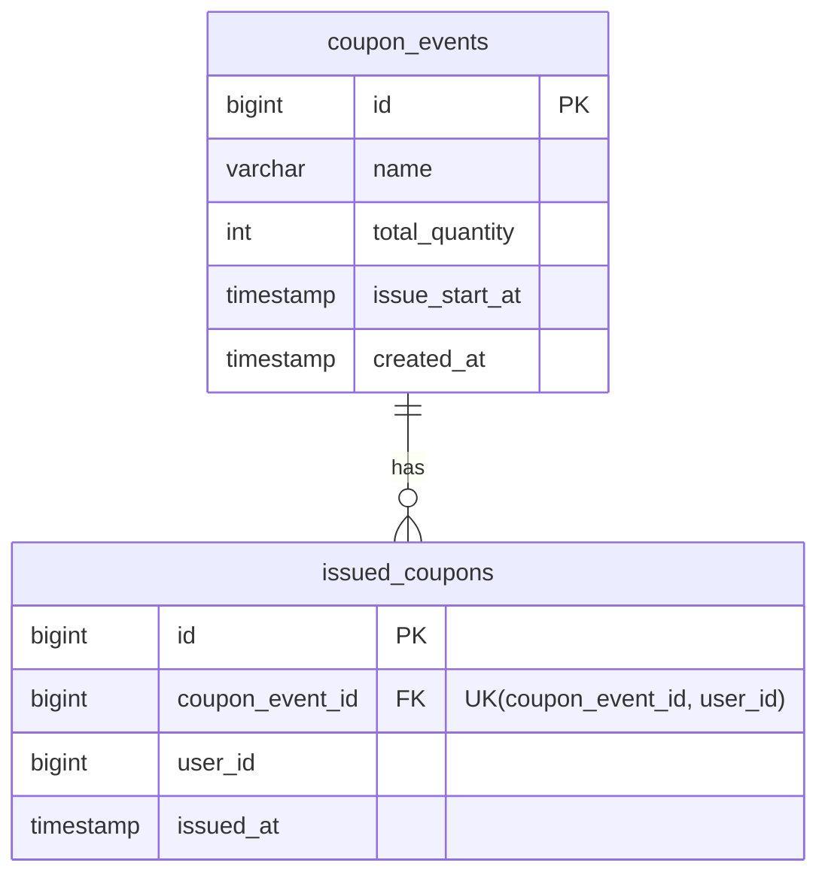

# ERD

## 변경 이력
| 버전 | 날짜 | 변경 내용 | 관련 요구사항 |
|------|------|-----------|----------------|
| v1.0 | 2026-11-16 | 최초 작성 | 전체 |
| v1.1 | 2026-11-16 | entries.entry_seq 의미 변경 (1..M 연속 → 고유·빈 번호 허용) | NFR-03 |
| v1.2 | 2026-11-16 | `draw_results.published` 추가, 스키마는 Flyway 로 관리하며 CHECK 제약을 둔다는 원칙 추가 | phase-0·2·4·5 구현 상세 6장 |

## 쉬운 설명
> 서비스마다 장부(DB)가 따로 있어요. 장부끼리는 선(외래키)으로 연결하지 않고, 번호(id)만 적어서 서로를 가리켜요.
> 다른 창구의 장부 내용이 필요하면 편지(이벤트)로 받은 사본을 자기 장부에 따로 적어둬요 (`drop_snapshots`).

## 원칙
- **Database per Service**: user_db / product_db / entry_db / coupon_db. queue·ranking 은 Redis 만 사용.
- **서비스 간 FK 없음**: `entries.user_id`, `entries.drop_id` 등은 논리 참조. 존재 보장은 발행 측 책임.
- **중복 방지 최종 방어선은 DB UNIQUE**: Redis 판정이 1차, 유니크 제약이 2차 (컨슈머 멱등성). 컨슈머 저장은 `INSERT ... ON CONFLICT DO NOTHING` 으로 한다.
- **스키마는 Flyway 마이그레이션으로 관리**하고 `ddl-auto: validate` 로 엔티티와 일치만 검사한다. 값 범위(예: `entry_capacity >= winner_count >= 1`)는 DB `CHECK` 제약으로도 막는다.

---

## user_db

## product_db

**읽는 법**: 드로우 상태(SCHEDULED/OPEN/CLOSED)는 시각으로 계산하므로 컬럼이 없고, 시각으로 알 수 없는 "추첨 완료"만 `drawn` 으로 저장한다. 한 상품에 여러 드로우(재입고 드로우 등)가 가능하도록 1:N.

## entry_db

**읽는 법**
- `drop_snapshots` 는 product 의 **읽기 전용 사본**이다. entry 는 이 테이블로 마감 시각·K 를 알고, `status` 는 추첨 진행 상태(entry 만의 관심사)를 담는다.
- `entries` 의 두 유니크 제약이 각각 "1인 1응모"와 "순번 중복 없음"을 DB 차원에서 보장한다.
- `draw_results.drop_id` UK 가 "드로우당 추첨 1회"를 보장한다.
- 인덱스: `entries(user_id, applied_at DESC)` — 내 응모 목록 조회용.

## coupon_db

**읽는 법**: 같은 서비스 안이므로 `issued_coupons → coupon_events` 는 실제 FK. `user_id` 는 다른 서비스 소속이라 논리 참조.
