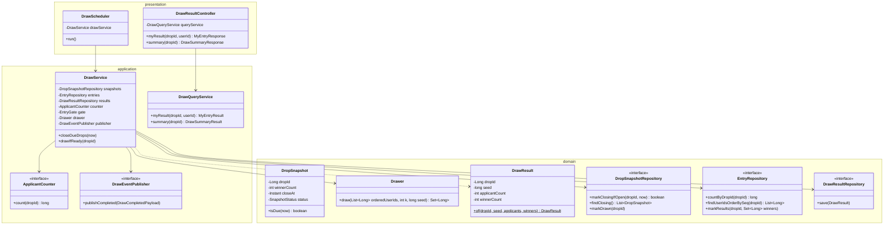
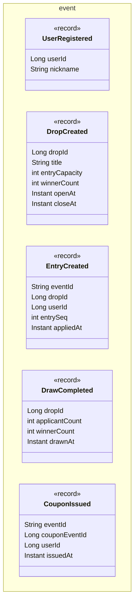

# 클래스 다이어그램 (4계층)

## 변경 이력
| 버전 | 날짜 | 변경 내용 | 관련 요구사항 |
|------|------|-----------|----------------|
| v1.0 | 2026-11-16 | 최초 작성 | 전체 |
| v2.0 | 2026-11-16 | 4계층 + 엄격한 DIP + 모델 비노출 원칙으로 전면 재작성 (도메인/JPA 엔티티 분리, 포트 위치 확정) | [layered-architecture.md](../02-architecture/layered-architecture.md) |

## 쉬운 설명
> 각 서비스는 창구(presentation) → 매니저(application) → 장인(domain) 순서로 일을 넘기고,
> 창고·택배(infrastructure)는 domain·application 이 정한 약속(인터페이스)을 구현해요.
> 그림에서 `<<interface>>` 와 점선 화살표(`..|>`)가 그 약속과 구현 관계예요.

## 공통 표기
- `namespace` = 계층 (presentation / application / domain / infrastructure)
- `-->` 사용(의존), `..|>` 구현, `..>` 생성·변환
- 규칙 전체는 [layered-architecture.md](../02-architecture/layered-architecture.md) 참고

---

## 1. entry-service (상세)

응모·추첨이 가장 복잡하므로 4계층 전체를 상세하게 그린다. 다른 서비스는 같은 패턴을 따른다.

### 1.1 응모 (Apply)

```mermaid
classDiagram
    namespace presentation {
        class EntryController {
            -EntryApplyService applyService
            +apply(dropId, userId) EntryApplyResponse
        }
        class EntryApplyResponse {
            <<record>>
            int entrySeq
            +from(EntryApplyResult)
        }
        class EntryCreatedListener {
            -EntrySaveService saveService
            +on(EntryCreated message)
        }
    }
    namespace application {
        class EntryApplyService {
            -EntryGate gate
            -EntryEventPublisher publisher
            +apply(EntryApplyCommand) EntryApplyResult
        }
        class EntrySaveService {
            -EntryRepository entryRepository
            -EntryGate gate
            +save(EntrySaveCommand)
        }
        class EntryApplyCommand {
            <<record>>
            Long dropId
            Long userId
        }
        class EntrySaveCommand {
            <<record>>
            Long dropId
            Long userId
            int entrySeq
            Instant appliedAt
        }
        class EntryApplyResult {
            <<record>>
            int entrySeq
        }
        class EntryGate {
            <<interface>>
            +tryApply(dropId, userId, now) GateResult
            +compensate(dropId, userId)
            +isApplicant(dropId, userId) boolean
        }
        class EntryEventPublisher {
            <<interface>>
            +publishCreated(EntryCreatedPayload)
        }
    }
    namespace domain {
        class Entry {
            -Long id
            -Long dropId
            -Long userId
            -int entrySeq
            -EntryStatus status
            -Instant appliedAt
            +apply(dropId, userId, seq, at)$ Entry
        }
        class ApplyOutcome {
            <<enum>>
            OK
            CLOSED
            NO_TOKEN
            DUPLICATE
            SOLD_OUT
        }
        class EntryRepository {
            <<interface>>
            +save(Entry) Entry
            +existsByDropIdAndUserId(dropId, userId) boolean
        }
    }
    namespace infrastructure {
        class RedisEntryGate {
            -apply.lua
            -compensate.lua
        }
        class KafkaEntryEventPublisher {
            -KafkaTemplate template
        }
        class EntryRepositoryImpl {
            -EntryJpaRepository jpa
            -EntryMapper mapper
        }
        class EntryJpaEntity {
            <<Entity>>
        }
        class EntryMapper {
            +toDomain(EntryJpaEntity) Entry
            +toEntity(Entry) EntryJpaEntity
        }
    }

    EntryController --> EntryApplyService
    EntryController ..> EntryApplyResponse
    EntryCreatedListener --> EntrySaveService
    EntryApplyService --> EntryGate
    EntryApplyService --> EntryEventPublisher
    EntryApplyService ..> EntryApplyResult
    EntrySaveService --> EntryRepository
    EntrySaveService --> EntryGate
    EntrySaveService ..> Entry
    EntryGate ..> ApplyOutcome
    RedisEntryGate ..|> EntryGate
    KafkaEntryEventPublisher ..|> EntryEventPublisher
    EntryRepositoryImpl ..|> EntryRepository
    EntryRepositoryImpl --> EntryMapper
    EntryMapper ..> EntryJpaEntity
```

**읽는 법**
- `EntryController` 는 `EntryApplyService` 와 Command/Result 만 안다. **domain 네임스페이스로 가는 화살표가 presentation 에 하나도 없다** (모델 비노출, ArchUnit R4).
- `EntryApplyService`(응답 경로)는 domain 의 `EntryRepository` 를 쓰지 않는다 — 응답 경로에서 DB 를 뺀 설계([D1](../04-non-functional/concurrency-consistency.md))가 의존 그래프에 그대로 드러난다.
- `EntrySaveService` 는 저장 전에 `EntryGate.isApplicant()` 로 보상된 응모를 걸러낸다 ([sequence-diagram.md](../08-sequence-diagram/sequence-diagram.md) 5.2).
- infrastructure 의 네 클래스는 모두 **위쪽 인터페이스를 구현**하는 방향으로만 연결된다.

### 1.2 추첨 (Draw)

**읽는 법**
- `Drawer` 는 domain 의 **순수 도메인 서비스**다 (입력 목록 + K + 시드 → 당첨자). 저장소·Spring 의존이 없어 공정성·재현성을 단위 테스트로 바로 검증한다.
- 상태 전이 `OPEN → CLOSING` 은 동시성 제어(조건부 UPDATE) 때문에 `markClosingIfOpen()` 이라는 **원자적 저장소 연산**으로 표현한다. 도메인 모델을 읽어 바꾸고 save 하는 방식으로는 다중 인스턴스 중복 추첨을 막을 수 없기 때문이다.
- 당첨/낙첨 반영도 엔티티 루프 대신 `markResults()` 벌크 연산 — JPA 엔티티 분리로 변경 감지를 쓰지 않기 때문 ([layered-architecture.md](../02-architecture/layered-architecture.md) 7장).
- infrastructure 구현체(`DropSnapshotRepositoryImpl`, `RedisApplicantCounter`, `KafkaDrawEventPublisher` 등)는 1.1 과 같은 패턴이라 생략.

### 1.3 드로우 정보 수신
| 계층 | 클래스 |
|------|--------|
| presentation | `DropCreatedListener` → `DropSnapshotRegisterCommand` 생성 |
| application | `DropSnapshotRegisterService` (DB 저장 + `EntryGate.initialize()` 로 Redis 정원 초기화) |
| domain | `DropSnapshot`, `DropSnapshotRepository` |
| infrastructure | `DropSnapshotJpaEntity`, `DropSnapshotRepositoryImpl`, `RedisEntryGate.initialize()` (`SET NX`) |

---

## 2. 나머지 서비스 (계층별 클래스)

같은 패턴이므로 표로 정리한다. `(I)` = interface, `→` = 구현 대상.

### 2.1 user-service
| 계층 | 클래스 |
|------|--------|
| presentation | `UserController`, `SignupRequest`, `LoginRequest`, `LoginResponse`, `UserResponse` |
| application | `UserService` (`signup(SignupCommand)`, `login(LoginCommand) → LoginResult`), 포트 `PasswordEncoder`(I), `TokenIssuer`(I), `UserEventPublisher`(I) |
| domain | `User`(email, passwordHash, nickname, role), `Role`(enum), `Email`(값 객체: 형식 검증), `UserRepository`(I) |
| infrastructure | `UserJpaEntity`, `UserRepositoryImpl`, `UserMapper`, `BCryptPasswordEncoderAdapter` → PasswordEncoder, `JwtTokenIssuer` → TokenIssuer, `KafkaUserEventPublisher` |

> `PasswordEncoder` 를 application 포트로 둔 이유: Spring Security 의 `PasswordEncoder` 를 domain/application 이 직접 쓰면 기술 의존이 생긴다.

### 2.2 product-service
| 계층 | 클래스 |
|------|--------|
| presentation | `ProductController`, `DropController`, `DrawCompletedListener`, `*Request`, `*Response` |
| application | `ProductService`, `DropService` (`register(DropRegisterCommand) → DropResult`, `republish(dropId)`), `DropQueryService`, 포트 `DropEventPublisher`(I) |
| domain | `Product`, `Drop`(+`status(now)`, `markDrawn()`, 생성 시 M≥K·시각 검증), `DropStatus`(enum), `ProductRepository`(I), `DropRepository`(I) |
| infrastructure | `ProductJpaEntity`, `DropJpaEntity`, `*RepositoryImpl`, `*Mapper`, `KafkaDropEventPublisher` |

> `Drop.status(now)` 처럼 **시각을 인자로 받는** 도메인 메서드로 상태를 계산한다 — domain 이 시계(`Clock`)에 의존하지 않고, 시각은 application 이 주입한다.

### 2.3 queue-service (DB 없음)
| 계층 | 클래스 |
|------|--------|
| presentation | `QueueController`, `QueueStatusResponse`, `AdmissionScheduler`, `DropCreatedListener` |
| application | `QueueService` (`enter(QueueEnterCommand) → QueueStatusResult`, `status(...)`), `AdmissionService` (`admit(now)`), 포트 `RemainingCapacityReader`(I, entry 소유 키 읽기) |
| domain | `QueueState`(enum: WAITING/ADMITTED/SOLD_OUT/NOT_IN_QUEUE), `QueueMeta`(openAt, closeAt, `isOpen(now)`), `WaitingQueueRepository`(I: enqueue, rank, hasToken, admit) |
| infrastructure | `RedisWaitingQueueRepository` → WaitingQueueRepository (admit 은 Lua), `RedisRemainingCapacityReader` → RemainingCapacityReader |

> 대기열은 도메인 개념(줄, 순번, 입장)이므로 저장소가 Redis 여도 포트를 **domain** 에 둔다. 반면 entry 의 잔여 정원 읽기는 다른 서비스 데이터 참조라 **application 포트**로 둔다.

### 2.4 coupon-service
| 계층 | 클래스 |
|------|--------|
| presentation | `CouponEventController`, `CouponController`, `CouponIssuedListener`, `*Request`, `*Response` |
| application | `CouponEventService`, `CouponIssueService` (`issue(CouponIssueCommand) → CouponIssueResult`), `CouponSaveService`, `CouponQueryService`, 포트 `CouponGate`(I), `CouponEventPublisher`(I) |
| domain | `CouponEvent`, `IssuedCoupon`, `IssueOutcome`(enum), `CouponEventRepository`(I), `IssuedCouponRepository`(I) |
| infrastructure | `*JpaEntity`, `*RepositoryImpl`, `*Mapper`, `RedisCouponGate` → CouponGate, `KafkaCouponEventPublisher` |

### 2.5 ranking-service (DB 없음)
| 계층 | 클래스 |
|------|--------|
| presentation | `RankingController`, `RankingResponse`, `EntryCreatedListener`, `DropCreatedListener`, `UserRegisteredListener` |
| application | `RankingAggregateService` (`record(RankingRecordCommand)`), `RankingQueryService` (`topDrops(n) → List<DropRankResult>` 등) |
| domain | `WeekKey`(값 객체: `of(Instant)` ISO 주차, Asia/Seoul), `RankingBoard`(enum: DROP_POPULAR / USER_WEEKLY / USER_ALL), `RankingRepository`(I: incrementOnce, top, rankOf), `DisplayNameRepository`(I) |
| infrastructure | `RedisRankingRepository` (dedupe + ZINCRBY Lua), `RedisDisplayNameRepository` |

### 2.6 gateway
계층 구조를 적용하지 않는다 — 도메인이 없는 라우팅·인증 필터만 존재 (`JwtAuthenticationFilter`, `HeaderSanitizeFilter`, `JwtVerifier`).

---

## 3. common 모듈

**읽는 법**
- `common` 은 **서비스 간 메시지 계약**만 담는다. 도메인 모델을 공유하지 않는다 (서비스마다 같은 이름의 개념이라도 각자 모델을 갖는다).
- 이 메시지를 직접 다루는 곳은 **presentation(Listener)** 과 **infrastructure(Publisher)** 뿐이다. application 은 자기 Payload DTO 로 포트를 호출한다.
- ArchUnit 공통 규칙은 `common` 의 test fixtures 에 둔다.
