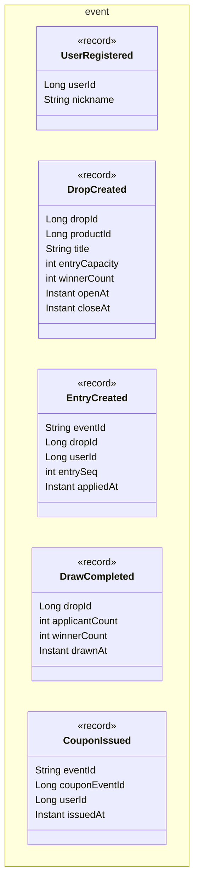

# 클래스 다이어그램 (4계층)

## 변경 이력
| 버전 | 날짜 | 변경 내용 | 관련 요구사항 |
|------|------|-----------|----------------|
| v1.0 | 2026-11-16 | 최초 작성 | 전체 |
| v2.0 | 2026-11-16 | 4계층 + 엄격한 DIP + 모델 비노출 원칙으로 전면 재작성 (도메인/JPA 엔티티 분리, 포트 위치 확정) | [layered-architecture.md](../02-architecture/layered-architecture.md) |
| v2.1 | 2026-11-16 | 단계별 구현 상세에서 구체화된 클래스·포트·메서드 반영 (EntryRepository.saveIfAbsent, DrawTransaction·SeedGenerator·DrawOutcome, DropPage·Requester, queue 포트, CouponGate, DropWindow, user·gateway 클래스), DropCreated.productId 추가, 발행 어댑터 afterCommit 구조 | phase-0~7 구현 상세 6장 |
| v2.2 | 2026-11-16 | 1.1 실패 응답을 `ApplicationException(EntryErrorCode)` + `GlobalExceptionHandler` 로, 1.3 잘못된 `drop.created` 는 application 이 로그 후 스킵(`InvalidDropSnapshotException` 제거) | phase-4 구현 상세 v1.2 |
| v2.3 | 2026-11-17 | 1.1 `EntryGate` 시그니처 변경 — `tryApply(..., eventId)`, `compensate(dropId, userId, eventId) CompensationResult`, `claimForSave(dropId, userId, eventId) boolean` 추가, `GateUnavailableException`·`CompensationResult` 추가, `EntrySaveCommand.eventId` 추가, `RedisEntryGate` 에 claim.lua (사용자 결정, E-40·E-41) | concurrency-consistency.md D2 v1.3 |

## 쉬운 설명
> 각 서비스는 창구(presentation) → 매니저(application) → 장인(domain) 순서로 일을 넘기고,
> 창고·택배(infrastructure)는 domain·application 이 정한 약속(인터페이스)을 구현해요.
> 그림에서 `<<interface>>` 와 점선 화살표(`..|>`)가 그 약속과 구현 관계예요.

## 공통 표기
- `namespace` = 계층 (presentation / application / domain / infrastructure)
- `-->` 사용(의존), `..|>` 구현, `..>` 생성·변환
- 규칙 전체는 [layered-architecture.md](../02-architecture/layered-architecture.md) 참고

---

## 1. entry-service (상세)

응모·추첨이 가장 복잡하므로 4계층 전체를 상세하게 그린다. 다른 서비스는 같은 패턴을 따른다.

### 1.1 응모 (Apply)

```mermaid
classDiagram
    namespace presentation {
        class EntryController {
            -EntryApplyService applyService
            +apply(dropId, userId) EntryApplyResponse
        }
        class EntryApplyResponse {
            <<record>>
            int entrySeq
            +from(EntryApplyResult)
        }
        class EntryCreatedListener {
            -EntrySaveService saveService
            +on(EntryCreated message)
        }
    }
    namespace application {
        class EntryApplyService {
            -EntryGate gate
            -EntryEventPublisher publisher
            +apply(EntryApplyCommand) EntryApplyResult
        }
        class EntrySaveService {
            -EntryRepository entryRepository
            -EntryGate gate
            +save(EntrySaveCommand) boolean
        }
        class EntryApplyCommand {
            <<record>>
            Long dropId
            Long userId
        }
        class EntrySaveCommand {
            <<record>>
            String eventId
            Long dropId
            Long userId
            int entrySeq
            Instant appliedAt
        }
        class EntryApplyResult {
            <<record>>
            int entrySeq
        }
        class EntryGate {
            <<interface>>
            +tryApply(dropId, userId, eventId, now) GateResult
            +compensate(dropId, userId, eventId) CompensationResult
            +claimForSave(dropId, userId, eventId) boolean
            +isApplicant(dropId, userId) boolean
            +initialize(dropId, capacity, openAt, closeAt)
            +close(dropId)
        }
        class EntryEventPublisher {
            <<interface>>
            +publishCreated(EntryCreatedPayload)
        }
        class CompensationResult {
            <<enum>>
            COMPENSATED
            ALREADY_PERSISTED
            NOT_OURS
        }
        class GateUnavailableException {
            <<exception>>
            Redis 장애·타임아웃
        }
    }
    namespace domain {
        class Entry {
            -Long id
            -Long dropId
            -Long userId
            -int entrySeq
            -EntryStatus status
            -Instant appliedAt
            +apply(dropId, userId, seq, at)$ Entry
        }
        class ApplyOutcome {
            <<enum>>
            OK
            CLOSED
            NO_TOKEN
            DUPLICATE
            SOLD_OUT
        }
        class EntryRepository {
            <<interface>>
            +saveIfAbsent(Entry) boolean
            +findByDropIdAndUserId(dropId, userId) Optional~Entry~
            +findAllByUserId(userId) List~Entry~
        }
    }
    namespace infrastructure {
        class RedisEntryGate {
            -apply.lua
            -compensate.lua
            -claim.lua
        }
        class KafkaEntryEventPublisher {
            -KafkaTemplate template
        }
        class EntryRepositoryImpl {
            -EntryJpaRepository jpa
            -EntryMapper mapper
            +saveIfAbsent() INSERT ON CONFLICT DO NOTHING
        }
        class EntryJpaEntity {
            <<Entity>>
        }
        class EntryMapper {
            +toDomain(EntryJpaEntity) Entry
            +toEntity(Entry) EntryJpaEntity
        }
    }

    EntryController --> EntryApplyService
    EntryController ..> EntryApplyResponse
    EntryCreatedListener --> EntrySaveService
    EntryApplyService --> EntryGate
    EntryApplyService --> EntryEventPublisher
    EntryApplyService ..> EntryApplyResult
    EntrySaveService --> EntryRepository
    EntrySaveService --> EntryGate
    EntrySaveService ..> Entry
    EntryGate ..> ApplyOutcome
    EntryGate ..> CompensationResult
    EntryGate ..> GateUnavailableException
    RedisEntryGate ..|> EntryGate
    KafkaEntryEventPublisher ..|> EntryEventPublisher
    EntryRepositoryImpl ..|> EntryRepository
    EntryRepositoryImpl --> EntryMapper
    EntryMapper ..> EntryJpaEntity
```

**읽는 법**
- `EntryController` 는 `EntryApplyService` 와 Command/Result 만 안다. **domain 네임스페이스로 가는 화살표가 presentation 에 하나도 없다** (모델 비노출, ArchUnit R4).
- `EntryApplyService`(응답 경로)는 domain 의 `EntryRepository` 를 쓰지 않는다 — 응답 경로에서 DB 를 뺀 설계([D1](../04-non-functional/concurrency-consistency.md))가 의존 그래프에 그대로 드러난다.
- `EntryApplyService` 는 판정 **전에** eventId(UUID)를 만들어 `tryApply` 에 넘기고 같은 값을 이벤트에 싣는다. 발행 실패 시 `compensate()` 결과가 `ALREADY_PERSISTED` 면 202 성공, 그 외는 503. `tryApply` 가 `GateUnavailableException` 을 던지면 같은 eventId 로 보상을 시도한 뒤 503. `RedisEntryGate` 가 Redis 예외(`DataAccessException` 계열)를 이 포트 예외로 감싼다 (application 은 Spring Data 예외를 모름).
- `EntrySaveService` 는 저장 전에 `EntryGate.claimForSave()` 로 저장을 확정하고(false 면 유령 이벤트로 스킵), `saveIfAbsent()` 로 멱등 저장한다. `isApplicant()` 는 단건 조회의 저장 대기 보완(`EntryQueryService`)에만 쓴다 ([sequence-diagram.md](../08-sequence-diagram/sequence-diagram.md) 5.2). `EntrySaveService` 에는 `@Transactional` 을 두지 않는다 — 단일 `INSERT ... ON CONFLICT DO NOTHING` 이라 필요 없고, 예외 기반 중복 처리를 피한다.
- 실패 응답은 `ApplicationException(EntryErrorCode.*)` 로 나가고, presentation 의 공통 `GlobalExceptionHandler` 가 `ErrorCode.status()`(409/503/404)로 매핑한다. `KafkaEntryEventPublisher` 는 `send().get(3.5s)` 실패를 포트 예외로 바꿔 던진다 (재시도는 producer 내부만).
- infrastructure 의 네 클래스는 모두 **위쪽 인터페이스를 구현**하는 방향으로만 연결된다.

### 1.2 추첨 (Draw)

```mermaid
classDiagram
    namespace presentation {
        class DrawScheduler {
            -DrawService drawService
            +run()
        }
        class DrawResultController {
            -DrawQueryService queryService
            +summary(dropId) DrawSummaryResponse
        }
    }
    namespace application {
        class DrawService {
            -DropSnapshotRepository snapshots
            -EntryRepository entries
            -ApplicantCounter counter
            -EntryGate gate
            -DrawTransaction drawTransaction
            -DrawEventPublisher publisher
            +closeDueDrops(now)
            +drawReadyDrops(now)
            +republishUnpublished()
        }
        class DrawTransaction {
            -SeedGenerator seedGenerator
            -Drawer drawer
            +execute(dropId, now) DrawOutcome
        }
        class DrawOutcome {
            <<record>>
            boolean drawn
            DrawCompletedPayload payload
        }
        class DrawQueryService {
            +summary(dropId) DrawSummaryResult
        }
        class SeedGenerator {
            <<interface>>
            +next() long
        }
        class ApplicantCounter {
            <<interface>>
            +count(dropId) long
        }
        class DrawEventPublisher {
            <<interface>>
            +publishCompleted(DrawCompletedPayload)
        }
    }
    namespace domain {
        class DropSnapshot {
            -Long dropId
            -int winnerCount
            -Instant closeAt
            -SnapshotStatus status
            +isDue(now) boolean
        }
        class Drawer {
            +draw(List~Long~ orderedUserIds, int k, long seed) Set~Long~
        }
        class DrawResult {
            -Long dropId
            -long seed
            -int applicantCount
            -int winnerCount
            +of(dropId, seed, applicants, winners)$ DrawResult
        }
        class DropSnapshotRepository {
            <<interface>>
            +findDueOpenIds(now) List~Long~
            +markClosingIfOpen(dropId, now) boolean
            +findClosing() List~DropSnapshot~
            +markDrawnIfClosing(dropId) boolean
        }
        class EntryRepository {
            <<interface>>
            +countByDropId(dropId) long
            +findUserIdsOrderBySeq(dropId) List~Long~
            +markResults(dropId, Set~Long~ winners)
        }
        class DrawResultRepository {
            <<interface>>
            +save(DrawResult) DrawResult
            +findByDropId(dropId) Optional~DrawResult~
            +findUnpublished() List~DrawResult~
            +markPublished(dropId)
        }
    }

    DrawScheduler --> DrawService
    DrawResultController --> DrawQueryService
    DrawService --> DropSnapshotRepository
    DrawService --> EntryRepository
    DrawService --> ApplicantCounter
    DrawService --> DrawTransaction
    DrawService --> DrawEventPublisher
    DrawTransaction --> DropSnapshotRepository
    DrawTransaction --> EntryRepository
    DrawTransaction --> DrawResultRepository
    DrawTransaction --> SeedGenerator
    DrawTransaction --> Drawer
    DrawTransaction ..> DrawResult
    DrawTransaction ..> DrawOutcome
```

**읽는 법**
- `Drawer` 는 domain 의 **순수 도메인 서비스**다 (입력 목록 + K + 시드 → 당첨자). 저장소·Spring 의존이 없어 공정성·재현성을 단위 테스트로 바로 검증한다.
- 상태 전이 `OPEN → CLOSING`, `CLOSING → DRAWN` 은 동시성 제어(조건부 UPDATE) 때문에 `markClosingIfOpen()`, `markDrawnIfClosing()` 이라는 **원자적 저장소 연산**으로 표현한다. 도메인 모델을 읽어 바꾸고 save 하는 방식으로는 다중 인스턴스 중복 추첨을 막을 수 없기 때문이다.
- `DrawTransaction` 을 `DrawService` 와 분리한 이유: 같은 클래스 안에서 `@Transactional` 메서드를 호출하면 프록시를 거치지 않아 트랜잭션이 적용되지 않는다. `execute()` 의 첫 문장이 `markDrawnIfClosing()` 이다 ([draw.md](../05-features/draw.md) 3장).
- `SeedGenerator` 는 application 포트다 (구현 `SecureRandomSeedGenerator`, 테스트는 고정 시드).
- 내 결과 조회(`/drops/{dropId}/me`)는 응모 단건 조회와 같은 API 라 `EntryController` 가 맡는다. `DrawResultController` 는 추첨 요약만 담당한다.
- `DrawService.republishUnpublished()` 가 `published=false` 인 결과의 `draw.completed` 를 다시 발행한다.
- 당첨/낙첨 반영도 엔티티 루프 대신 `markResults()` 벌크 연산 — JPA 엔티티 분리로 변경 감지를 쓰지 않기 때문 ([layered-architecture.md](../02-architecture/layered-architecture.md) 7장).
- infrastructure 구현체(`DropSnapshotRepositoryImpl`, `RedisApplicantCounter`, `KafkaDrawEventPublisher` 등)는 1.1 과 같은 패턴이라 생략.

### 1.3 드로우 정보 수신
| 계층 | 클래스 |
|------|--------|
| presentation | `DropCreatedListener` → `DropSnapshotRegisterCommand` 생성 |
| application | `DropSnapshotRegisterService` (DB 저장 + `EntryGate.initialize()` 로 Redis 정원 초기화) |
| domain | `DropSnapshot`, `DropSnapshotRepository` (`saveIfAbsent`, `findById`) |
| infrastructure | `DropSnapshotJpaEntity`, `DropSnapshotRepositoryImpl` (`ON CONFLICT DO NOTHING`), `RedisEntryGate.initialize()` (`entry-initialize.lua`: meta 가 없을 때만 초기화) |

- 수신 데이터가 도메인 불변식을 어기면 application 이 `DomainException` 을 잡아 로그 후 스킵한다 (재시도·DLT 없음, queue 와 같음). DB·Redis 장애만 3회 재시도 후 `drop.created.DLT` 로 간다.

---

## 2. 나머지 서비스 (계층별 클래스)

같은 패턴이므로 표로 정리한다. `(I)` = interface, `→` = 구현 대상.

### 2.1 user-service
| 계층 | 클래스 |
|------|--------|
| presentation | `UserController`, `SignupRequest`, `LoginRequest`, `LoginResponse`, `UserResponse`, `bootstrap/AdminAccountInitializer` (기동 시 `ADMIN_EMAIL`/`ADMIN_PASSWORD` 로 관리자 시드, REQ-USER-04) |
| application | `UserService` (`signup(SignupCommand) → SignupResult`, `login(LoginCommand) → LoginResult`, `createAdminIfAbsent(...)`), `exception/UserErrorCode`, 포트 `PasswordEncoder`(I), `TokenIssuer`(I: `issue(TokenSubject) → IssuedToken`), `UserEventPublisher`(I: `publishRegistered(UserRegisteredPayload)`) |
| domain | `User`(email, passwordHash, nickname, role), `Role`(enum), `Email`(값 객체: 형식 검증), `UserRepository`(I), `exception/DomainException` |
| infrastructure | `UserJpaEntity`, `UserRepositoryImpl`, `UserMapper`, `BCryptPasswordEncoderAdapter` → PasswordEncoder, `JwtTokenIssuer` → TokenIssuer, `KafkaUserEventPublisher` → UserEventPublisher (afterCommit 등록) |

> `PasswordEncoder` 를 application 포트로 둔 이유: Spring Security 의 `PasswordEncoder` 를 domain/application 이 직접 쓰면 기술 의존이 생긴다.

### 2.2 product-service
| 계층 | 클래스 |
|------|--------|
| presentation | `ProductController`, `DropController`, `DrawCompletedListener`(5단계), `*Request`, `*Response` — 헤더를 `Requester` 로 바꿔 전달만 함 |
| application | `ProductService`, `DropService` (`register(Requester, DropRegisterCommand) → DropResult`, `republish(Requester, dropId)`), `DropQueryService` (`→ DropPageResult`), `Requester`(record: userId, role, `isAdmin()`), `exception/ProductErrorCode`, 포트 `DropEventPublisher`(I: `publishCreated(DropCreatedPayload)`) |
| domain | `Product`, `Drop`(+`status(now)`, `markDrawn()`, 생성 시 M≥K·시각·openAt 1분 여유 검증), `DropStatus`(enum), `DropPage`(자체 페이지 타입 — Spring Data `Page` 비의존), `ProductRepository`(I), `DropRepository`(I), `exception/DomainException` |
| infrastructure | `ProductJpaEntity`, `DropJpaEntity`(연관관계 없이 `productId` 만), `*RepositoryImpl`, `*Mapper`, `KafkaDropEventPublisher` → DropEventPublisher (afterCommit 등록, 트랜잭션 없으면 즉시) |

> `Drop.status(now)` 처럼 **시각을 인자로 받는** 도메인 메서드로 상태를 계산한다 — domain 이 시계(`Clock`)에 의존하지 않고, 시각은 application 이 주입한다.
> ADMIN 판단은 application(`Requester.isAdmin()`)이 한다. `DropResult.status` 는 String 으로 내보내 presentation 이 domain enum 을 참조하지 않는다.

### 2.3 queue-service (DB 없음)
| 계층 | 클래스 |
|------|--------|
| presentation | `QueueController`, `QueueStatusResponse`(state, position, `nextPollAfterMs`), `AdmissionScheduler`, `DropCreatedListener` |
| application | `QueueService` (`enter(QueueEnterCommand) → QueueStatusResult`, `status(...)`), `AdmissionService` (`admit(now)`), `QueueMetaRegisterService`, `AdmissionProperties`(record: 배치 크기·주기·토큰 TTL), 포트 `RemainingCapacityReader`(I, entry 소유 키 읽기), `SchedulerGate`(I: `tryPass(name, window)`) |
| domain | `QueueState`(enum: WAITING/ADMITTED/SOLD_OUT/NOT_IN_QUEUE), `QueueMeta`(openAt, closeAt, `isOpen(now)`), `EnqueueResult`(record: admitted, rank), `PollIntervalPolicy`(`nextPollAfterMs(aheadCount)`), `WaitingQueueRepository`(I: `saveMeta`, `findMeta`, `enqueue`, `hasToken`, `rank`, `admit`, `findActiveDropIds`, `removeExpiredDrops`) |
| infrastructure | `RedisWaitingQueueRepository` → WaitingQueueRepository (`enqueue.lua`, `admit.lua`, `queue:active-drops`), `RedisRemainingCapacityReader` → RemainingCapacityReader, `RedisSchedulerGate` → SchedulerGate (`SET NX PX`, 미해제) |

> 대기열은 도메인 개념(줄, 순번, 입장)이므로 저장소가 Redis 여도 포트를 **domain** 에 둔다. 반면 entry 의 잔여 정원 읽기는 다른 서비스 데이터 참조라 **application 포트**로 둔다.

### 2.4 coupon-service
| 계층 | 클래스 |
|------|--------|
| presentation | `CouponEventController`, `CouponController`, `CouponIssuedListener`, `*Request`, `*Response` |
| application | `CouponEventService` (등록, 재초기화), `CouponIssueService` (`issue(CouponIssueCommand) → CouponIssueResult`), `CouponSaveService` (→ `CouponGate.isIssued` 확인 후 저장), `CouponQueryService`, 포트 `CouponGate`(I: `initialize`, `tryIssue`, `compensate`, `isIssued`, `remaining`), `CouponEventPublisher`(I) |
| domain | `CouponEvent`, `IssuedCoupon`, `IssueOutcome`(enum: OK / NOT_FOUND / NOT_STARTED / DUPLICATE / SOLD_OUT), `CouponEventRepository`(I), `IssuedCouponRepository`(I: `saveIfAbsent`) |
| infrastructure | `*JpaEntity`, `*RepositoryImpl` (`ON CONFLICT DO NOTHING`), `*Mapper`, `RedisCouponGate` → CouponGate (`issue.lua`, `compensate.lua`), `KafkaCouponEventPublisher` (`send().get(3.5s)`, 재시도는 producer 내부만) |

### 2.5 ranking-service (DB 없음)
| 계층 | 클래스 |
|------|--------|
| presentation | `RankingController`, `RankingResponse`, `EntryCreatedListener`, `DropCreatedListener`, `UserRegisteredListener` |
| application | `RankingAggregateService` (`recordEntry(RankingRecordCommand)`, `registerDrop(DropInfoCommand)`, `registerUser(...)`), `RankingQueryService` (`topDrops(n) → List<DropRankResult>` 등) |
| domain | `WeekKey`(값 객체: `of(Instant)` ISO 주차, Asia/Seoul), `RankingBoard`(enum: DROP_POPULAR / USER_WEEKLY / USER_ALL), `DropWindow`(record: dropId, closeAt, `isInProgress(now)`), `RankingRepository`(I: incrementOnce, top, rankOf), `DisplayNameRepository`(I), `DropWindowRepository`(I: `save`, `findAll`) |
| infrastructure | `RedisRankingRepository` (`rank.lua`: dedupe + ZINCRBY + TTL), `RedisDisplayNameRepository`, `RedisDropWindowRepository` (`rank:drop:closeAt`) |

### 2.6 gateway
계층 구조를 적용하지 않는다 — 도메인이 없는 라우팅·인증 필터만 존재.

| 클래스 | 책임 |
|--------|------|
| `HeaderSanitizeFilter` | 클라이언트 `X-User-*` 헤더 제거 (가장 먼저 실행) |
| `JwtAuthenticationFilter` | JWT 검증 → `X-User-Id`, `X-User-Role` 주입 / 401 |
| `JwtVerifier` | 서명·만료·발급자 검증 |
| `PublicPathMatcher` | 인증 제외 경로 판정 (Method + Path) |
| `ErrorResponseWriter`, `GatewayErrorCode` | 401 등 응답 바디를 서비스와 같은 `ErrorResponse` 형식으로 작성 |

---

## 3. common 모듈

**읽는 법**
- `common` 은 **서비스 간 계약**만 담는다: `common.event`(메시지 record 5종, 토픽 이름 `Topics`)와 `common.error`(에러 계약: `ErrorCode` interface, `ApplicationException`, `ErrorResponse` — 순수 Java). 도메인 모델을 공유하지 않는다 (서비스마다 같은 이름의 개념이라도 각자 모델을 갖는다).
- application 은 `common.error` 에만 의존할 수 있고 `common.event` 에는 의존하지 않는다 (ArchUnit R3).
- 이 메시지를 직접 다루는 곳은 **presentation(Listener)** 과 **infrastructure(Publisher)** 뿐이다. application 은 자기 Payload DTO 로 포트를 호출한다.
- ArchUnit 공통 규칙은 `common` 의 test fixtures 에 둔다.
