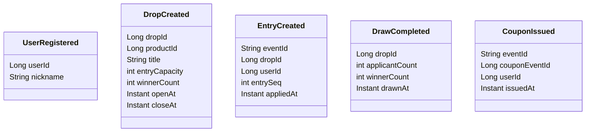
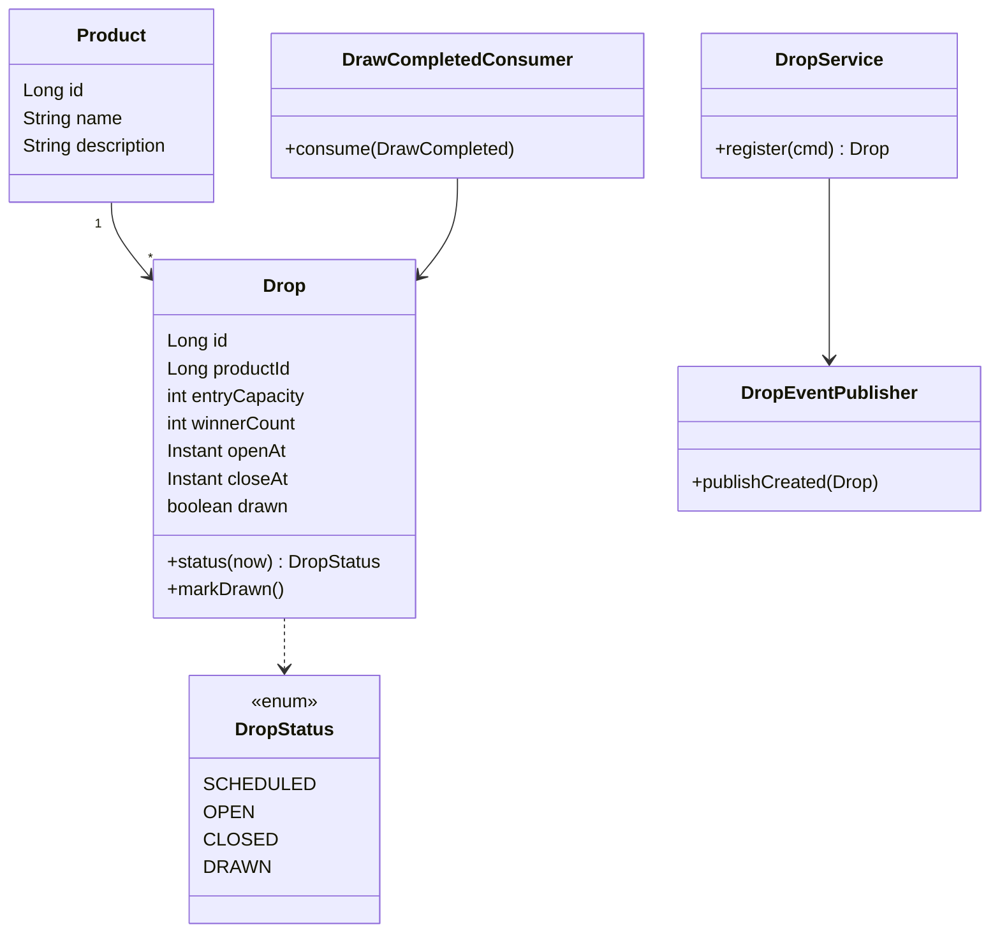
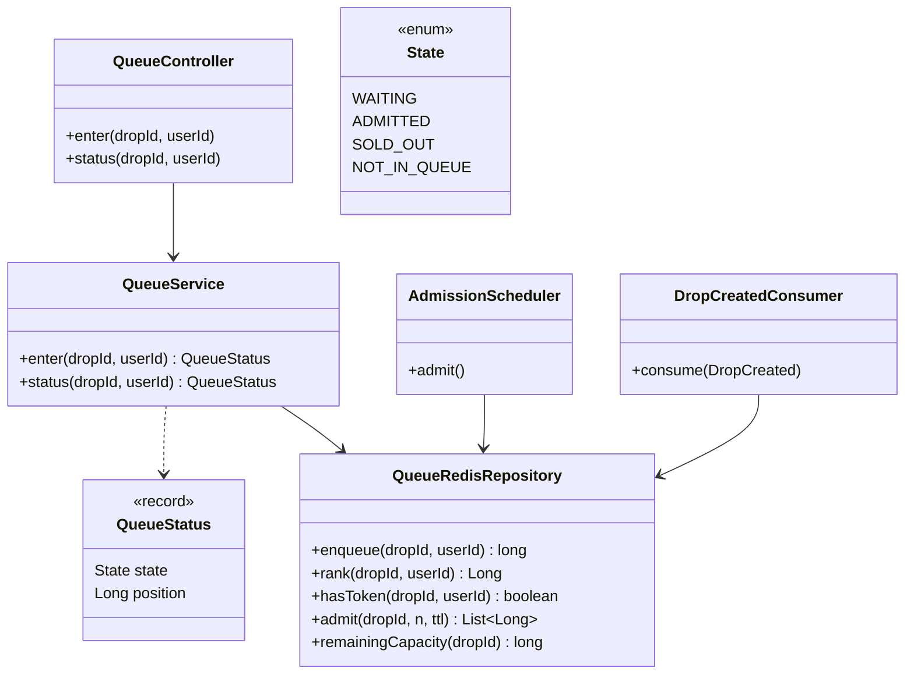
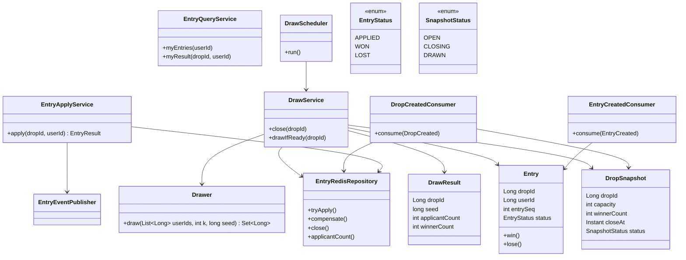
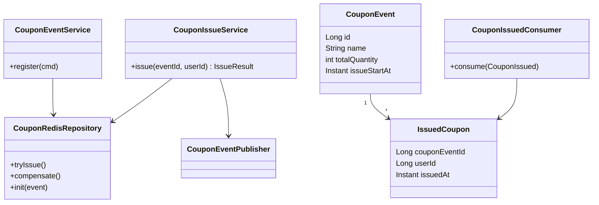
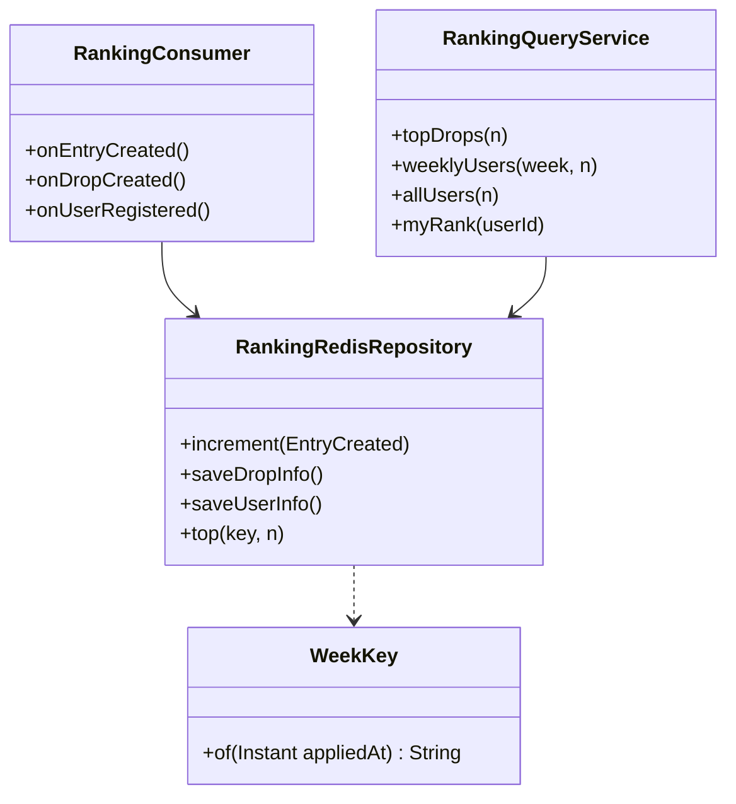

# 클래스 다이어그램 (주요 도메인)

## 변경 이력
| 버전 | 날짜 | 변경 내용 | 관련 요구사항 |
|------|------|-----------|----------------|
| v1.0 | 2026-11-16 | 최초 작성 | 전체 |

## 쉬운 설명
> 서비스마다 "요청을 받는 곳(Controller) → 일을 처리하는 곳(Service) → 저장하는 곳(Repository)" 순서로 이어져요.
> 화살표는 항상 한 방향(바깥 → 안쪽)으로만 가고, 다른 서비스와는 편지(이벤트) 클래스로만 소통해요.

## 공통 원칙
- 의존 방향: Controller → Service → Repository / EventPublisher
- 선착순 판정은 `*RedisRepository`(Lua 실행) 에, 영속 저장은 `*Consumer` → JPA Repository 에 둔다.
- 이벤트 클래스는 `common` 모듈에 두고 모든 서비스가 공유한다.

---

## common — 이벤트 스키마

Java `record` 로 구현한다.

## product-service

**읽는 법**: `Drop.status(now)` 가 시각을 받아 상태를 계산한다 — 상태 전이 로직이 엔티티 안에 응집되고 테스트에서 시각을 주입할 수 있다.

## queue-service

**읽는 법**: `admit()` 은 `ZPOPMIN + SET token` 을 하나의 Lua 로 실행하는 메서드다 ([queue-enter.md](../05-features/queue-enter.md) 리스크 참고).

## entry-service

**읽는 법**
- `Drawer` 는 **순수 함수**(입력 목록 + K + 시드 → 당첨자)로 분리한다. 저장소 의존이 없어 단위 테스트로 공정성·재현성을 바로 검증할 수 있다.
- 응모(`EntryApplyService`)와 추첨(`DrawService`)은 같은 서비스 안에 있지만 서로 의존하지 않는다 — 나중에 draw-service 로 분리할 때 `DrawService` 묶음만 떼어내면 된다.

## coupon-service

## ranking-service

**읽는 법**: `WeekKey` 를 분리해 "주차 경계(일요일 23:59 → 월요일 00:00, Asia/Seoul)" 를 단위 테스트로 검증한다.
