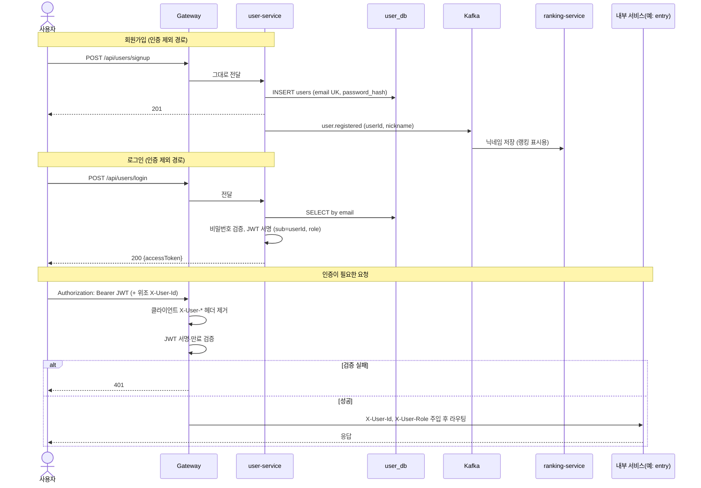
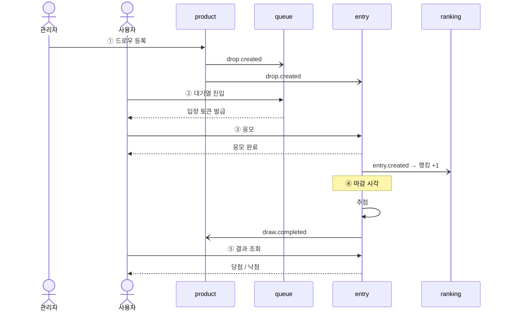
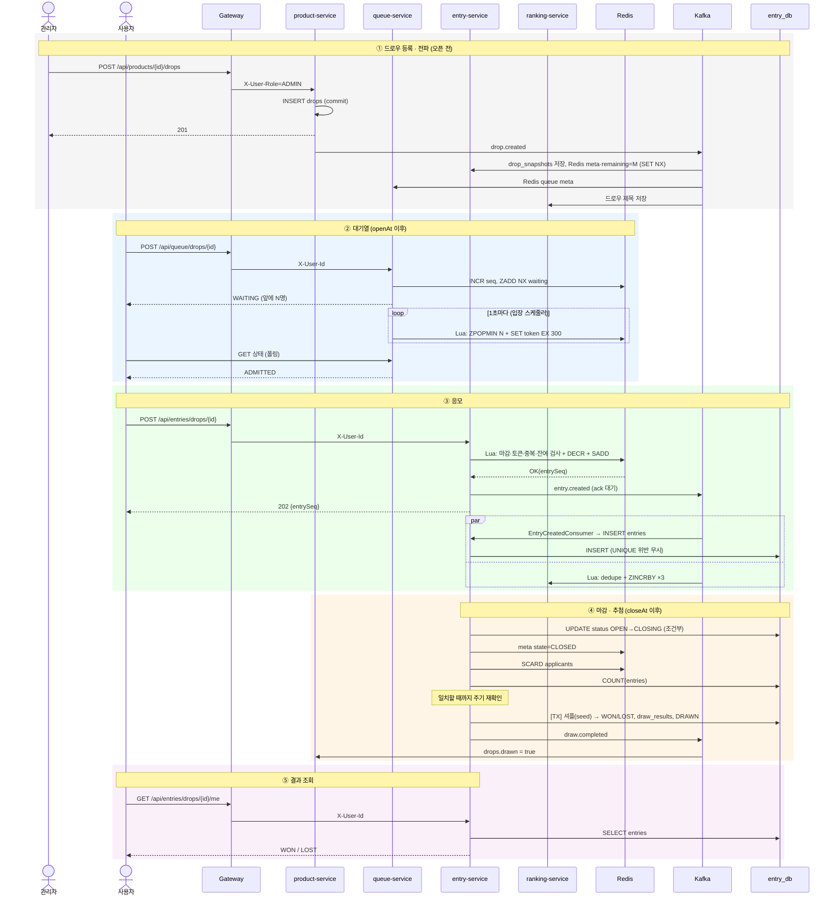
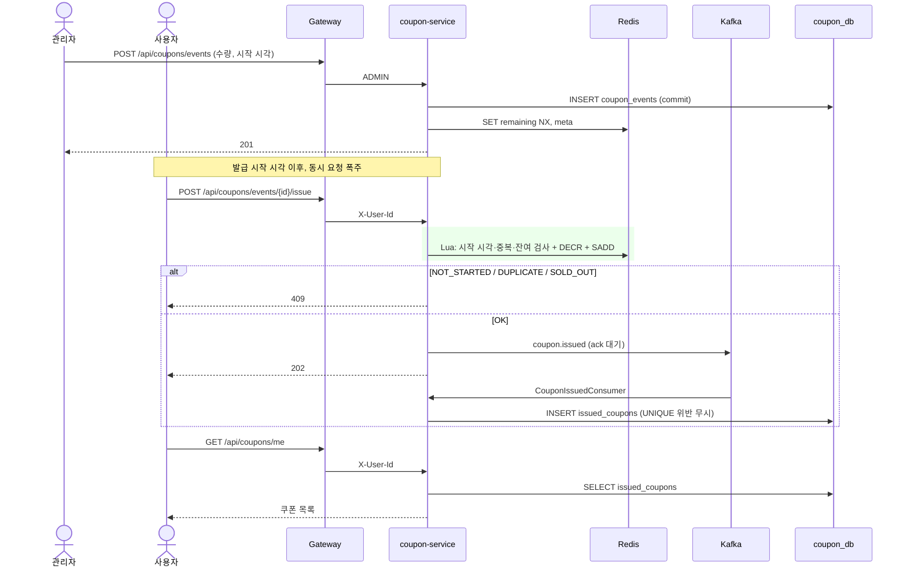
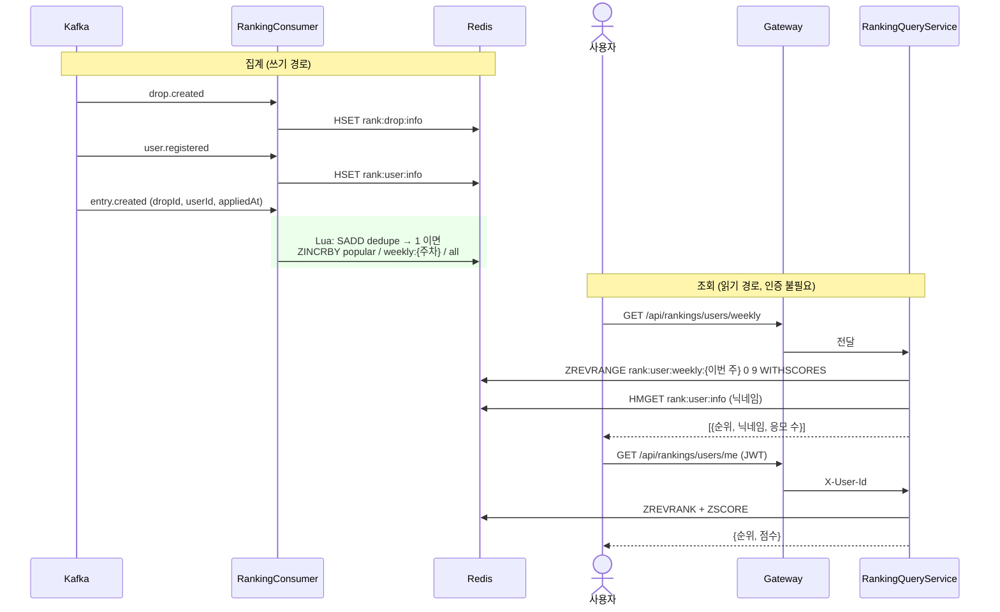
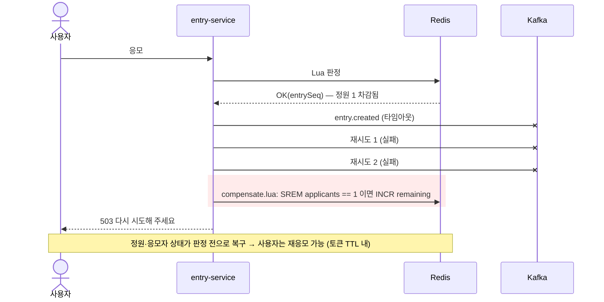
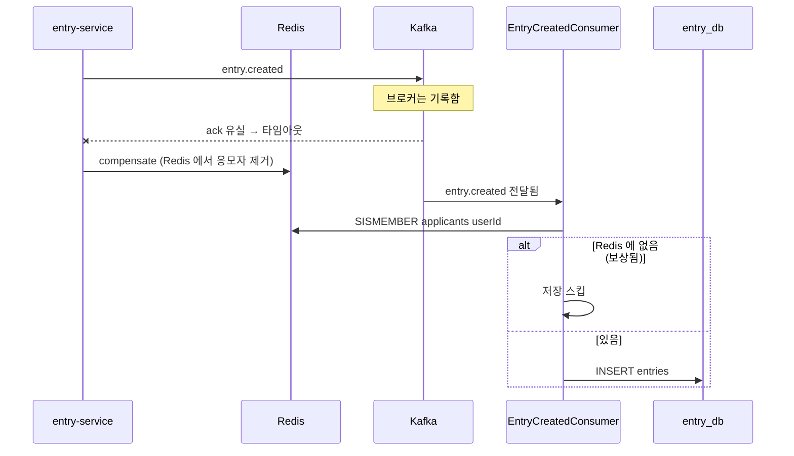
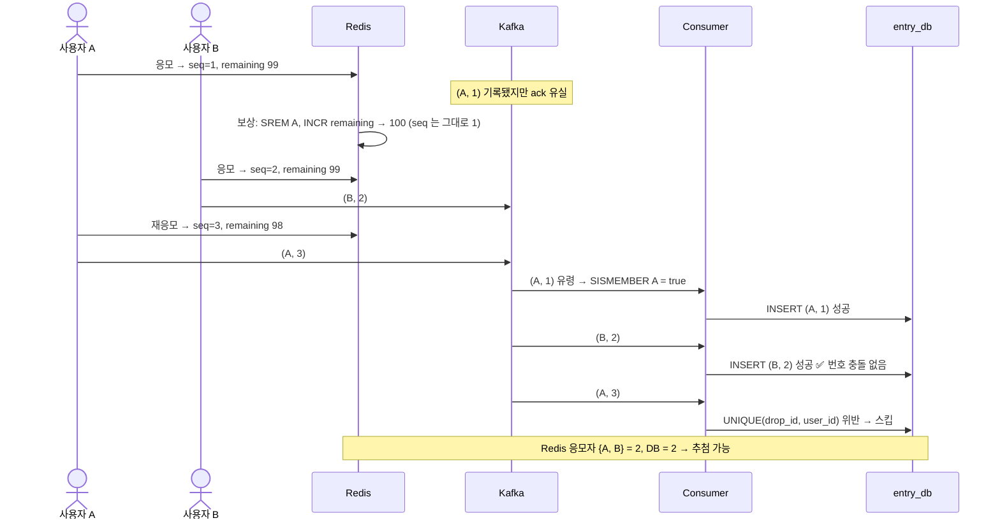
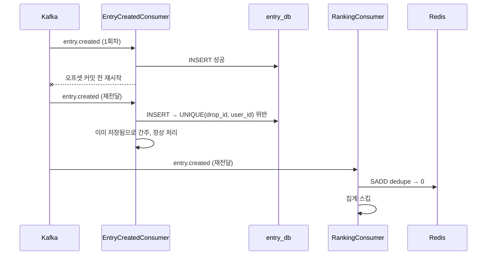
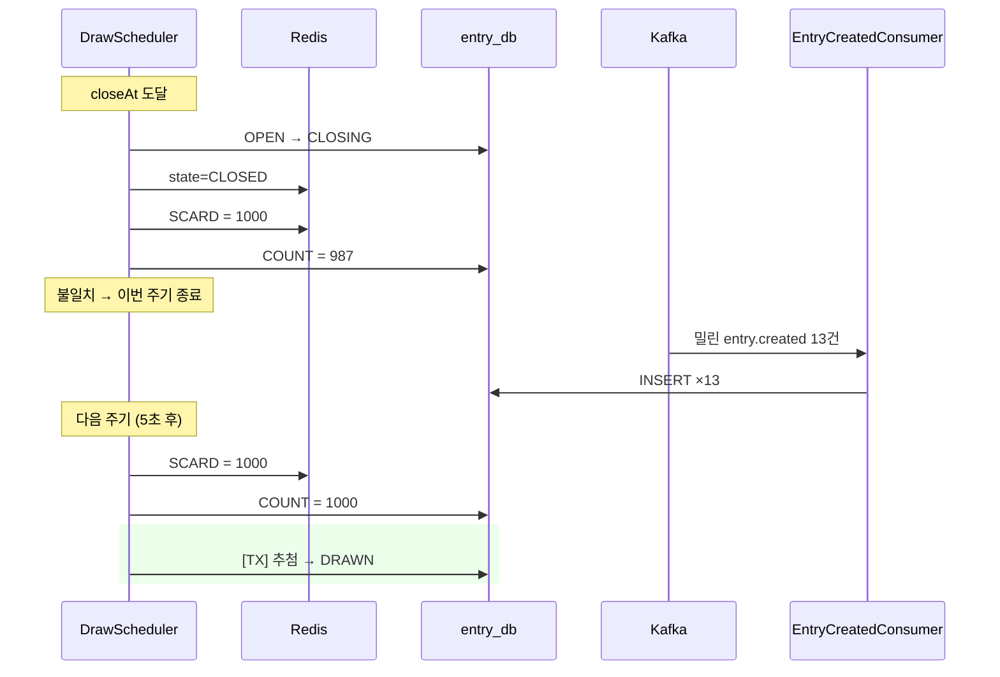

# 시퀀스 다이어그램

## 변경 이력
| 버전 | 날짜 | 변경 내용 | 관련 요구사항 |
|------|------|-----------|----------------|
| v1.0 | 2026-11-16 | 최초 작성 (인증, 전체 흐름, 쿠폰, 랭킹, 장애 시나리오) | 전체 |
| v1.1 | 2026-11-16 | 5.2 응모 번호 재사용 문제 해결 반영 (별도 seq 카운터) 및 해결 후 시퀀스 추가 | NFR-03 |

## 쉬운 설명
> 기능 문서(`05-features/`)의 시퀀스가 "창구 하나에서 무슨 일이 일어나는지"라면,
> 이 문서는 "사용자 한 명이 처음부터 끝까지 어떤 창구들을 거쳐 가는지"와 "중간에 무언가 고장 나면 어떻게 되는지"를 보여줘요.

## 이 문서의 범위
| 구분 | 이 문서 | 기능 문서 (상세) |
|------|---------|------------------|
| 관점 | 서비스 간 전체 흐름, 장애 시나리오 | 기능 하나의 분기·예외·Redis 명령 수준 |
| 목록 | 1. 인증 / 2. 드로우 전체 흐름 / 3. 선착순 쿠폰 / 4. 랭킹 / 5. 장애 시나리오 | [drop-register](../05-features/drop-register.md) · [queue-enter](../05-features/queue-enter.md) · [entry-apply](../05-features/entry-apply.md) · [draw](../05-features/draw.md) · [coupon-issue](../05-features/coupon-issue.md) · [ranking](../05-features/ranking.md) |

**표기 규칙**
- 실선 화살표(`->>`): 동기 호출 / 점선(`-->>`): 응답
- `Kafka` 참여자를 거치는 화살표: 비동기 이벤트 (응답을 기다리지 않음)
- `rect` 박스: 하나의 DB 트랜잭션 또는 하나의 원자 연산(Lua)

---

## 1. 회원가입 · 로그인 · 인증 요청 처리

**왜**: 모든 기능의 전제. Gateway 가 어디서 신원을 확정하고, 내부 서비스는 무엇을 믿는지(신뢰 경계) 확인한다.
**근거**: REQ-USER-01 ~ 03, [architecture.md](../02-architecture/architecture.md) 6장

**읽는 법**
- **신뢰 경계는 Gateway 하나**다. 내부 서비스는 JWT 를 다시 검증하지 않고 `X-User-Id` 헤더를 믿는다 → 내부 포트가 외부에 노출되면 이 전제가 깨진다.
- 헤더 제거가 검증보다 **먼저**다. 순서가 바뀌면 검증 실패 경로 등에서 위조 헤더가 남을 여지가 생긴다.
- 회원가입 응답과 `user.registered` 발행은 분리되어 있어, 랭킹 닉네임 반영이 늦어도 가입에는 영향이 없다.

---

## 2. 드로우 전체 흐름 (End-to-End, 정상 경로)

**왜**: 드로우 하나가 등록되어 추첨될 때까지 6개 서비스가 어떤 순서로 관여하는지 한 장으로 확인한다. 각 단계의 상세 분기는 기능 문서를 본다.
**근거**: REQ-DROP-02, REQ-QUEUE-*, REQ-ENTRY-*, REQ-RANK-03

### 2.1 단순 버전

### 2.2 상세 버전

**읽는 법**
- 사용자가 **응답을 기다리는 동기 구간**은 ②의 진입·폴링, ③의 Lua + Kafka ack, ⑤의 조회뿐이다. DB 쓰기(③ 저장, ④ 추첨)와 랭킹은 모두 사용자 응답 밖에 있다.
- ③에서 Redis 를 읽는 건 entry 지만, **토큰 키를 쓴 건 ②의 queue** 다 — 두 서비스가 만나는 유일한 지점이 Redis 키 하나라는 점이 그림에 드러난다.
- ④는 사용자 요청 없이 **스케줄러가 시작**한다. 사용자는 ⑤에서 폴링 또는 재방문으로 결과를 확인한다 (알림은 범위 밖).

---

## 3. 선착순 쿠폰 (등록 → 발급 → 조회)

**왜**: 대기열 없이 피크 요청이 그대로 Redis 에 도달하는 흐름. 응모와 같은 판정 패턴을 쓰되 무엇이 다른지 확인한다.
**근거**: REQ-COUPON-01 ~ 05, 상세는 [coupon-issue.md](../05-features/coupon-issue.md)

**읽는 법**
- 응모(2.2 ③)와 비교하면 **토큰 검사 대신 시작 시각 검사**가 들어가고, 나머지 구조(Lua → ack → 컨슈머 저장)는 같다.
- 쿠폰 이벤트 등록은 같은 서비스 안이라 Kafka 를 거치지 않고 Redis 를 직접 초기화한다 (드로우 등록과의 차이).

---

## 4. 랭킹 (집계 · 조회)

**왜**: 랭킹은 다른 서비스를 호출하지 않고 이벤트만으로 동작한다. 쓰기(집계)와 읽기(조회)가 어떻게 분리되는지 확인한다.
**근거**: REQ-RANK-01 ~ 03, 상세는 [ranking.md](../05-features/ranking.md)

**읽는 법**
- 주차 키는 **이벤트의 `appliedAt`** 으로 계산한다. 월요일 00:00 직전 응모가 지연 처리되어도 지난 주 랭킹에 들어간다.
- 같은 `entry.created` 가 두 번 와도 dedupe Set 이 막는다 — Kafka at-least-once 전제를 랭킹이 스스로 감당한다.

---

## 5. 장애 시나리오

**왜**: "Redis 판정 + Kafka 비동기 저장"(D1)을 고르면서 생긴 틈이 실제로 어떻게 메워지는지 확인한다. 정상 경로만 그리면 설계 결정의 비용이 보이지 않는다.
**근거**: [concurrency-consistency.md](../04-non-functional/concurrency-consistency.md) D2, D6

### 5.1 Kafka 발행 실패 → Redis 보상

**읽는 법**: "성공 응답 = 이벤트 기록" 불변식을 지키기 위해 실패를 사용자에게 돌려준다. 토큰은 삭제하지 않았으므로 복구할 필요가 없다.

### 5.2 발행이 실제로는 성공했는데 타임아웃으로 판단한 경우

**읽는 법**: 컨슈머가 저장 전에 Redis 를 확인해 "보상된 응모"를 걸러낸다. 이 확인이 없으면 Redis 응모 수 < DB 응모 수가 되어 5.4 의 추첨이 영원히 대기한다. (README "확인 필요" 항목의 기본안)

> ✅ **응모 번호 재사용 문제 (v1.1 에서 해결)**
> 번호를 잔여 정원으로 계산(`M - remaining`)하면 보상(`INCR remaining`) 후 같은 번호가 다른 사용자에게 재발급된다.
> 보상된 사용자가 재응모하면 `SISMEMBER` 가 다시 true 가 되어 유령 이벤트가 저장되고, 같은 번호를 받은 다른 사용자의 INSERT 가
> `UNIQUE(drop_id, entry_seq)` 위반으로 "중복" 오인되어 **누락**될 수 있었다.
> → `entrySeq` 를 **되돌리지 않는 별도 카운터 `INCR entry:{dropId}:seq`** 로 발급하도록 변경. 번호가 겹치지 않으므로 유령 이벤트는
> 같은 사용자의 정상 이벤트와 `UNIQUE(drop_id, user_id)` 에서만 충돌하고, 다른 사용자의 응모에는 영향을 주지 않는다.

**읽는 법**: A 는 유령 이벤트의 번호(1)로 저장되지만 응모 1건은 정확히 남는다. 번호는 추첨 정렬 기준일 뿐 당첨은 시드 셔플로 정해지므로 공정성에 영향이 없다.

### 5.3 컨슈머 재전달 (중복 이벤트)

**읽는 법**: 저장은 **DB 유니크 제약**으로, 랭킹은 **Redis dedupe Set** 으로 각자 멱등성을 확보한다. 두 컨슈머는 서로의 처리 여부를 모른다.

### 5.4 추첨 시 응모 수 불일치 (컨슈머 지연)

**읽는 법**: `CLOSING` 상태가 "닫혔지만 장부 정리 대기 중"을 표현한다. 불일치가 일정 시간 이상 계속되면 경고를 남기고 관리자 확정을 기다린다 ([draw.md](../05-features/draw.md) 6장).

---

## 잠재 리스크 (흐름 관점)
- **동기 구간의 Kafka 의존**: 2.2 ③과 3의 응답 시간에 Kafka ack 왕복이 들어간다. Kafka 가 느려지면 응모·쿠폰 응답이 같이 느려진다 → 부하 테스트에서 p99 확인 필요.
- **스케줄러 3종의 다중 인스턴스 동작**: 입장(queue), 추첨(entry)은 각각 분산 락 / 조건부 UPDATE 로 중복 실행을 막는다. 서비스를 여러 대로 늘리기 전에 두 장치가 실제로 동작하는지 테스트해야 한다.
- **사용자 폴링**: 대기열 상태(②)와 추첨 결과(⑤) 모두 폴링 기반이다. 대기자가 많으면 조회 요청이 응모 요청보다 많아질 수 있다.
