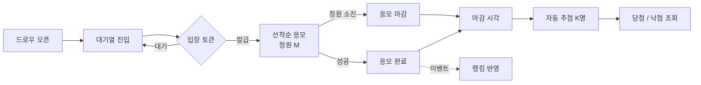

# 설계 문서

## 디렉터리 구성

```
docs/design/
├── README.md                          # 이 문서 (인덱스)
├── 01-requirements/                   # 요구사항
│   └── requirements.md
├── 02-architecture/                   # 아키텍처
│   ├── architecture.md                #   서비스 간 구조
│   └── layered-architecture.md        #   서비스 내부 4계층 · DIP 규칙
├── 03-infrastructure/                 # 인프라
│   └── infrastructure.md
├── 04-non-functional/                 # 비기능 결정 기록
│   └── concurrency-consistency.md
├── 05-features/                       # 기능별 설계
│   ├── drop-register.md
│   ├── queue-enter.md
│   ├── entry-apply.md
│   ├── draw.md
│   ├── coupon-issue.md
│   └── ranking.md
├── 06-erd/                            # ERD
│   └── erd.md
├── 07-class-diagram/                  # 클래스 다이어그램
│   └── class-diagram.md
└── 08-sequence-diagram/               # 시퀀스 다이어그램 (서비스 간 전체 흐름, 장애 시나리오)
    └── sequence-diagram.md
```

읽는 순서는 번호 순서를 따른다. 요구사항 → 전체 구조 → 인프라 → 여러 기능에 걸친 결정 → 기능별 상세 → 데이터·클래스 구조 → 서비스 간 흐름.

## 문서 목록

| 구분 | 문서 | 내용 | 관련 요구사항 |
|------|------|------|----------------|
| 요구사항 | [requirements.md](01-requirements/requirements.md) | 요구사항 정의서 (설계의 근거) | 전체 |
| 아키텍처 | [architecture.md](02-architecture/architecture.md) | 서비스 책임, Kafka 토픽, Redis 키 소유권, 인증 | 전체, REQ-USER-* |
| 아키텍처 | [layered-architecture.md](02-architecture/layered-architecture.md) | 4계층, 엄격한 DIP, 모델 비노출, 포트 위치, ArchUnit 규칙 | 전체 |
| 인프라 | [infrastructure.md](03-infrastructure/infrastructure.md) | 기술 스택, docker-compose 구성, 환경변수, 변경 예정 사항 | NFR-01 ~ 03 |
| 비기능 | [concurrency-consistency.md](04-non-functional/concurrency-consistency.md) | 동시성·정합성 결정 (D1~D7) | NFR-01 ~ 04 |
| 기능 | [drop-register.md](05-features/drop-register.md) | 상품·드로우 등록, 이벤트 전파 | REQ-DROP-* |
| 기능 | [queue-enter.md](05-features/queue-enter.md) | 대기열 진입, 입장 토큰 발급 | REQ-QUEUE-* |
| 기능 | [entry-apply.md](05-features/entry-apply.md) | 선착순 응모 | REQ-ENTRY-01~04, 06 |
| 기능 | [draw.md](05-features/draw.md) | 마감 자동 추첨 | REQ-ENTRY-05, 06 |
| 기능 | [coupon-issue.md](05-features/coupon-issue.md) | 선착순 쿠폰 발급 | REQ-COUPON-* |
| 기능 | [ranking.md](05-features/ranking.md) | 인기 드로우 / 유저 활동 랭킹 | REQ-RANK-* |
| ERD | [erd.md](06-erd/erd.md) | 서비스별 ERD | 전체 |
| 클래스 | [class-diagram.md](07-class-diagram/class-diagram.md) | 서비스별 4계층 클래스 구조 | 전체 |
| 시퀀스 | [sequence-diagram.md](08-sequence-diagram/sequence-diagram.md) | 인증, 드로우 전체 흐름, 쿠폰, 랭킹, 장애 시나리오 | 전체 |

## 전체 사용자 흐름



## 확인 필요 (미결정 정책)
| 항목 | 문서 | 기본안 |
|------|------|--------|
| 인기 드로우 랭킹 범위 (전체 누적 vs 진행 중만) | [ranking.md](05-features/ranking.md) 6장 | 진행 중 드로우만 필터 |
| 랭킹 동점 처리 | [ranking.md](05-features/ranking.md) 6장 | member 사전순 (정책 없음) |
| 추첨 건수 불일치 장기화 시 | [draw.md](05-features/draw.md) 6장 | 경고 후 관리자 수동 확정 |
| 발행 타임아웃 후 실제 성공 케이스 | [entry-apply.md](05-features/entry-apply.md) 6장 | 컨슈머가 Redis SISMEMBER 확인 후 저장 |
| 보상 후 entrySeq 재사용 문제 | [sequence-diagram.md](08-sequence-diagram/sequence-diagram.md) 5.2 | entrySeq 를 별도 INCR 카운터로 발급 |
| 드로우 이벤트 발행 방식 | [concurrency-consistency.md](04-non-functional/concurrency-consistency.md) D4 | AFTER_COMMIT + 재발행 API (Outbox 미사용) |

## 문서 작성 규칙
- 모든 문서 상단에 **변경 이력** 표를 두고, 수정 시 버전·날짜·변경 내용·관련 요구사항을 추가한다.
- 새 기능은 `05-features/` 에 새 파일로, 기존 기능 변경은 해당 파일을 수정한다.
- 여러 기능에 걸친 결정(성능, 동시성, 정합성 등)은 `04-non-functional/` 에 먼저 합의 기록을 남긴다.
- 다이어그램은 Mermaid 로 작성하고, 아래에 "읽는 법"을 붙인다.
