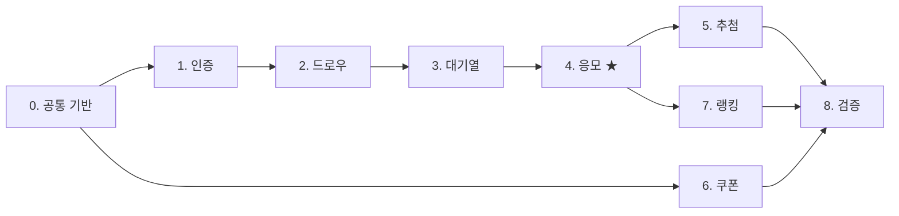

# 구현 플랜

## 변경 이력
| 버전 | 날짜 | 변경 내용 |
|------|------|-----------|
| v1.0 | 2026-11-16 | 최초 작성 (0~8단계) |
| v1.1 | 2026-11-16 | 단계별 구현 상세 문서(`phases/`) 추가 및 링크 |
| v1.2 | 2026-11-16 | 확정 사항 반영: Flyway, 커밋 후 발행 방식(afterCommit), 동기 발행 정책(애플리케이션 재시도 없음), DLT, 관리자 계정 생성, 저장 전 Redis 확인(응모·쿠폰). 미결정 표 갱신 |
| v1.3 | 2026-11-16 | 0단계 완료: 진행 현황·체크리스트 갱신. 에러 계약 결정(X-User-* 누락 400, `{SERVICE}_{REASON}`, 응답 메시지 고정) 4장 표에 추가 |
| v1.4 | 2026-11-16 | 1단계 완료: 진행 현황·체크리스트 갱신 |
| v1.5 | 2026-11-16 | 2단계 완료: 진행 현황·체크리스트 갱신. 드로우 등록 상한(오픈 365일·기간 30일) 기본안 확정 4장 표에 추가 |
| v1.6 | 2026-11-16 | 3단계 완료: 진행 현황·체크리스트 갱신. 대기열 기본안 3건(마감 후 CLOSED 상태 없음, queue 키 `closeAt + 1일` 만료, 입장 게이트 유지 시간 = 주기의 90%) 4장 표에 추가 |
| v1.7 | 2026-11-16 | 4단계 착수: 사용자 결정 2건(E-34 주기당 N명 유지, E-39 해시 태그 미적용) 4장 표에 추가 |
| v1.8 | 2026-11-17 | 4단계 사용자 결정 2건(E-40 요청 ID·저장 확정 기반 유령 이벤트 대응, E-41 Redis 타임아웃 시 보상 후 503) 4장 표에 추가 |
| v1.9 | 2026-11-17 | 4단계 완료: 진행 현황·체크리스트 갱신 (entry-service 테스트 223건, 전체 빌드, 로컬 compose 에서 등록 → 진입 → 입장 → 응모 202 → 내 응모 조회 확인) |
| v2.0 | 2026-11-17 | 5단계 착수: 추첨 건수 불일치 정책 확정(사용자 결정, 관리자 수동 추첨) |
| v2.1 | 2026-11-17 | 5단계 완료: 진행 현황·완료 조건 갱신 |
| v2.2 | 2026-11-17 | 6단계 착수: D6-1~D6-4 확정 (D6-4 는 4단계 E-40·E-41 사용자 결정 적용) |

---

## 1. 진행 방식

### 1.0 문서 구성
| 문서 | 역할 |
|------|------|
| 이 문서 | 전체 순서, 단계별 작업 범위와 완료 조건 |
| `phases/phase-{n}-*.md` | 단계별 **구현 상세**: 파일 목록, 클래스·메서드 시그니처, Lua·SQL·설정 전문, 테스트 케이스, 커밋 계획 |
| `../design/` | **무엇을, 왜**: 설계 근거와 결정 (구현 상세 문서는 설계를 참조만 하고 결정을 바꾸지 않는다) |

### 1.1 원칙
- **의존 순서대로 단계를 진행**한다. 각 단계가 끝나면 실제로 동작하는 흐름이 하나씩 늘어난다.
- 각 단계 안의 작업은 **서비스 → 계층(domain → application → infrastructure → presentation)** 순서로 적는다.
  안쪽(domain)부터 만들면 바깥 계층이 생기기 전에 규칙을 단위 테스트로 먼저 고정할 수 있다.
- 단계마다 **완료 조건(테스트)** 을 통과해야 다음 단계로 넘어간다.
- 설계와 다르게 구현해야 하면, **설계 문서를 먼저 수정**(변경 이력 추가)하고 구현한다.

### 1.2 브랜치 · 커밋
| 항목 | 규칙 |
|------|------|
| 브랜치 | `dev` 에서 단계별 브랜치 생성 → 완료 후 `dev` 로 PR 머지 |
| 브랜치명 | `{type}/phase-{n}-{name}` (예: `feat/phase-4-entry-apply`) |
| 커밋 | Conventional Commits (`feat`, `fix`, `test`, `refactor`, `chore`, `docs`) |
| 커밋 단위 | 계층 또는 기능 조각 단위 (예: "entry 도메인 모델", "응모 Lua 스크립트와 Gate 구현") |

### 1.3 테스트 전략
| 대상 계층 | 테스트 종류 | 도구 | 검증 내용 |
|-----------|-------------|------|-----------|
| domain | 단위 테스트 | JUnit 5, AssertJ | 상태 전이, 불변식, 도메인 서비스 (Spring 없이) |
| application | 단위 테스트 | JUnit 5, **Fake 포트 구현체** | 유스케이스 흐름, 분기, 보상 호출 여부 |
| infrastructure | 통합 테스트 | **Testcontainers** (PostgreSQL, Redis, Kafka) | Lua 스크립트, JPA 매핑, Kafka 발행·수신 |
| presentation | 슬라이스 테스트 | `@WebMvcTest`, MockMvc | 요청 검증, 에러 코드 → HTTP 매핑 |
| 전체 구조 | 아키텍처 테스트 | ArchUnit | 계층 의존 규칙 R1~R7 |
| 동시성 | 통합 테스트 | `ExecutorService` + `CountDownLatch` | 정원·수량 초과 없음, 중복 없음 |

> application 테스트에서 Mockito 대신 **Fake 포트**를 권장한다. 포트 인터페이스가 이미 있으므로 `InMemoryEntryRepository` 같은 Fake 를 만들기 쉽고, "호출됐는지"가 아니라 "결과 상태"를 검증할 수 있다.

### 1.4 공통 완료 조건 (모든 단계)
- [ ] `./gradlew build` 통과 (ArchUnit 포함)
- [ ] 새로 만든 API 는 해당 기능 설계 문서의 API 표와 일치
- [ ] 설계와 달라진 부분이 있으면 설계 문서 수정 + 변경 이력 추가
- [ ] 미결정 사항 중 이 단계에 해당하는 항목 결정 및 문서 반영

---

## 2. 전체 순서

**읽는 법**
- 굵은 줄기 `0 → 1 → 2 → 3 → 4 → 5` 가 드로우 핵심 흐름이다. **4단계(응모)가 과제의 핵심**이고, 1~3단계는 그 준비 단계다.
- **6단계(쿠폰)는 0단계에만 의존**한다. 중간 단계가 막히면 먼저 진행해도 된다.
- 7단계(랭킹)는 `entry.created` 만 있으면 되므로 4단계 이후 언제든 가능하다.

### 진행 현황
| 단계 | 브랜치 | 구현 상세 | 상태 |
|------|--------|-----------|------|
| 0. 공통 기반 | `chore/phase-0-foundation` | [phase-0-foundation.md](phases/phase-0-foundation.md) | ✅ 완료 (2026-11-16) |
| 1. 인증 | `feat/phase-1-auth` | [phase-1-auth.md](phases/phase-1-auth.md) | ✅ 완료 (2026-11-16) |
| 2. 드로우 | `feat/phase-2-drop` | [phase-2-drop.md](phases/phase-2-drop.md) | ✅ 완료 (2026-11-16) |
| 3. 대기열 | `feat/phase-3-queue` | [phase-3-queue.md](phases/phase-3-queue.md) | ✅ 완료 (2026-11-16) |
| 4. 응모 | `feat/phase-4-entry-apply` | [phase-4-entry-apply.md](phases/phase-4-entry-apply.md) | ✅ 완료 (2026-11-17) |
| 5. 추첨 | `feat/phase-5-draw` | [phase-5-draw.md](phases/phase-5-draw.md) | ✅ 완료 (2026-11-17) |
| 6. 쿠폰 | `feat/phase-6-coupon` | [phase-6-coupon.md](phases/phase-6-coupon.md) | ⬜ 대기 |
| 7. 랭킹 | `feat/phase-7-ranking` | [phase-7-ranking.md](phases/phase-7-ranking.md) | ⬜ 대기 |
| 8. 검증 | `test/phase-8-load-test` | [phase-8-load-test.md](phases/phase-8-load-test.md) | ⬜ 대기 |

---

## 3. 단계별 상세

### 0단계 — 공통 기반
**목표**: 모든 서비스가 같은 규칙(4계층, ArchUnit, 테스트 환경, 이벤트 계약) 위에서 시작하게 한다.
**참고**: [layered-architecture.md](../design/02-architecture/layered-architecture.md), [infrastructure.md](../design/03-infrastructure/infrastructure.md), [architecture.md](../design/02-architecture/architecture.md) 4장

**작업**
- 빌드
  - [x] 루트 `build.gradle`: ArchUnit, Testcontainers(PostgreSQL, Kafka, Redis) 테스트 의존성 추가
  - [x] `common` 에 `java-test-fixtures` 플러그인 적용
- common
  - [x] 이벤트 메시지 record 5종: `UserRegistered`, `DropCreated`, `EntryCreated`, `DrawCompleted`, `CouponIssued`
  - [x] 토픽 이름 상수 `Topics`
  - [x] testFixtures: ArchUnit 규칙 R1~R7 (`LayerRules`)
  - [x] testFixtures: Testcontainers 공통 지원 클래스 (컨테이너 재사용 설정)
- 각 서비스 (user, product, queue, entry, coupon, ranking)
  - [x] 4계층 패키지 골격 (`presentation`, `application`, `domain`, `infrastructure`)
  - [x] `ArchitectureTest` (공통 규칙 적용)
  - [x] 공통 에러 응답 형식 + `@RestControllerAdvice` 기본 틀
- 인프라 (`docker-compose.yml`)
  - [x] Redis AOF (`appendonly yes`, `appendfsync everysec`) + 데이터 볼륨
  - [x] Kafka `auto.create.topics.enable=false` + 토픽 초기화 컨테이너 (파티션 수, `entry.created` 보존 30일, DLT 3종 `drop.created.DLT`·`entry.created.DLT`·`coupon.issued.DLT`)
  - [x] Kafka producer 공통 설정: `acks=all`, 멱등, `request.timeout.ms=1000`, `delivery.timeout.ms=3000` (동기 발행은 애플리케이션 재시도 없음)

**확정 (2026-11-16)**
- [x] DB 스키마 관리: **Flyway 도입**, `ddl-auto: validate`

**완료 조건**
- [x] 모든 모듈 `./gradlew build` 통과, 각 서비스 `ArchitectureTest` 실행됨
- [x] 계층 규칙을 일부러 어긴 코드를 넣으면 테스트가 실패함을 확인 (규칙이 실제로 동작하는지)
- [x] `docker compose up -d` 후 모든 컨테이너 healthy, 토픽 5개 + DLT 3개 생성 확인 (Kafka UI)

---

### 1단계 — 인증 (user-service, gateway)
**목표**: 회원가입·로그인이 되고, 인증된 요청이 각 서비스에 `X-User-Id` 헤더로 도착한다.
**요구사항**: REQ-USER-01 ~ 03
**참고**: [architecture.md](../design/02-architecture/architecture.md) 6장, [sequence-diagram.md](../design/08-sequence-diagram/sequence-diagram.md) 1장, [class-diagram.md](../design/07-class-diagram/class-diagram.md) 2.1

**작업**
- user-service
  - [x] domain: `User`, `Email`(값 객체, 형식 검증), `Role`, `UserRepository`(I)
  - [x] application: `UserService`(signup, login), Command/Result, 포트 `PasswordEncoder`, `TokenIssuer`, `UserEventPublisher`, 에러 코드
  - [x] infrastructure: `UserJpaEntity`, `UserMapper`, `UserRepositoryImpl`, BCrypt 어댑터, JWT 발급기, `user.registered` Kafka 발행
  - [x] presentation: `UserController`(signup, login), Request/Response
  - [x] 관리자 계정 초기화: 기동 시 `ADMIN_EMAIL` / `ADMIN_PASSWORD` 가 있으면 ADMIN 계정을 없을 때만 생성 (확정, 2026-11-16)
- gateway
  - [x] 클라이언트가 보낸 `X-User-*` 헤더 제거 필터
  - [x] JWT 검증 필터 → `X-User-Id`, `X-User-Role` 주입
  - [x] 인증 제외 경로 설정 (가입, 로그인, 드로우 조회, 랭킹 조회)
  - [x] JWT 비밀키를 환경변수(`JWT_SECRET`)로 user-service 와 공유

**완료 조건**
- [x] 단위: `Email` 형식 검증, 중복 이메일 가입 거부, 비밀번호 불일치 로그인 실패
- [x] 통합: 가입 → DB 저장 + `user.registered` 발행 확인 (Testcontainers)
- [x] gateway: 토큰 없음/만료/위조 → 401, 정상 토큰 → 헤더 주입, **클라이언트가 보낸 `X-User-Id` 가 제거됨**
- [x] 관리자: 환경변수로 기동 → ADMIN 로그인 토큰의 role = ADMIN, 재기동해도 1계정

---

### 2단계 — 드로우 (product-service)
**목표**: 관리자가 상품·드로우를 등록하면 `drop.created` 가 발행되고, 누구나 드로우를 조회할 수 있다.
**요구사항**: REQ-DROP-01 ~ 03
**참고**: [drop-register.md](../design/05-features/drop-register.md), [erd.md](../design/06-erd/erd.md) product_db

**작업**
- [x] domain: `Product`, `Drop`(생성 검증 M ≥ K ≥ 1, openAt < closeAt, `status(now)`, `markDrawn()`), `DropStatus`, Repository(I) 2개
- [x] application: `ProductService`, `DropService`(register, republish), `DropQueryService`, 포트 `DropEventPublisher`, 관리자 권한 검사
- [x] infrastructure: JPA 엔티티·Mapper·Repository 구현, 발행 어댑터 안의 `TransactionSynchronization.afterCommit` 발행 (1단계와 같은 패턴, producer 내부 재시도)
- [x] presentation: `ProductController`, `DropController` (API 5개)

**확정 (2026-11-16)**
- [x] 드로우 이벤트 발행 방식: **afterCommit 발행 + 재발행 API** (Outbox 미사용)

**완료 조건**
- [x] 단위: `Drop.status(now)` 경계값 (openAt 직전/정각, closeAt 직전/정각), 생성 검증 실패 케이스
- [x] 통합: 드로우 등록 → 커밋 후 `drop.created` 발행, **롤백 시 발행되지 않음**
- [x] USER 권한으로 등록 시 403

---

### 3단계 — 대기열 (queue-service)
**목표**: 오픈된 드로우의 대기열에 진입하고, 스케줄러가 주기적으로 입장 토큰을 발급한다.
**요구사항**: REQ-QUEUE-01 ~ 06
**참고**: [queue-enter.md](../design/05-features/queue-enter.md), [class-diagram.md](../design/07-class-diagram/class-diagram.md) 2.3

**작업**
- [x] domain: `QueueMeta`(`isOpen(now)`), `QueueState`, `WaitingQueueRepository`(I)
- [x] application: `QueueService`(enter, status), `AdmissionService`(admit), 포트 `RemainingCapacityReader`
- [x] infrastructure: `RedisWaitingQueueRepository` (진입 `INCR` + `ZADD NX`, 입장 **Lua: `ZPOPMIN` + `SET token EX`**), `RedisRemainingCapacityReader`, 스케줄러 분산 락
- [x] presentation: `QueueController`, `AdmissionScheduler`, `DropCreatedListener`

> 이 단계에서는 entry-service 가 아직 없으므로, 잔여 정원 키(`entry:{dropId}:remaining`)는 테스트에서 직접 넣는다.

**완료 조건**
- [x] 단위: `QueueMeta.isOpen` 경계값, 상태 판정 분기
- [x] 통합: 같은 사용자가 동시에 10번 진입 → 순번 1개
- [x] 통합: 대기 250명, 배치 100 → 3번 실행 후 전원 토큰 보유, 순서 유지
- [x] 통합: 토큰 TTL 만료 후 `NOT_IN_QUEUE`
- [x] 통합: 잔여 정원 0 → 입장 중단, 상태 `SOLD_OUT`
- [x] 통합: 스케줄러 2개 동시 실행 → 한 주기에 N명만 입장 (분산 락 동작)

---

### 4단계 — 응모 ★ (entry-service)
**목표**: 입장 토큰을 가진 사용자가 선착순으로 응모하고, 정원 초과·중복 없이 DB 에 저장된다.
**요구사항**: REQ-ENTRY-01 ~ 04, 06 / NFR-01 ~ 03
**참고**: [entry-apply.md](../design/05-features/entry-apply.md), [concurrency-consistency.md](../design/04-non-functional/concurrency-consistency.md) D1~D3, [class-diagram.md](../design/07-class-diagram/class-diagram.md) 1.1, 1.3, [sequence-diagram.md](../design/08-sequence-diagram/sequence-diagram.md) 5장

**작업**
- 드로우 정보 수신
  - [x] domain: `DropSnapshot`, `DropSnapshotRepository`(I)
  - [x] application: `DropSnapshotRegisterService` (DB 저장 + Redis 정원 초기화)
  - [x] infrastructure: JPA, `RedisEntryGate.initialize()` (`SET NX` 로 멱등 처리)
  - [x] presentation: `DropCreatedListener`
- 응모
  - [x] domain: `Entry`, `EntryStatus`, `ApplyOutcome`, `EntryRepository`(I)
  - [x] application: `EntryApplyService`, 포트 `EntryGate`, `EntryEventPublisher`, 에러 코드 (`CLOSED` / `NO_TOKEN` / `DUPLICATE` / `SOLD_OUT` / `TEMPORARILY_FAILED`)
  - [x] infrastructure: `apply.lua` (마감·토큰·중복·잔여 검사 → `DECR` + `SADD` + **`INCR seq`**), `compensate.lua`, `KafkaEntryEventPublisher` (`acks=all`, 동기 확인 3.5초, **애플리케이션 재시도 없음** — producer 내부 재시도 + `delivery.timeout.ms=3000`)
  - [x] presentation: `EntryController` (응모 → 202)
- 저장
  - [x] application: `EntrySaveService` (**저장 전 Redis 응모자 확인**, 유니크 위반 무시)
  - [x] infrastructure: `EntryJpaEntity`(UK 2개), Mapper, Repository 구현
  - [x] presentation: `EntryCreatedListener` (3회 재시도 후 `entry.created.DLT`)
- 조회
  - [x] `EntryQueryService`, 내 응모 목록 / 특정 드로우 내 응모 (DB 에 없으면 Redis 로 보완)

**확정 (2026-11-16)**
- [x] 컨슈머 저장 전 Redis 응모자 확인 (없으면 저장 스킵) → 2026-11-17 E-40 결정으로 `entry-claim.lua` 저장 확정으로 대체

**완료 조건**
- [x] 통합(Lua): 결과 5가지(OK / CLOSED / NO_TOKEN / DUPLICATE / SOLD_OUT)가 각각 올바르게 나옴
- [x] **동시성: 정원 100, 서로 다른 사용자 1,000명 동시 응모 → 성공 정확히 100, Redis 잔여 0, 최종 DB 100건**
- [x] **동시성: 같은 사용자 10번 동시 응모 → 성공 1**
- [x] 발행 실패(Fake publisher 예외) → 보상 후 잔여 정원·응모자 원상복구, 503
- [x] 유령 이벤트 시나리오 ([sequence-diagram.md](../design/08-sequence-diagram/sequence-diagram.md) 5.2): A 보상 → B 응모 → A 재응모 → DB 에 A, B 모두 1건씩
- [x] 같은 이벤트 재전달 → DB 1건 유지
- [x] `drop.created` 재수신 → 진행 중인 잔여 정원이 덮어써지지 않음

---

### 5단계 — 추첨 (entry-service, product-service)
**목표**: 마감 시각에 자동으로 추첨하고, 결과를 조회할 수 있다. 드로우 흐름 전체가 완성된다.
**요구사항**: REQ-ENTRY-05, 06 / NFR-04
**참고**: [draw.md](../design/05-features/draw.md), [class-diagram.md](../design/07-class-diagram/class-diagram.md) 1.2

**작업**
- entry-service
  - [ ] domain: `Drawer`(순수 함수: 정렬된 목록 + K + 시드 → 당첨자), `DrawResult`, `SnapshotStatus`, `DrawResultRepository`(I)
  - [ ] domain Repository 확장: `markClosingIfOpen`, `findClosing`, `markDrawn`, `countByDropId`, `findUserIdsOrderBySeq`, `markResults`(벌크)
  - [ ] application: `DrawService`(closeDueDrops, drawIfReady), `DrawQueryService`, 포트 `ApplicantCounter`, `DrawEventPublisher`
  - [ ] infrastructure: 조건부 UPDATE, 벌크 UPDATE, Redis 마감 처리(`state=CLOSED`)·응모 수 조회, `draw.completed` 발행
  - [ ] presentation: `DrawScheduler`, `DrawResultController`
- product-service
  - [ ] `DrawCompletedListener` → `Drop.markDrawn()`

**결정 필요**
- [x] 건수 불일치가 계속될 때: **경고 후 관리자 수동 확정** (사용자 결정, 2026-11-17)

**완료 조건**
- [x] 단위(`Drawer`): 같은 시드 → 같은 결과, K ≥ 응모자 수 → 전원 당첨, 응모자 0 → 당첨 0
- [x] 통합: 스케줄러 2개 동시 실행 → `draw_results` 1건 (중복 추첨 없음)
- [x] 통합: DB 응모 수가 부족한 상태 → 추첨 대기, 저장 완료 후 다음 주기에 추첨
- [x] 통합: 마감 후 응모 → `CLOSED`
- [x] 통합: 추첨 후 product 드로우 상태 `DRAWN`
- [x] **E2E: 드로우 등록 → 대기열 → 응모 → 마감 → 추첨 → 결과 조회** 시나리오 1회 통과

---

### 6단계 — 선착순 쿠폰 (coupon-service)
**목표**: 대기열 없이 선착순으로 쿠폰을 1인 1매 발급한다.
**요구사항**: REQ-COUPON-01 ~ 05
**참고**: [coupon-issue.md](../design/05-features/coupon-issue.md), [class-diagram.md](../design/07-class-diagram/class-diagram.md) 2.4

**작업**
- [ ] domain: `CouponEvent`, `IssuedCoupon`, `IssueOutcome`, Repository(I) 2개
- [ ] application: `CouponEventService`, `CouponIssueService`(요청 ID, 보상 3결과), `CouponSaveService`(**저장 전 claim 필수**), `CouponQueryService`, 포트 `CouponGate`, `CouponEventPublisher`
- [ ] infrastructure: `coupon-issue.lua`, `coupon-compensate.lua`, `coupon-claim.lua`, JPA, `coupon.issued` 발행 (4단계와 같은 동기 발행 정책)
- [ ] presentation: `CouponEventController`, `CouponController`, `CouponIssuedListener` (3회 재시도 후 `coupon.issued.DLT`)

> 응모(4단계)와 판정 패턴이 같다. 공통 컴포넌트로 뽑지 않고 서비스별로 구현한다 (D6-1 확정(기본안), 2026-11-17). 유령 이벤트·타임아웃 대응도 4단계와 같다 (D6-4).

**완료 조건**
- [ ] **동시성: 수량 100, 1,000명 동시 요청 → 발급 정확히 100**
- [ ] 동시성: 같은 사용자 10번 동시 요청 → 1매
- [ ] 발급 시작 전 요청 → `NOT_STARTED`
- [ ] 발행 실패 → 보상 후 원상복구
- [ ] 유령 이벤트(보상 후 실제로 기록된 발급) → DB 에 남지 않음, 초과 발급 없음
- [ ] 유령 이벤트 소비가 보상보다 먼저 / 판정 Lua 타임아웃 → 초과 발급 없음 (D6-4)

---

### 7단계 — 랭킹 (ranking-service)
**목표**: 인기 드로우, 주간·누적 유저 랭킹을 조회한다.
**요구사항**: REQ-RANK-01 ~ 03
**참고**: [ranking.md](../design/05-features/ranking.md), [class-diagram.md](../design/07-class-diagram/class-diagram.md) 2.5

**작업**
- [ ] domain: `WeekKey`(ISO 주차, Asia/Seoul), `RankingBoard`, `RankingRepository`(I), `DisplayNameRepository`(I)
- [ ] application: `RankingAggregateService`, `RankingQueryService`
- [ ] infrastructure: `rank.lua` (dedupe + `ZINCRBY` 3개), 주간 키 TTL, 표시 이름 Hash
- [ ] presentation: `RankingController` (API 4개), Listener 3개 (`entry.created`, `drop.created`, `user.registered`)

**결정 필요**
- [ ] 인기 드로우 범위: **진행 중 드로우만** (기본안) vs 전체 누적
- [ ] 동점 처리 정책

**완료 조건**
- [ ] 단위(`WeekKey`): 일요일 23:59:59 KST → 그 주, 월요일 00:00:00 KST → 다음 주, UTC 기준과 다른 경우
- [ ] 통합: 같은 이벤트 3번 → 점수 1
- [ ] 통합: Top N 조회 시 닉네임·드로우 제목 포함

---

### 8단계 — 검증 (부하 테스트)
**목표**: 트래픽이 몰려도 정원·수량 초과와 중복이 없음을 수치로 증명하고, 과제에서 강조할 결과를 정리한다.
**참고**: [infrastructure.md](../design/03-infrastructure/infrastructure.md) 6장

**작업**
- [ ] 서비스 컨테이너화 (서비스별 Dockerfile, compose `app` 프로필, 내부 포트 비노출)
- [ ] 관측: Actuator 메트릭 (선택: Prometheus + Grafana)
- [ ] k6 시나리오
  - 드로우 오픈 스파이크: N명 동시 대기열 진입 → 입장 → 응모
  - 쿠폰 스파이크: N명 동시 발급 요청
- [ ] 결과 검증 스크립트: DB 응모 수 ≤ M, 쿠폰 발급 수 ≤ 수량, 중복 0
- [ ] 리포트 작성 (`docs/report/`): 처리량, p95/p99, 병목 분석, 개선 전후 비교

**선택 (시간 여유 시)**
- [ ] 비교 실험: DB 락 방식 판정과 Redis Lua 방식의 처리량·지연 비교

**완료 조건**
- [ ] 부하 테스트 중 정원·수량 초과 0, 중복 0
- [ ] 리포트에 측정 조건·수치·해석 기록

---

## 4. 미결정 사항 처리 시점
| 항목 | 처리 단계 | 기본안 / 결정 | 상태 |
|------|-----------|---------------|------|
| DB 스키마 관리 (ddl-auto vs Flyway) | 0단계 | Flyway, `ddl-auto: validate` | ✅ 확정 (2026-11-16) |
| Kafka 동기 발행 정책 (응모·쿠폰) | 0·4·6단계 | 애플리케이션 재시도 없음, producer 내부 재시도 + `delivery.timeout.ms=3000`, `get` 3.5초 | ✅ 확정 (2026-11-16) |
| 저장 컨슈머 실패 처리 | 0·4·6단계 | 3회 재시도 후 `{topic}.DLT` (랭킹은 로그·스킵) | ✅ 확정 (2026-11-16) |
| 관리자 계정 생성 | 1단계 | 기동 시 `ADMIN_EMAIL`/`ADMIN_PASSWORD` 로 없으면 생성 | ✅ 확정 (2026-11-16) |
| 드로우 이벤트 발행 방식 | 2단계 | 발행 어댑터 안의 afterCommit 발행 + 재발행 API | ✅ 확정 (2026-11-16) |
| 드로우 등록 상한 | 2단계 | 오픈은 등록 후 365일 이내, 응모 기간 30일 이내 (범위 밖 시각 500 방지) | ✅ 확정(기본안) (2026-11-16) |
| 대기열 마감 후 상태 | 3단계 | 별도 CLOSED 상태 없음, 마감 여부는 드로우 상세로 판단 | ✅ 확정(기본안) (2026-11-16) |
| 대기열 키 정리 | 3단계 | `meta`·`waiting`·`seq` 를 `closeAt + 1일` 에 만료 | ✅ 확정(기본안) (2026-11-16) |
| 입장 게이트 유지 시간 | 3단계 | 주기의 90% (지터로 주기를 건너뛰는 문제 방지, 다중 인스턴스 상한 초당 약 1.11N명) | ✅ 확정(기본안) (2026-11-16) |
| 주기당 입장 수와 잔여 정원 (E-34) | 4단계 | 주기당 N명 유지 (잔여와 무관). 8단계에서 소진 직전 SOLD_OUT 응답 수 관찰 | ✅ 확정(사용자 결정) (2026-11-16) |
| Redis Cluster 대비 해시 태그 (E-39) | 4단계 | 적용하지 않음. 단일 Redis 전제 유지 | ✅ 확정(사용자 결정) (2026-11-16) |
| 컨슈머 저장 전 Redis 응모자 확인 | 4단계 | 확인 후 없으면 저장 스킵 | ✅ 확정 (2026-11-16) → 아래 E-40 결정으로 대체 |
| 유령 이벤트가 보상보다 먼저 소비 (E-40) | 4단계 | 요청 ID(eventId)를 `requests` 에 기록, 저장 컨슈머가 claim Lua 로 `persisted` 확정, 보상 Lua 3결과(COMPENSATED / ALREADY_PERSISTED / NOT_OURS), ALREADY_PERSISTED 면 202. 쿠폰 적용은 6단계에서 확정 | ✅ 확정(사용자 결정) (2026-11-17) |
| 판정 Lua 응답 타임아웃 (E-41) | 4단계 | Redis 예외 → `GateUnavailableException`, 같은 eventId 로 보상 시도 후 503 `ENTRY_TEMPORARILY_FAILED`. 보상까지 실패한 경우의 대조는 5단계에서 판단 | ✅ 확정(사용자 결정) (2026-11-17) |
| 쿠폰 저장 전 Redis 발급 확인 | 6단계 | 확인 후 없으면 저장 스킵 (초과 발급 방지) | ✅ 확정 (2026-11-16) |
| 에러 계약 (헤더 누락 상태 코드, 코드 명명, 상세 메시지 노출) | 0단계 | `COMMON_MISSING_USER_HEADER`(400), `{SERVICE}_{REASON}`, 응답 메시지 고정·상세는 로그만 | ✅ 확정 (2026-11-16) |
| 추첨 건수 불일치 장기화 | 5단계 | 경고 후 관리자 수동 추첨 API (`POST /api/entries/admin/drops/{dropId}/draw`, DB 응모 기준). Redis∖DB 대조(E-41 개선안 2)는 만들지 않음 | ✅ 확정(사용자 결정) (2026-11-17) |
| 인기 드로우 랭킹 범위 | 7단계 | 진행 중 드로우만 | 미결정 |
| 랭킹 동점 처리 | 7단계 | member 사전순 | 미결정 |
