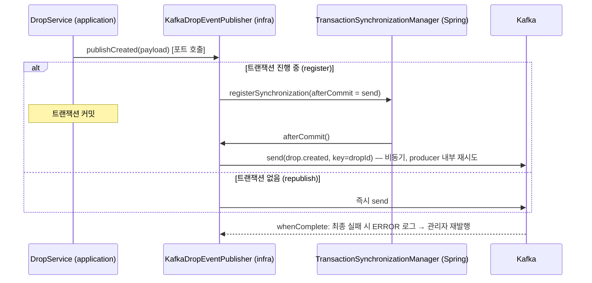

# 2단계 — 드로우 구현 상세

## 변경 이력
| 버전 | 날짜 | 변경 내용 |
|------|------|-----------|
| v1.0 | 2026-11-16 | 최초 작성 |
| v1.1 | 2026-11-16 | 커밋 후 발행을 1단계와 같은 방식(발행 어댑터 안의 `TransactionSynchronization.afterCommit`)으로 교체 — Spring 이벤트 중계 구조 제거, 재시도는 producer 내부 재시도로 일원화. 이벤트 발행 방식 확정, 설계 반영 완료 표시 |
| v1.2 | 2026-11-16 | 0단계 에러 계약에 정렬: `ProductErrorCode implements ErrorCode`(코드 `PRODUCT_*`), 별도 `ProductException`·`ProductExceptionHandler` 제거(`ApplicationException` + 0단계 `GlobalExceptionHandler`), 권한 없음은 `COMMON_FORBIDDEN`(403), 헤더 누락은 `COMMON_MISSING_USER_HEADER`(400), 응답 메시지는 코드별 고정(도메인 상세는 cause 로 로그에만). Kafka 설정은 0단계 공통 블록 유지 + `delivery.timeout.ms` 만 덮어씀. 커밋 계획을 1단계처럼 테스트 포함 기능 커밋 단위로 재편 |

---

## 1. 개요

| 항목 | 내용 |
|------|------|
| 목표 | 관리자가 상품·드로우를 등록하면 커밋 후 `drop.created` 가 발행되고, 누구나 드로우 목록·상세를 조회할 수 있다 |
| 요구사항 | REQ-DROP-01, REQ-DROP-02, REQ-DROP-03 |
| 대상 서비스 | product-service |
| 브랜치 | `feat/phase-2-drop` (`dev` 에서 생성) |
| 선행 조건 | 0단계(common 이벤트 record·`Topics`, ArchUnit testFixtures, Testcontainers 지원, Flyway, 공통 에러 응답), 1단계(Gateway 가 `X-User-Id`/`X-User-Role` 주입, `GET /api/products/drops/**` 인증 제외) |
| 범위 밖 | `draw.completed` 수신(`DrawCompletedListener`, `Drop.markDrawn()` 호출) → **5단계**. 이 단계에서는 `markDrawn()` 도메인 메서드와 `drawn` 컬럼만 만든다 |

**참고 설계 문서**
- [drop-register.md](../../design/05-features/drop-register.md) — 상태, 등록 검증, API, 시퀀스
- [concurrency-consistency.md](../../design/04-non-functional/concurrency-consistency.md) D4 — 이벤트 전파 방식
- [erd.md](../../design/06-erd/erd.md) product_db
- [class-diagram.md](../../design/07-class-diagram/class-diagram.md) 2.2
- [layered-architecture.md](../../design/02-architecture/layered-architecture.md) — 계층 규칙 R1~R7, 에러 처리 4.5
- [architecture.md](../../design/02-architecture/architecture.md) 4장(토픽), 6장(인증)

---

## 2. 산출물 파일 목록

```
product-service/
├── build.gradle                                        # (수정) Flyway 의존성
└── src
    ├── main
    │   ├── java/com/queuedrop/product
    │   │   ├── ProductServiceApplication.java
    │   │   ├── domain
    │   │   │   ├── model
    │   │   │   │   ├── Product.java
    │   │   │   │   ├── Drop.java
    │   │   │   │   ├── DropStatus.java
    │   │   │   │   └── DropPage.java
    │   │   │   ├── exception
    │   │   │   │   └── DomainException.java
    │   │   │   └── repository
    │   │   │       ├── ProductRepository.java
    │   │   │       └── DropRepository.java
    │   │   ├── application
    │   │   │   ├── service
    │   │   │   │   ├── ProductService.java
    │   │   │   │   ├── DropService.java
    │   │   │   │   ├── DropQueryService.java
    │   │   │   │   └── AdminGuard.java                       # package-private 관리자 검사
    │   │   │   ├── dto
    │   │   │   │   ├── Requester.java
    │   │   │   │   ├── ProductCreateCommand.java
    │   │   │   │   ├── ProductResult.java
    │   │   │   │   ├── DropRegisterCommand.java
    │   │   │   │   ├── DropSearchQuery.java
    │   │   │   │   ├── DropResult.java
    │   │   │   │   └── DropPageResult.java
    │   │   │   ├── port
    │   │   │   │   ├── DropEventPublisher.java
    │   │   │   │   └── DropCreatedPayload.java
    │   │   │   └── exception
    │   │   │       └── ProductErrorCode.java                # common.error.ErrorCode 구현 (v1.2)
    │   │   ├── infrastructure
    │   │   │   ├── persistence
    │   │   │   │   ├── ProductJpaEntity.java
    │   │   │   │   ├── ProductJpaRepository.java
    │   │   │   │   ├── ProductMapper.java
    │   │   │   │   ├── ProductRepositoryImpl.java
    │   │   │   │   ├── DropJpaEntity.java
    │   │   │   │   ├── DropJpaRepository.java
    │   │   │   │   ├── DropMapper.java
    │   │   │   │   └── DropRepositoryImpl.java
    │   │   │   ├── messaging
    │   │   │   │   └── KafkaDropEventPublisher.java       # 포트 구현: 커밋 후(afterCommit) Kafka 전송, 트랜잭션 밖이면 즉시
    │   │   │   └── config
    │   │   │       └── ClockConfig.java
    │   │   └── presentation
    │   │       ├── api
    │   │       │   ├── ProductController.java
    │   │       │   ├── DropController.java
    │   │       │   ├── RequesterResolver.java
    │   │       │   ├── request
    │   │       │   │   ├── ProductCreateRequest.java
    │   │       │   │   └── DropRegisterRequest.java
    │   │       │   └── response
    │   │       │       ├── ProductResponse.java
    │   │       │       ├── DropResponse.java
    │   │       │       └── DropPageResponse.java
    │   │       └── api/GlobalExceptionHandler.java        # (0단계 생성, 유지) 서비스별 핸들러는 두지 않는다
    │   └── resources
    │       ├── application.yml                           # (수정) ddl-auto=validate, Flyway, Kafka producer
    │       └── db/migration
    │           └── V1__create_products_and_drops.sql
    └── test/java/com/queuedrop/product
        ├── ArchitectureTest.java                          # (0단계 생성, 유지)
        ├── domain/model
        │   ├── DropTest.java
        │   └── ProductTest.java
        ├── application/service
        │   ├── DropServiceTest.java
        │   ├── ProductServiceTest.java
        │   ├── DropQueryServiceTest.java
        │   └── fake
        │       ├── FakeProductRepository.java
        │       ├── FakeDropRepository.java
        │       └── FakeDropEventPublisher.java
        ├── infrastructure
        │   ├── persistence/DropRepositoryImplTest.java
        │   └── messaging/DropCreatedPublishIntegrationTest.java
        └── presentation/api
            ├── ProductControllerTest.java
            └── DropControllerTest.java
```

---

## 3. 구현 상세

### 3.0 설정

**build.gradle** (product-service)
```groovy
dependencies {
    implementation project(':common')
    implementation 'org.springframework.boot:spring-boot-starter-webmvc'
    implementation 'org.springframework.boot:spring-boot-starter-validation'
    implementation 'org.springframework.boot:spring-boot-starter-data-jpa'
    implementation 'org.springframework.boot:spring-boot-starter-flyway'
    implementation 'org.flywaydb:flyway-database-postgresql'
    runtimeOnly 'org.postgresql:postgresql'
    implementation 'org.springframework.boot:spring-boot-starter-kafka'

    testImplementation 'org.springframework.boot:spring-boot-starter-kafka-test'
    testImplementation 'org.springframework.boot:spring-boot-starter-webmvc-test'
    testImplementation 'org.springframework.boot:spring-boot-starter-data-jpa-test'
    testImplementation testFixtures(project(':common'))   // ArchUnit 규칙, Testcontainers 지원
}
```
> Flyway 스타터·Testcontainers 의존성은 0단계에서 공통으로 넣었다면 중복 선언하지 않는다. Flyway 는 Boot BOM 관리 대상이라 버전 표기 없음.

**application.yml**
```yaml
server:
  port: 8082

spring:
  application:
    name: product-service
  datasource:
    url: jdbc:postgresql://${DB_HOST:localhost}:${DB_PORT:5432}/product_db
    username: ${DB_USERNAME:queuedrop}
    password: ${DB_PASSWORD:queuedrop}
  jpa:
    hibernate:
      ddl-auto: validate          # 스키마는 Flyway 가 관리, JPA 는 검증만
    open-in-view: false
    properties:
      hibernate.jdbc.time_zone: UTC
  flyway:
    enabled: true
    locations: classpath:db/migration
  kafka:
    bootstrap-servers: ${KAFKA_BOOTSTRAP_SERVERS:localhost:9092}
    producer:
      acks: all
      retries: 2147483647        # 재시도는 producer 내부(멱등)에 맡기고 delivery.timeout.ms 로 전체 시간 제한
      key-serializer: org.apache.kafka.common.serialization.StringSerializer
      value-serializer: org.springframework.kafka.support.serializer.JacksonJsonSerializer
      properties:
        enable.idempotence: true
        request.timeout.ms: 1000     # 0단계 공통값
        delivery.timeout.ms: 10000   # 관리자 응답과 무관한 비동기 발행이라 0단계 공통값(3000)보다 길게 (구현 결정)
        max.block.ms: 1000           # 0단계 공통값 (E-02)
    consumer:
      group-id: product-service
      auto-offset-reset: earliest
```
> v1.2: 0단계에서 공통 Kafka 블록(consumer 의 `ErrorHandlingDeserializer`·trusted packages 포함)을 넣었으므로 그대로 두고 `delivery.timeout.ms` 만 10000 으로 덮어쓴다.
> `JacksonJsonSerializer` 는 Spring Kafka 4.x(Jackson 3) 기준 이름이다. **구현 시 클래스명 확인** (3.x 의 `JsonSerializer` 대체). 0단계에서 Kafka 직렬화를 공통 설정했다면 그 설정을 따른다.

**V1__create_products_and_drops.sql**
```sql
CREATE TABLE products (
    id          BIGSERIAL    PRIMARY KEY,
    name        VARCHAR(100) NOT NULL,
    description TEXT,
    image_url   VARCHAR(500),
    created_at  TIMESTAMPTZ  NOT NULL
);

CREATE TABLE drops (
    id             BIGSERIAL    PRIMARY KEY,
    product_id     BIGINT       NOT NULL REFERENCES products (id),
    title          VARCHAR(100) NOT NULL,
    entry_capacity INT          NOT NULL,
    winner_count   INT          NOT NULL,
    open_at        TIMESTAMPTZ  NOT NULL,
    close_at       TIMESTAMPTZ  NOT NULL,
    drawn          BOOLEAN      NOT NULL DEFAULT FALSE,
    created_at     TIMESTAMPTZ  NOT NULL,
    CONSTRAINT ck_drops_winner_count   CHECK (winner_count >= 1),
    CONSTRAINT ck_drops_capacity       CHECK (entry_capacity >= winner_count),
    CONSTRAINT ck_drops_period         CHECK (open_at < close_at)
);

CREATE INDEX idx_drops_product_id ON drops (product_id);
CREATE INDEX idx_drops_open_at    ON drops (open_at);
CREATE INDEX idx_drops_close_at   ON drops (close_at);
```
> 도메인 검증과 별개로 DB CHECK 제약을 둔다 (최종 방어선). **(구현 결정)**

---

### 3.1 domain

#### `DomainException` — 도메인 불변식 위반 (순수 Java)
```java
package com.queuedrop.product.domain.exception;

public class DomainException extends RuntimeException {
    public DomainException(String message) { super(message); }
}
```

#### `Product` — 상품
```java
package com.queuedrop.product.domain.model;

public class Product {
    private final Long id;            // 저장 전 null
    private final String name;
    private final String description;
    private final String imageUrl;
    private final Instant createdAt;

    private Product(Long id, String name, String description, String imageUrl, Instant createdAt) { /* 필드 대입 */ }

    public static Product create(String name, String description, String imageUrl, Instant now) {
        if (name == null || name.isBlank()) throw new DomainException("상품명은 필수입니다");
        return new Product(null, name, description, imageUrl, now);
    }

    /** 영속 계층 복원 전용 (Mapper 에서만 사용) */
    public static Product restore(Long id, String name, String description, String imageUrl, Instant createdAt) {
        return new Product(id, name, description, imageUrl, createdAt);
    }

    // getter (Lombok @Getter 허용)
}
```

#### `DropStatus` — 드로우 상태
```java
public enum DropStatus { SCHEDULED, OPEN, CLOSED, DRAWN }
```

#### `Drop` — 드로우 (생성 검증 + 시각 기반 상태 계산)
```java
package com.queuedrop.product.domain.model;

public class Drop {
    /** 등록 시각 대비 오픈까지 최소 여유 (이벤트 전파 시간 확보) — drop-register.md 5.1 */
    public static final Duration MIN_OPEN_LEAD_TIME = Duration.ofMinutes(1);

    private final Long id;
    private final Long productId;
    private final String title;
    private final int entryCapacity;   // M
    private final int winnerCount;     // K
    private final Instant openAt;
    private final Instant closeAt;
    private boolean drawn;
    private final Instant createdAt;

    public static Drop create(Long productId, String title, int entryCapacity, int winnerCount,
                              Instant openAt, Instant closeAt, Instant now) {
        if (productId == null) throw new DomainException("상품 ID 는 필수입니다");
        if (title == null || title.isBlank()) throw new DomainException("드로우 제목은 필수입니다");
        if (winnerCount < 1) throw new DomainException("당첨 수량은 1 이상이어야 합니다");
        if (entryCapacity < winnerCount) throw new DomainException("응모 정원은 당첨 수량 이상이어야 합니다");
        if (openAt == null || closeAt == null) throw new DomainException("오픈·마감 시각은 필수입니다");
        if (!openAt.isBefore(closeAt)) throw new DomainException("오픈 시각은 마감 시각보다 앞서야 합니다");
        if (openAt.isBefore(now.plus(MIN_OPEN_LEAD_TIME))) {
            throw new DomainException("오픈 시각은 현재로부터 최소 1분 이후여야 합니다");
        }
        return new Drop(null, productId, title, entryCapacity, winnerCount, openAt, closeAt, false, now);
    }

    /** 영속 계층 복원 전용 (검증 없음). 인자 순서: id, productId, title, entryCapacity, winnerCount, openAt, closeAt, drawn, createdAt */
    public static Drop restore(Long id, Long productId, String title, int entryCapacity, int winnerCount,
                               Instant openAt, Instant closeAt, boolean drawn, Instant createdAt) { /* ... */ }

    /** 시각으로 상태를 계산한다. DRAWN 만 저장 값. */
    public DropStatus status(Instant now) {
        if (drawn) return DropStatus.DRAWN;
        if (now.isBefore(openAt)) return DropStatus.SCHEDULED;   // now < openAt
        if (now.isBefore(closeAt)) return DropStatus.OPEN;       // openAt <= now < closeAt
        return DropStatus.CLOSED;                                // closeAt <= now
    }

    /** 5단계 draw.completed 수신 시 호출. 멱등. */
    public void markDrawn() { this.drawn = true; }

    // getter
}
```
- 경계: `openAt` 정각 = OPEN, `closeAt` 정각 = CLOSED (`[openAt, closeAt)` 반열린 구간).
- `drawn` 은 시각보다 우선한다 (마감 전 DRAWN 은 정상 흐름에서 발생하지 않지만 저장 값이 진실).

#### `DropPage` — 페이징 결과 (Spring `Page` 대체)
```java
public record DropPage(List<Drop> content, long totalElements, int page, int size) {}
```
> domain 이 Spring Data 의 `Page`/`Pageable` 에 의존하지 않도록 자체 타입을 둔다. **(구현 결정)**

#### `ProductRepository`, `DropRepository` — 영속성 포트
```java
public interface ProductRepository {
    Product save(Product product);
    Optional<Product> findById(Long id);
    boolean existsById(Long id);
}

public interface DropRepository {
    Drop save(Drop drop);
    Optional<Drop> findById(Long id);
    /** status 가 null 이면 전체. 상태는 시각 조건으로 변환해 조회한다. */
    DropPage search(DropStatus status, Instant now, int page, int size);
}
```

---

### 3.2 application

#### `Requester` — 요청자 정보 (presentation 이 헤더에서 만들어 전달)
```java
package com.queuedrop.product.application.dto;

public record Requester(Long userId, String role) {
    public boolean isAdmin() { return "ADMIN".equals(role); }
}
```
> **권한 검사 위치 (구현 결정)**: presentation 은 `X-User-Id`, `X-User-Role` 헤더를 읽어 `Requester` 로 Command 에 담기만 하고, **ADMIN 여부 판단은 application 서비스**가 한다. 권한 규칙을 유스케이스 단위 테스트로 검증할 수 있고, 컨트롤러는 형식 변환만 담당한다.

#### Command / Query / Result
```java
public record ProductCreateCommand(Requester requester, String name, String description, String imageUrl) {}

public record ProductResult(Long id, String name, String description, String imageUrl, Instant createdAt) {
    public static ProductResult from(Product p) { /* ... */ }   // application 내부에서만 호출
}

public record DropRegisterCommand(Requester requester, Long productId, String title,
                                  int entryCapacity, int winnerCount, Instant openAt, Instant closeAt) {}

public record DropSearchQuery(String status /* nullable: SCHEDULED|OPEN|CLOSED|DRAWN */, int page, int size) {}

public record DropResult(Long id, Long productId, String title, int entryCapacity, int winnerCount,
                         Instant openAt, Instant closeAt, String status, Instant createdAt) {
    public static DropResult of(Drop d, Instant now) {
        return new DropResult(d.getId(), d.getProductId(), d.getTitle(), d.getEntryCapacity(),
                d.getWinnerCount(), d.getOpenAt(), d.getCloseAt(), d.status(now).name(), d.getCreatedAt());
    }
}

public record DropPageResult(List<DropResult> content, long totalElements, int page, int size) {}
```
- Result 의 `status` 는 **String** 으로 노출한다 — presentation 이 domain enum `DropStatus` 를 import 하지 않도록 (ArchUnit R4). **(구현 결정)**

#### 에러 코드 · 예외
```java
public enum ProductErrorCode implements ErrorCode {          // com.queuedrop.common.error.ErrorCode
    PRODUCT_NOT_FOUND("PRODUCT_NOT_FOUND", 404, "상품을 찾을 수 없습니다."),
    DROP_NOT_FOUND("PRODUCT_DROP_NOT_FOUND", 404, "드로우를 찾을 수 없습니다."),
    INVALID_DROP("PRODUCT_INVALID_DROP", 400, "드로우 정보가 올바르지 않습니다."),
    INVALID_PRODUCT("PRODUCT_INVALID_PRODUCT", 400, "상품 정보가 올바르지 않습니다."),
    INVALID_STATUS_FILTER("PRODUCT_INVALID_STATUS_FILTER", 400, "알 수 없는 상태 값입니다.");

    private final String code;
    private final int status;
    private final String message;
    // 생성자, code()/status()/message() — UserErrorCode 와 같은 형태
}
```
- **v1.2 에러 계약 정렬** (layered-architecture.md 4.5):
  - 별도 `ProductException` 을 두지 않고 1단계 `UserService` 처럼 `new ApplicationException(ProductErrorCode.X[, cause])` 로 던진다.
  - 권한 없음은 서비스 고유 사유가 아니므로 `CommonErrorCode.FORBIDDEN`(`COMMON_FORBIDDEN`, 403) 을 쓴다.
  - 응답 `message` 는 코드별 고정 문구다. `DomainException` 은 cause 로 넘겨 `GlobalExceptionHandler` 의 warn 로그에만 남는다.
  - 코드 문자열은 `PRODUCT_*` 접두어. 상수명 `PRODUCT_NOT_FOUND` 는 접두어 규칙 그대로면 `NOT_FOUND` 지만 `DROP_NOT_FOUND` 와 구분하려고 대상을 넣었다.
```java
// (예외 클래스 없음 — common.error.ApplicationException 사용)
```

#### `DropEventPublisher` — 외부 연동 포트 (이벤트 발행)
```java
package com.queuedrop.product.application.port;

public interface DropEventPublisher {
    /** 트랜잭션 안에서 호출되면 커밋 후 발행, 트랜잭션 밖이면 즉시 발행한다 (구현체 책임). */
    void publishCreated(DropCreatedPayload payload);
}

public record DropCreatedPayload(Long dropId, Long productId, String title, int entryCapacity,
                                 int winnerCount, Instant openAt, Instant closeAt) {}
```
> application 은 `common` 의 `DropCreated` 메시지나 Spring 이벤트를 모른다. 포트 + 자체 Payload 만 사용 (layered-architecture.md 4.4).

#### `ProductService` — 상품 등록
```java
@Service
@RequiredArgsConstructor
public class ProductService {
    private final ProductRepository productRepository;
    private final Clock clock;

    @Transactional
    public ProductResult create(ProductCreateCommand cmd) {
        requireAdmin(cmd.requester());
        try {
            Product saved = productRepository.save(
                    Product.create(cmd.name(), cmd.description(), cmd.imageUrl(), clock.instant()));
            return ProductResult.from(saved);
        } catch (DomainException e) {
            throw new ApplicationException(ProductErrorCode.INVALID_PRODUCT, e);
        }
    }
}
```
> `requireAdmin` 은 `DropService` 와 공유하는 package-private 유틸(`AdminGuard`)로 뽑는다. ADMIN 이 아니면 `ApplicationException(CommonErrorCode.FORBIDDEN)`. **(구현 결정)**

#### `DropService` — 드로우 등록·재발행
```java
@Service
@RequiredArgsConstructor
public class DropService {
    private final ProductRepository productRepository;
    private final DropRepository dropRepository;
    private final DropEventPublisher eventPublisher;
    private final Clock clock;

    @Transactional
    public DropResult register(DropRegisterCommand cmd) {
        AdminGuard.requireAdmin(cmd.requester());
        if (!productRepository.existsById(cmd.productId())) {
            throw new ApplicationException(ProductErrorCode.PRODUCT_NOT_FOUND);
        }
        Instant now = clock.instant();
        Drop drop;
        try {
            drop = Drop.create(cmd.productId(), cmd.title(), cmd.entryCapacity(), cmd.winnerCount(),
                    cmd.openAt(), cmd.closeAt(), now);
        } catch (DomainException e) {
            throw new ApplicationException(ProductErrorCode.INVALID_DROP, e);
        }
        Drop saved = dropRepository.save(drop);
        eventPublisher.publishCreated(toPayload(saved));   // 실제 전송은 커밋 후
        return DropResult.of(saved, now);
    }

    /** 발행 실패 복구용. 트랜잭션 밖에서 즉시 발행. */
    public void republish(Requester requester, Long dropId) {
        AdminGuard.requireAdmin(requester);
        Drop drop = dropRepository.findById(dropId)
                .orElseThrow(() -> new ApplicationException(ProductErrorCode.DROP_NOT_FOUND));
        eventPublisher.publishCreated(toPayload(drop));
    }

    private DropCreatedPayload toPayload(Drop d) { /* ... */ }
}
```
- `republish` 는 이미 오픈된 드로우에도 허용한다. 수신 측(entry/queue)이 `SET NX`·HSET 으로 멱등 처리하므로 진행 중인 잔여 정원을 덮어쓰지 않는다 (drop-register.md 6장).
- `republish` 의 파라미터 `Long dropId` 는 원시값이므로 R6(도메인 타입 금지) 위반 아님.

#### `DropQueryService` — 조회
```java
@Service
@RequiredArgsConstructor
@Transactional(readOnly = true)
public class DropQueryService {
    private final DropRepository dropRepository;
    private final Clock clock;

    public DropPageResult search(DropSearchQuery q) {
        DropStatus status = parseStatus(q.status());   // 잘못된 값 → INVALID_STATUS_FILTER
        Instant now = clock.instant();
        DropPage page = dropRepository.search(status, now, q.page(), q.size());
        return new DropPageResult(page.content().stream().map(d -> DropResult.of(d, now)).toList(),
                page.totalElements(), page.page(), page.size());
    }

    public DropResult get(Long dropId) {
        Drop drop = dropRepository.findById(dropId)
                .orElseThrow(() -> new ApplicationException(ProductErrorCode.DROP_NOT_FOUND));
        return DropResult.of(drop, clock.instant());
    }
}
```
> 정원 소진 여부(entry 의 잔여 정원)는 product 가 알 수 없으므로 상세 응답에 넣지 않는다. 클라이언트는 대기열 진입 응답(`SOLD_OUT`)으로 확인한다. **(구현 결정)**

---

### 3.3 infrastructure

#### `ProductJpaEntity` / `DropJpaEntity` — JPA 엔티티 (`@Entity` 는 이 패키지에만, R7)
```java
@Entity
@Table(name = "drops")
@Getter
@NoArgsConstructor(access = AccessLevel.PROTECTED)
public class DropJpaEntity {
    @Id @GeneratedValue(strategy = GenerationType.IDENTITY)
    private Long id;
    @Column(name = "product_id", nullable = false) private Long productId;   // 연관관계 매핑 없이 ID 참조
    @Column(nullable = false, length = 100) private String title;
    @Column(name = "entry_capacity", nullable = false) private int entryCapacity;
    @Column(name = "winner_count", nullable = false) private int winnerCount;
    @Column(name = "open_at", nullable = false) private Instant openAt;
    @Column(name = "close_at", nullable = false) private Instant closeAt;
    @Column(nullable = false) private boolean drawn;
    @Column(name = "created_at", nullable = false) private Instant createdAt;

    public DropJpaEntity(Long id, Long productId, /* ... */) { /* ... */ }
}
```
> `DropJpaEntity` 는 `ProductJpaEntity` 와 `@ManyToOne` 을 맺지 않고 `productId` 만 가진다 — 지연 로딩·N+1 을 원천 차단하고 도메인 모델과 1:1 매핑. FK 는 DB 에만 존재. **(구현 결정)**

#### `DropMapper`
```java
@Component
public class DropMapper {
    public Drop toDomain(DropJpaEntity e) { return Drop.restore(e.getId(), e.getProductId(), /* ... */); }
    public DropJpaEntity toEntity(Drop d) { return new DropJpaEntity(d.getId(), d.getProductId(), /* ... */); }
}
```

#### `DropJpaRepository` — Spring Data (상태 → 시각 조건 변환)
```java
public interface DropJpaRepository extends JpaRepository<DropJpaEntity, Long> {

    @Query("select d from DropJpaEntity d where d.drawn = false and d.openAt > :now")
    Page<DropJpaEntity> findScheduled(@Param("now") Instant now, Pageable pageable);

    @Query("select d from DropJpaEntity d where d.drawn = false and d.openAt <= :now and d.closeAt > :now")
    Page<DropJpaEntity> findOpen(@Param("now") Instant now, Pageable pageable);

    @Query("select d from DropJpaEntity d where d.drawn = false and d.closeAt <= :now")
    Page<DropJpaEntity> findClosed(@Param("now") Instant now, Pageable pageable);

    Page<DropJpaEntity> findByDrawnTrue(Pageable pageable);
}
```

#### `DropRepositoryImpl` — domain 포트 구현
```java
@Repository
@RequiredArgsConstructor
public class DropRepositoryImpl implements DropRepository {
    private final DropJpaRepository jpa;
    private final DropMapper mapper;

    @Override public Drop save(Drop drop) { return mapper.toDomain(jpa.save(mapper.toEntity(drop))); }
    @Override public Optional<Drop> findById(Long id) { return jpa.findById(id).map(mapper::toDomain); }

    @Override
    public DropPage search(DropStatus status, Instant now, int page, int size) {
        Pageable pageable = PageRequest.of(page, size, Sort.by("openAt").and(Sort.by("id")));   // id 로 동순위 고정 (페이지 간 중복·누락 방지)
        Page<DropJpaEntity> result = switch (status) {
            case null      -> jpa.findAll(pageable);
            case SCHEDULED -> jpa.findScheduled(now, pageable);
            case OPEN      -> jpa.findOpen(now, pageable);
            case CLOSED    -> jpa.findClosed(now, pageable);
            case DRAWN     -> jpa.findByDrawnTrue(pageable);
        };
        return new DropPage(result.map(mapper::toDomain).getContent(), result.getTotalElements(), page, size);
    }
}
```
> 쿼리 조건이 `Drop.status(now)` 와 **같은 경계**(`[openAt, closeAt)`, drawn 우선)를 쓰는지 T2-19 에서 검증한다. 도메인 규칙이 JPQL 에 중복된다는 점은 6장 리스크 참고.

`ProductJpaEntity`, `ProductMapper`, `ProductJpaRepository`, `ProductRepositoryImpl` 은 같은 패턴 (생략).

#### 커밋 후 발행 구조 (1단계 `KafkaUserEventPublisher` 와 같은 패턴, 확정)


**읽는 법**: application 은 포트만 호출한다. "커밋 후에 보낸다"는 타이밍 제어는 **발행 어댑터 안에서** `TransactionSynchronization` 으로 처리하므로 application 이 Spring 트랜잭션·이벤트 API 에 의존하지 않는다. 롤백되면 `afterCommit` 이 호출되지 않아 발행되지 않는다.

```java
// infrastructure/messaging
@Slf4j
@Component
@RequiredArgsConstructor
class KafkaDropEventPublisher implements DropEventPublisher {

    private final KafkaTemplate<String, Object> kafkaTemplate;

    @Override
    public void publishCreated(DropCreatedPayload p) {
        DropCreated message = new DropCreated(p.dropId(), p.productId(), p.title(),
                p.entryCapacity(), p.winnerCount(), p.openAt(), p.closeAt());
        Runnable send = () -> kafkaTemplate.send(Topics.DROP_CREATED, String.valueOf(p.dropId()), message)
                .whenComplete((r, ex) -> {
                    if (ex != null) {
                        log.error("drop.created 최종 발행 실패 — 관리자 재발행 필요 dropId={}", p.dropId(), ex);
                    }
                });

        if (TransactionSynchronizationManager.isSynchronizationActive()) {
            TransactionSynchronizationManager.registerSynchronization(new TransactionSynchronization() {
                @Override public void afterCommit() { send.run(); }
            });
        } else {
            send.run();     // republish 처럼 트랜잭션 밖 호출은 즉시 발행
        }
    }
}
```
- 재시도는 **producer 내부 재시도(멱등, `delivery.timeout.ms=10000` 안에서)** 로 일원화한다. 애플리케이션이 같은 메시지를 다시 send 하는 루프는 두지 않는다 (0단계 공통 발행 정책과 같은 원칙).
- 발행은 비동기(`whenComplete`)라 관리자 응답(201)을 지연시키지 않는다. 최종 실패는 **ERROR 로그 후 재발행 API 로 복구** (D4 확정안).
- 수신 측(entry/queue/ranking)은 재수신에 멱등하다(`SET NX`, `ON CONFLICT DO NOTHING`) — 재발행이 여러 번 와도 안전.
- `DropCreated` 의 필드 구성은 0단계 `common` record 를 따른다 (architecture.md 4장: dropId, productId, title, entryCapacity, winnerCount, openAt, closeAt).

#### `ClockConfig`
```java
@Configuration
public class ClockConfig {
    @Bean public Clock clock() { return Clock.systemUTC(); }
}
```
> application 은 `java.time.Clock`(JDK)만 주입받는다. 테스트에서는 `Clock.fixed(...)` 로 교체.

---

### 3.4 presentation

#### `RequesterResolver` — 헤더 → `Requester`
```java
@Component
public class RequesterResolver {
    public Requester resolve(Long userId, String role) { return new Requester(userId, role); }
}
```
컨트롤러에서 `@RequestHeader("X-User-Id") Long userId`, `@RequestHeader("X-User-Role") String role` 로 **필수**로 받는다 (v1.2). 관리자 경로는 gateway 가 항상 헤더를 주입하므로 헤더가 없다는 것은 gateway 우회다. 0단계 계약대로 `MissingRequestHeaderException` → 400 `COMMON_MISSING_USER_HEADER`. 헤더는 있으나 role 이 ADMIN 이 아니면 application 에서 403 `COMMON_FORBIDDEN`.
> `HandlerMethodArgumentResolver` 로 `Requester` 를 바로 주입하는 방식도 가능하나, 1차는 명시적 헤더 파라미터. **(구현 결정)**

#### Request / Response
```java
public record ProductCreateRequest(
        @NotBlank @Size(max = 100) String name,
        String description,
        @Size(max = 500) String imageUrl) {
    public ProductCreateCommand toCommand(Requester r) { return new ProductCreateCommand(r, name, description, imageUrl); }
}

public record DropRegisterRequest(
        @NotBlank @Size(max = 100) String title,
        @NotNull @Positive Integer entryCapacity,   // v1.2: Integer — 누락을 0(양수 위반)이 아닌 필수 누락으로 구분
        @NotNull @Positive Integer winnerCount,
        @NotNull Instant openAt,     // ISO-8601, 예: 2026-12-01T10:00:00+09:00
        @NotNull Instant closeAt) {
    public DropRegisterCommand toCommand(Requester r, Long productId) { /* ... */ }
}

public record ProductResponse(Long id, String name, String description, String imageUrl, Instant createdAt) {
    public static ProductResponse from(ProductResult r) { /* ... */ }
}

public record DropResponse(Long id, Long productId, String title, int entryCapacity, int winnerCount,
                           Instant openAt, Instant closeAt, String status, Instant createdAt) {
    public static DropResponse from(DropResult r) { /* ... */ }
}

public record DropPageResponse(List<DropResponse> content, long totalElements, int page, int size) {
    public static DropPageResponse from(DropPageResult r) { /* ... */ }
}
```
> Bean Validation 은 형식 검증(필수·양수·길이)만, 업무 규칙(M ≥ K, 시각 순서, 1분 여유)은 domain 이 담당한다.

#### `ProductController`
```java
@RestController
@RequestMapping("/api/products")
@RequiredArgsConstructor
public class ProductController {
    private final ProductService productService;
    private final RequesterResolver requesterResolver;

    @PostMapping
    public ResponseEntity<ProductResponse> create(
            @RequestHeader("X-User-Id") Long userId,
            @RequestHeader("X-User-Role") String role,
            @Valid @RequestBody ProductCreateRequest request) {
        ProductResult result = productService.create(request.toCommand(requesterResolver.resolve(userId, role)));
        return ResponseEntity.status(HttpStatus.CREATED).body(ProductResponse.from(result));
    }
}
```

#### `DropController` — API 4개 (상품 등록 제외)
```java
@RestController
@RequestMapping("/api/products")
@RequiredArgsConstructor
public class DropController {
    private final DropService dropService;
    private final DropQueryService dropQueryService;
    private final RequesterResolver requesterResolver;

    @PostMapping("/{productId:\\d+}/drops")                 // 201
    public ResponseEntity<DropResponse> register(/* 헤더 */, @PathVariable Long productId,
                                                 @Valid @RequestBody DropRegisterRequest request) { /* ... */ }

    @GetMapping("/drops")                                    // 200, ?status=OPEN&page=0&size=20
    public DropPageResponse search(@RequestParam(required = false) String status,
                                   @RequestParam(defaultValue = "0") @Min(0) int page,
                                   @RequestParam(defaultValue = "20") @Min(1) @Max(100) int size) { /* ... */ }

    @GetMapping("/drops/{dropId:\\d+}")                      // 200
    public DropResponse get(@PathVariable Long dropId) { /* ... */ }

    @PostMapping("/drops/{dropId:\\d+}/republish")           // 202
    public ResponseEntity<Void> republish(/* 헤더 */, @PathVariable Long dropId) { /* ... */ }
}
```
> `/{productId:\d+}/drops` 처럼 숫자 정규식을 붙여 `/drops` 고정 경로와 충돌하지 않게 한다. **(구현 결정)**

| Method | Path | 권한 | 성공 | 실패 |
|--------|------|------|------|------|
| POST | `/api/products` | ADMIN | 201 ProductResponse | 400 `PRODUCT_INVALID_PRODUCT`·`COMMON_INVALID_INPUT`·`COMMON_MISSING_USER_HEADER`, 403 `COMMON_FORBIDDEN` |
| POST | `/api/products/{productId}/drops` | ADMIN | 201 DropResponse | 400 `PRODUCT_INVALID_DROP`·`COMMON_INVALID_INPUT`·`COMMON_MISSING_USER_HEADER`, 403 `COMMON_FORBIDDEN`, 404 `PRODUCT_NOT_FOUND` |
| GET | `/api/products/drops` | 공개 | 200 DropPageResponse | 400 `PRODUCT_INVALID_STATUS_FILTER`·`COMMON_INVALID_INPUT`(page/size 범위) |
| GET | `/api/products/drops/{dropId}` | 공개 | 200 DropResponse | 404 `PRODUCT_DROP_NOT_FOUND` |
| POST | `/api/products/drops/{dropId}/republish` | ADMIN | 202 | 400 `COMMON_MISSING_USER_HEADER`, 403 `COMMON_FORBIDDEN`, 404 `PRODUCT_DROP_NOT_FOUND` |

#### 예외 → HTTP 매핑 (v1.2)
0단계에서 만든 `presentation/api/GlobalExceptionHandler` 를 그대로 쓴다. `ApplicationException` → `ErrorCode.status()` + 고정 메시지, Bean Validation → 400 `COMMON_INVALID_INPUT` + `fieldErrors`, 헤더 누락 → 400 `COMMON_MISSING_USER_HEADER`. 서비스별 `@RestControllerAdvice` 는 두지 않는다.

---

## 4. 테스트 케이스

| ID | 계층/종류 | 테스트 클래스 | 시나리오 (Given / When / Then) | 관련 REQ |
|----|-----------|---------------|-------------------------------|----------|
| T2-01 | domain 단위 | `DropTest` | Given openAt=10:00, closeAt=12:00 / When status(09:59:59.999) / Then SCHEDULED | REQ-DROP-03 |
| T2-02 | domain 단위 | `DropTest` | When status(10:00:00 정각) / Then OPEN | REQ-DROP-03 |
| T2-03 | domain 단위 | `DropTest` | When status(11:59:59.999) / Then OPEN | REQ-DROP-03 |
| T2-04 | domain 단위 | `DropTest` | When status(12:00:00 정각) / Then CLOSED | REQ-DROP-03 |
| T2-05 | domain 단위 | `DropTest` | Given markDrawn() / When status(마감 후 임의 시각) / Then DRAWN, 두 번 호출해도 DRAWN | REQ-DROP-03 |
| T2-06 | domain 단위 | `DropTest` | Given M=10, K=11 / When create / Then DomainException | REQ-DROP-02 |
| T2-07 | domain 단위 | `DropTest` | Given K=0 / When create / Then DomainException. M=K 는 성공 | REQ-DROP-02 |
| T2-08 | domain 단위 | `DropTest` | Given openAt == closeAt, openAt > closeAt / When create / Then DomainException | REQ-DROP-02 |
| T2-09 | domain 단위 | `DropTest` | Given now=10:00, openAt=10:00:59 / Then 예외. openAt=10:01:00 / Then 성공 | REQ-DROP-02 |
| T2-10 | domain 단위 | `ProductTest` | Given 빈 상품명 / When create / Then DomainException | REQ-DROP-01 |
| T2-11 | application 단위 | `DropServiceTest` | Given ADMIN, 존재하는 상품, FakeDropEventPublisher / When register / Then 저장됨 + 발행 payload 1건(필드 일치) | REQ-DROP-02 |
| T2-12 | application 단위 | `DropServiceTest` | Given role=USER 또는 null / When register·republish / Then ApplicationException(`COMMON_FORBIDDEN`), 저장·발행 없음 | REQ-DROP-02 |
| T2-13 | application 단위 | `DropServiceTest` | Given 없는 productId / When register / Then PRODUCT_NOT_FOUND | REQ-DROP-02 |
| T2-14 | application 단위 | `DropServiceTest` | Given M<K / When register / Then `INVALID_DROP`, cause 가 DomainException(상세 메시지 보존), 저장·발행 없음 | REQ-DROP-02 |
| T2-15 | application 단위 | `DropServiceTest` | Given 저장된 드로우 / When republish / Then 발행 1건. 없는 dropId → DROP_NOT_FOUND | REQ-DROP-02 |
| T2-16 | application 단위 | `DropQueryServiceTest` | Given status="FOO" / When search / Then INVALID_STATUS_FILTER. 없는 dropId get → DROP_NOT_FOUND | REQ-DROP-03 |
| T2-17 | application 단위 | `ProductServiceTest` | ADMIN 등록 성공 / USER 등록 FORBIDDEN | REQ-DROP-01 |
| T2-18 | infra 통합 (PostgreSQL) | `DropRepositoryImplTest` | Given 드로우 저장 / When findById / Then 모든 필드 왕복 일치 (Mapper, Instant 정밀도) | REQ-DROP-02 |
| T2-19 | infra 통합 (PostgreSQL) | `DropRepositoryImplTest` | Given SCHEDULED·OPEN·CLOSED·DRAWN 각 1건 + 경계 시각(openAt=now, closeAt=now) / When search(각 상태, now) / Then `Drop.status(now)` 결과와 동일하게 분류 | REQ-DROP-03 |
| T2-20 | infra 통합 (PostgreSQL) | `DropRepositoryImplTest` | Flyway 마이그레이션 적용 후 `ddl-auto=validate` 로 컨텍스트 기동 성공. CHECK 제약 위반 INSERT 는 실패 | REQ-DROP-02 |
| T2-21 | infra 통합 (PostgreSQL+Kafka) | `DropCreatedPublishIntegrationTest` | Given ADMIN 등록 / When 트랜잭션 커밋 / Then `drop.created` 1건 수신, key=dropId, 필드 일치 | REQ-DROP-02 |
| T2-22 | infra 통합 (PostgreSQL+Kafka) | `DropCreatedPublishIntegrationTest` | Given 같은 트랜잭션에서 저장 후 예외로 **롤백** / Then 일정 시간(예: 3초) 동안 `drop.created` 미수신, DB 0건 | REQ-DROP-02 |
| T2-23 | infra 통합 (Kafka) | `DropCreatedPublishIntegrationTest` | Given 트랜잭션 밖 republish / Then 즉시 1건 수신 (동기화 비활성 → 즉시 send 분기) | REQ-DROP-02 |
| T2-24 | presentation 슬라이스 | `DropControllerTest` | Given X-User-Role=USER / When POST drops / Then 403 + code `COMMON_FORBIDDEN`. 도메인 검증 실패(`INVALID_DROP`) → 400, message 는 고정 문구 | REQ-DROP-02 |
| T2-25 | presentation 슬라이스 | `DropControllerTest` | Given entryCapacity=0, title 누락, openAt 누락 / Then 400 | REQ-DROP-02 |
| T2-26 | presentation 슬라이스 | `DropControllerTest` | GET /drops?status=OPEN / Then 200 + 페이지 구조, status 문자열. GET /drops/{id} 404 매핑 | REQ-DROP-03 |
| T2-27 | presentation 슬라이스 | `ProductControllerTest` | ADMIN → 201, USER → 403 `COMMON_FORBIDDEN`, 헤더 없음 → 400 `COMMON_MISSING_USER_HEADER` | REQ-DROP-01 |
| T2-28 | 아키텍처 | `ArchitectureTest` | R1~R7 통과 (특히 presentation 이 `DropStatus` 등 domain 미참조) | — |

> Fake 구현: `FakeDropRepository.search()` 는 `Drop.status(now)` 로 필터링한다 (도메인 규칙 그대로 사용). JPQL 경계 일치는 T2-19 가 따로 보장.

---

## 5. 커밋 계획

> v1.2: 1단계와 같이 TDD 사이클(장원영 Red → 카리나 Green) 단위로, 테스트와 구현을 한 커밋에 넣는다. 신민아 검증은 단계 끝에 한 번 (1~3단계 합의).

| # | 커밋 단위 | 커밋 메시지 | 테스트 ID |
|---|-----------|-------------|-----------|
| 1 | domain | `feat(product): 상품·드로우 도메인 모델과 저장소 포트 추가`<br>- Drop 생성 검증(M≥K≥1, 시각 순서, 오픈 1분 여유)<br>- status(now) 시각 기반 상태 계산, markDrawn | T2-01~10 |
| 2 | application | `feat(product): 상품·드로우 등록·조회 유스케이스와 발행 포트 추가`<br>- Command/Result, ProductErrorCode, AdminGuard | T2-11~17 |
| 3 | infrastructure 영속 | `feat(product): products·drops 마이그레이션과 JPA 영속성 어댑터 추가`<br>- CHECK 제약, 상태 → 시각 조건 JPQL | T2-18~20 |
| 4 | infrastructure 메시징 | `feat(product): 커밋 후 drop.created 이벤트 발행`<br>- afterCommit 전송, 트랜잭션 밖(재발행)은 즉시 | T2-21~23 |
| 5 | presentation | `feat(product): 상품·드로우 API 추가` (API 5개) | T2-24~27 |
| 6 | 검증 반영 | `fix(product): ...` (신민아·한지민 지적 중 명백한 버그가 있을 때만) | — |
| 7 | 문서 | `docs: 2단계 완료 표시` (플랜 진행 현황, 결정 사항) | — |

---

## 6. 결정 필요 · 리스크

### 결정 사항 (확정)
| 항목 | 결정 | 포기한 대안 |
|------|------|-------------|
| 드로우 이벤트 발행 방식 | **발행 어댑터 안의 afterCommit 전송 + producer 내부 재시도 + 관리자 재발행 API** (2026-11-16 확정) | Transactional Outbox / Spring 이벤트 + `@TransactionalEventListener` 중계 |

### 결정 필요
| 항목 | 기본안 (이 문서 반영) | 대안 |
|------|----------------------|------|
| openAt 최소 여유 | **등록 시각 + 1분** (`Drop.MIN_OPEN_LEAD_TIME`) | 설정값으로 외부화 |

### 구현 결정 요약
- 권한 검사: presentation 은 헤더 → `Requester` 전달만, ADMIN 판단은 application
- `DropResult.status` 는 String (presentation 의 domain enum 참조 방지)
- 페이징: domain 자체 타입 `DropPage` (Spring Data `Page` 비의존)
- `DropJpaEntity` 는 `@ManyToOne` 없이 `productId` 만 보유
- DB CHECK 제약 추가, `ddl-auto=validate`
- 경로 변수 숫자 정규식으로 `/drops` 와 충돌 방지
- 상세 응답에 잔여 정원 미포함

### 설계 수정 필요
- [drop-register.md](../../design/05-features/drop-register.md) 5.1 의 "openAt 최소 1분 검증 권장" → **확정 규칙**으로 3장 "등록 검증"에 추가 필요. → 설계 반영 완료 (2026-11-16)
- [class-diagram.md](../../design/07-class-diagram/class-diagram.md) 2.2 에 `DropPage`, `Requester`, `DomainException` 및 infrastructure 의 `KafkaDropEventPublisher`(afterCommit 발행) 반영 필요. → 설계 반영 완료 (2026-11-16)

### 리스크
- **고정 에러 메시지 (v1.2)**: 등록 검증 실패는 `PRODUCT_INVALID_DROP` 하나로 응답해 관리자가 어떤 규칙(M≥K, 시각 순서, 1분 여유)을 어겼는지 응답만으로는 알 수 없다. 0단계 계약(상세는 로그만)을 따른 결과이며, 필요해지면 규칙별 코드로 쪼갠다.
- **상태 판정 규칙 중복**: `Drop.status(now)` 와 `DropJpaRepository` JPQL 조건에 같은 경계가 두 번 존재한다. T2-19 로 일치를 고정하고, 규칙 변경 시 두 곳을 함께 수정한다.
- **발행 최종 실패 감지**: ERROR 로그에만 의존한다. 8단계 관측 구성 시 이 로그를 알림 대상으로 지정한다.
- **재발행 오남용**: 같은 드로우 여러 번 재발행 시 수신 측 멱등 처리(`SET NX`)에 의존한다. 3·4단계 테스트(T3-xx, 4단계 재수신 테스트)가 이를 보장해야 한다.
- **Kafka 직렬화 클래스명**: Spring Kafka 4.x 에서 `JacksonJsonSerializer` 명칭 확인 필요. 소비 측(entry/queue/ranking)과 타입 헤더 정책(`spring.json.add.type.headers`)을 0단계 공통 설정과 맞춰야 한다.

---

## 7. 완료 체크리스트

| 플랜 완료 조건 | 테스트 ID |
|----------------|-----------|
| 단위: `Drop.status(now)` 경계값 (openAt 직전/정각, closeAt 직전/정각) | T2-01, T2-02, T2-03, T2-04, T2-05 |
| 단위: 생성 검증 실패 케이스 | T2-06, T2-07, T2-08, T2-09, T2-10, T2-14 |
| 통합: 드로우 등록 → 커밋 후 `drop.created` 발행 | T2-21, T2-23 |
| 통합: **롤백 시 발행되지 않음** | T2-22 |
| USER 권한으로 등록 시 403 | T2-12, T2-17, T2-24, T2-27 |
| 공통: `./gradlew build` 통과 (ArchUnit 포함) | T2-28 |
| 공통: API 가 설계 문서 API 표와 일치 | T2-24 ~ T2-27 |
| 공통: 설계 수정 필요 항목 설계 문서 반영 | 6장 "설계 수정 필요" |
| 결정: 드로우 이벤트 발행 방식 확정 | 6장 "결정 필요" |

- [ ] 위 테스트 전부 통과
- [ ] 로컬 docker compose 환경에서 관리자 등록 → Kafka UI 에서 `drop.created` 메시지 확인
- [ ] [implementation-plan.md](../implementation-plan.md) 진행 현황 갱신
